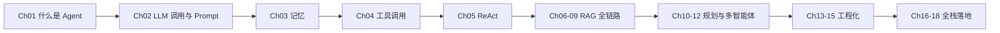

# 学习路线与前置要求

## 推荐学习顺序

本教程是**强递进**的，不建议跳读：模块一的每个部件都是后续章节的积木。

| 阶段 | 章节 | 你将获得 |
|---|---|---|
| 入门 | Ch01–05 | 能手写一个不依赖框架的最小 Agent |
| 进阶 | Ch06–09 | 能给 Agent 接上私有知识库并评估召回质量 |
| 提升 | Ch10–12 | 能让 Agent 自主规划任务、多角色协作 |
| 工程 | Ch13–15 | 能让 Agent 可观测、可评测、安全、可控成本 |
| 落地 | Ch16–18 | 能交付一个前后端完整的 Agent 产品 |

## 时间投入参考

- 每章正文阅读约 40–60 分钟；配套代码跟做约 30–60 分钟；练习约 30 分钟。
- 全模块走完约 6–8 周（每周 6–8 小时），可按节奏拆成碎片时间。

## 学习方法建议

1. **先跑通，再读原理**：每章先把 `examples/` 里的示例跑一遍，产生直觉，再回头读讲解。
2. **改参数观察行为**：把 temperature、上下文长度、工具清单改一改，观察 Agent 行为变化——这是建立直觉最快的方式。
3. **练习必须动手写**：思考题帮助复述，练习帮助形成肌肉记忆；不要只看答案。
4. **用自己的项目替代示例**：学到模块二以后，把教程里的示例数据换成你自己的文档/任务。

## 前置能力自查

- [ ] 能在终端运行 Python 脚本、看懂报错栈
- [ ] 理解 JSON、HTTP 请求/响应、环境变量
- [ ] 至少注册并对话过一个大模型产品
- [ ] 前端章节另需：基础 React 组件与 props/state 概念
