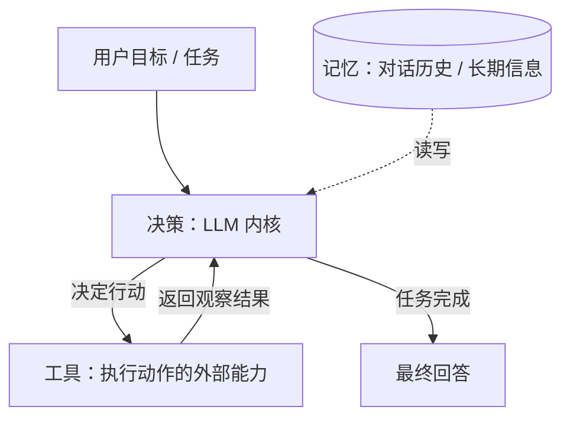
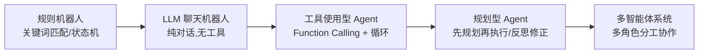

# 第 01 章 什么是 Agent

## 本章目标

读完本章，你应当能够：

1. 说清「普通聊天机器人」和「Agent」的本质差别，不再把套壳对话应用叫做 Agent；
2. 讲出 Agent 的三个构成要素（LLM 内核、工具、感知—决策—行动循环）各自负责什么；
3. 看懂一个最小 Agent 循环的代码骨架，知道每一轮在做什么；
4. 判断一个需求该不该用 Agent，识别「为了 Agent 而 Agent」的反模式。

---

## 1. 先厘清：聊天机器人 ≠ Agent

很多人第一次接触 Agent，是从「接一个 ChatGPT 对话框」开始的。这个理解需要先被纠正。

**一次普通的 LLM 调用**是单向的：你给模型一段输入，模型返回一段文本，程序结束。模型在这次调用里**不能自己决定去查资料、执行命令、修改外部状态**，它只能生成文字。

**Agent** 则把模型放进一个循环里：模型不仅生成文字，还能决定「要不要调用工具、调用哪个、参数是什么」；程序执行工具后把结果交回模型，模型据此继续推理，直到判断任务完成。

| 维度 | 普通聊天机器人 | Agent |
|---|---|---|
| 控制流 | 程序写死：输入 → 调一次模型 → 输出 | 模型在循环中决定下一步行动，程序负责执行 |
| 能否影响外部世界 | 不能，只能输出文本 | 能调用工具（查天气、读写数据库、调 API）改变外部状态 |
| 完成任务方式 | 单轮或多轮纯对话 | 感知 → 决策 → 行动 → 观察 → 再决策，直到完成 |
| 失败处理 | 重新提问 | 观察工具结果后自我修正、重试或换路 |
| 典型复杂度 | 低，几行代码 | 高，需要管理记忆、工具、循环终止与成本 |

一句话区分：**聊天机器人「说」，Agent「做」**。当然，绝大多数 Agent 同时保留对话能力，所以外观上看很像，但内核的控制流不同。

## 2. Agent 的三要素

抛开各家框架的包装，任何 Agent 都由三块构成：



1. **LLM 内核（大脑）**：负责理解目标、做决策、生成自然语言回答。它本身不执行任何动作，只输出「决策」——可以是一段回答，也可以是「我要调用某工具」的结构化请求。
2. **工具（手脚）**：封装成函数/API 的外部能力，如检索知识库、查天气、发邮件、写文件。工具的输入输出由程序定义成明确的 Schema（第 04 章详述）。
3. **感知—决策—行动循环（躯干）**：程序维持一个循环：把当前上下文（目标 + 记忆 + 工具观察结果）交给 LLM，根据 LLM 的决策执行工具或结束，直到满足终止条件。

记忆通常被画成与内核双向连接的第四块：短期记忆是当前对话窗口，长期记忆是跨会话的持久存储（第 03 章）。为了先建立主干，本章先看前三要素。

## 3. Agent 的演进脉络

理解 Agent 为什么长成今天这样，有助于你知道每一层技术在解决什么问题：



- **规则机器人**：关键词 + 状态机，能力被规则写死，换个说法就答不上来。
- **LLM 聊天机器人**：模型自由生成，但不能动手，也无法接入私有数据。
- **工具使用型 Agent**：模型可以请求调用工具，程序执行后回喂结果——这是现代 Agent 的起点，也是模块一的终点。
- **规划型 Agent**：面对复杂任务先拆解计划、执行中反思修正（第 10 章）。
- **多智能体系统**：多个角色分工协作（第 11、12 章）。

注意：演进是**能力叠加**而非替代。大量生产级 Agent 停留在「工具使用型 + 检索增强」这一层就足够好用，不必追新。

## 4. 实战：从一次调用到 Agent 循环骨架

示例代码位于仓库 [`examples/ch01-hello-agent/`](https://github.com/thomaslwq/AgentTutorial/tree/main/examples/ch01-hello-agent)，先运行最简单的「一次调用」建立手感，再看循环骨架。

### 4.1 一次最基础的 LLM 调用

`hello_llm.py`：

```python
"""第01章 · 最基础的一次 LLM 调用
前置：export OPENAI_API_KEY=sk-... （兼容服务另设 OPENAI_BASE_URL）
运行：pip install openai && python hello_llm.py
"""
import os
from openai import OpenAI

# 自动读取环境变量 OPENAI_API_KEY / OPENAI_BASE_URL
client = OpenAI()

# messages 是一个消息列表：system 定角色，user 给任务
messages = [
    {"role": "system", "content": "你是一名严谨的技术讲师，回答简洁直接。"},
    {"role": "user", "content": "用一句话说明：Agent 和聊天机器人的区别是什么？"},
]

response = client.chat.completions.create(
    model="gpt-4o-mini",
    messages=messages,
    temperature=0.3,
)

answer = response.choices[0].message.content
print(answer)

# usage 记录本次消耗的 token，工程化阶段要靠它做成本统计（第13章）
print("\n[token 使用]", response.usage.prompt_tokens, "→", response.usage.completion_tokens)
```

这段代码里，程序发一次请求、拿一段回答就结束了。模型无法主动做任何事——这就是「聊天机器人」的形态。

### 4.2 Agent 循环骨架：决策、执行、观察

下面的 `agent_skeleton.py` 是一个**不带真实工具的循环骨架**，先把循环结构讲清楚；真实工具调用在第 04 章补全。你会看到：循环每一轮，模型的输出只有两种可能——`final`（直接回答，结束循环）或 `action`（要求执行动作，程序执行后把观察结果塞回对话，继续下一轮）。

```python
"""第01章 · Agent 循环骨架（暂用伪工具演示控制流，真实工具见第04章）"""
import json
from openai import OpenAI

client = OpenAI()

# 伪工具注册表：名字 -> 处理函数。第04章会换成真实 Function Calling 协议
TOOLS = {
    "get_time": lambda _args: "现在是 2026-11-10 周二 上午。",
}

SYSTEM_PROMPT = (
    "你是一个助手。每次回复必须只输出一个 JSON 对象：\n"
    '{"type": "final", "answer": "..."} 表示直接回答并结束；\n'
    '{"type": "action", "tool": "工具名", "args": {...}} 表示要调用工具。\n'
    f"可用工具：{list(TOOLS.keys())}。"
)


def run_agent(user_task: str, max_turns: int = 5) -> str:
    messages = [
        {"role": "system", "content": SYSTEM_PROMPT},
        {"role": "user", "content": user_task},
    ]

    for turn in range(max_turns):
        resp = client.chat.completions.create(
            model="gpt-4o-mini",
            messages=messages,
            temperature=0,
            response_format={"type": "json_object"},
        )
        raw = resp.choices[0].message.content
        messages.append({"role": "assistant", "content": raw})

        decision = json.loads(raw)
        if decision["type"] == "final":
            return decision["answer"]          # 决策完成 → 退出循环

        # 决策为 action：程序执行工具，把观察结果回喂模型，进入下一轮
        tool_name = decision["tool"]
        observation = TOOLS[tool_name](decision.get("args", {}))
        print(f"[第{turn + 1}轮] 调用 {tool_name}，观察结果：{observation}")
        messages.append({
            "role": "user",
            "content": f"工具返回：{observation}，请继续推进任务。",
        })

    return "达到最大轮次仍未完成。"


if __name__ == "__main__":
    print(run_agent("现在几点？告诉我，然后一句话总结它。"))
```

这个骨架已经具备 Agent 的全部控制流：**循环、决策分支、工具执行、观察回喂、终止条件（final / max_turns）**。它目前「工具」是假的、格式约束靠 Prompt 硬逼，这些都会在后续章节被更严谨的方案替换。

> 注意：本章用「输出 JSON 再解析」的方式演示循环，只是为了不引入协议细节。生产做法是模型原生的 Function Calling（第 04 章），不要在真实项目里长期依赖 Prompt 硬约束 JSON。

## 5. 什么时候**不该**用 Agent

Agent 的循环、工具、记忆都有成本（token、延迟、失败率）。以下场景强行上 Agent 通常是过度设计：

- **纯知识问答**：直接调一次模型 + RAG 即可，不需要多轮行动；
- **固定流程任务**：规则确定、分支明确的，写普通代码比让模型临场决策更可靠；
- **要求零幻觉的强一致场景**：如财务结算，模型只该做建议、不该自动执行；
- **预算敏感且任务简单**：单轮能答的，不要付多轮循环的 token 成本。

判断标准：**任务是否需要模型在执行中根据外部反馈动态调整路径？** 不需要，就别用 Agent。

## 动手练习

1. **跟做**：运行 `hello_llm.py`，把 `temperature` 分别改成 0 和 1，同一个问题问三次，观察回答的稳定性差异（为第 02 章埋点）。
2. **改骨架**：在 `agent_skeleton.py` 的 `TOOLS` 里加一个 `calculate` 伪工具（接收表达式字符串并 `eval` 出结果，仅用于练习），让 Agent 先问算式再回答。
3. **辨析**：你手头一个真实需求（比如「自动总结邮箱」「查订单并退款」），对照第 5 节判断它该不该做成 Agent，写下 3 条理由。

> 练习参考答案见 `examples/ch01-hello-agent/README.md`。

## 本章小结

- 聊天机器人只「说」，Agent 能「做」：本质差别是模型是否在循环中根据外部反馈决策并行动。
- Agent 三要素：LLM 内核做决策、工具做执行、循环串起感知—决策—行动。
- 演进路线：规则机器人 → 聊天机器人 → 工具型 Agent → 规划型 → 多智能体，能力叠加而非替代。
- 不要为 Agent 而 Agent：动态调整路径是使用它的唯一理由。

## 思考题

1. 为什么 Agent 必须有「终止条件」？如果不设 `max_turns`，可能出现什么问题？（提示：结合 token 成本与死循环）
2. 第 4.2 节用 Prompt 要求模型输出 JSON 有什么脆弱之处？如果模型偶尔输出了非 JSON 文本会怎样？
3. 你认为「记忆」应该属于三要素之外的独立一块吗？如果 Agent 无记忆，循环还能成立吗？

---

下一章：[第 02 章 LLM 调用与 Prompt 工程](ch02-llm-prompt.md)
