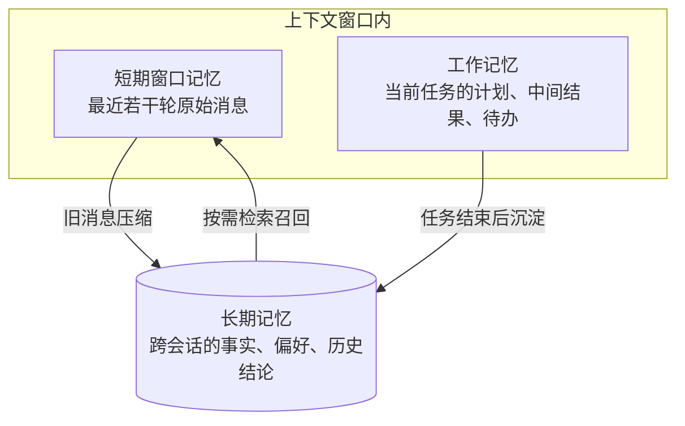
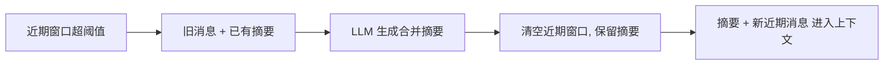

# 第 03 章 记忆系统

## 本章目标

读完本章，你应当能够：

1. 说清 Agent 记忆的三个层次（短期窗口、工作记忆、长期记忆）各自存什么、生命周期多长，不再把「对话历史」等同于「记忆」；
2. 实现滑动窗口历史管理：按 token 预算淘汰最旧消息，保证输入不超出模型上下文窗口；
3. 实现摘要压缩记忆：把超出阈值的旧对话交给模型总结成一段摘要，用一次额外调用换取上下文长度可控；
4. 辨析长期记忆的三种落法（向量记忆、实体/键值记忆、文件数据库记忆）的检索方式与适用边界，并理解遗忘策略为什么和记忆同样重要。

---

## 1. 概念讲解

### 1.1 模型无状态，记忆由程序维护

第 02 章提到过：模型本身是无状态的，每次调用都是独立的。所谓「记得上一轮」，是程序把上一轮的 `assistant` 回复重新塞进了 messages 列表。顺着这个事实往外推：

- 会话变长后，历史消息会持续占用输入 token，直到撞上模型的上下文窗口上限；
- 跨会话的信息（用户偏好、历史结论）根本不在当前 messages 里，必须由程序另外持久化；
- 中间推理结果、当前计划、待办事项，也需要一块单独的区域保存，不能混在闲聊历史里。

这三块需求分别对应短期记忆、工作记忆与长期记忆。记忆系统要解决的问题就是：**存什么、存多久、怎么取回来、什么时候丢掉**。

### 1.2 记忆分层



| 层次 | 存储内容 | 生命周期 | 典型实现 |
|---|---|---|---|
| 短期窗口记忆 | 最近几轮原始对话消息 | 当前会话，随窗口滚动淘汰 | 滑动窗口、摘要压缩 |
| 工作记忆 | 当前任务的计划步骤、中间产物、已确认结论 | 当前任务执行期间 | 内存中的列表 / 结构化状态 |
| 长期记忆 | 用户画像、实体事实、历史决策、知识库条目 | 跨会话持久保存 | 向量库、键值存储、文件 / 数据库 |

短期记忆和工作记忆都在进程内存里，任务结束即可释放；长期记忆需要落盘或写入外部存储，下次会话按相关性取回。本章示例聚焦短期与长期两层，工作记忆在第 05 章 ReAct 循环与第 10 章规划专题中再展开。

### 1.3 滑动窗口：管理短期历史与 token 预算

最简单的短期记忆是滑动窗口：只保留最近 N 轮消息，超出预算就从最旧的开始丢弃。规则有三条：

1. `system` 消息常驻，不参与淘汰；
2. 淘汰从队首（最旧）开始，优先保留最近的对话；
3. 预算按输入侧 token 计算，给模型回复留出 `max_tokens` 空间，不能把窗口撑到上下文上限。

token 数量在工程上建议用词表工具（如 `tiktoken`）按具体模型精确计数；演示阶段可以按字符数粗略估算（中文约 1.5 字符/token）。窗口大小是稳定性与上下文完整度的权衡：窗口太小，模型丢掉前文约定；窗口太大，成本上升且注意力被稀释。

### 1.4 摘要压缩记忆

滑动窗口一刀切丢掉旧消息，会丢失早期约定与关键事实。摘要压缩记忆的做法是：当近期历史超过阈值，把这批旧消息连同已有摘要一起交给模型总结，用一段简短摘要替代原始对话。



这种方案的代价是多一次模型调用，且摘要本身会损失细节。因此压缩时要明确保留项：用户身份与目标、已确认的关键事实、待办事项；删除寒暄与重复细节。摘要长度也要设上限，避免摘要本身再次膨胀。

### 1.5 长期记忆的三种落法

长期记忆解决「跨会话还记得」的问题。按检索方式不同，常见三种落法：

| 落法 | 检索方式 | 优点 | 局限 | 适用场景 |
|---|---|---|---|---|
| 向量记忆 | 把记忆条目嵌入成向量，按语义相似度召回 | 能按意思匹配，不依赖精确关键词 | 需要 Embedding 模型与向量库；纯词袋相似度效果有限 | 知识库条目、历史对话片段、模糊语义回忆 |
| 实体 / 键值记忆 | 以实体名为键直接存取事实 | 结构清晰、命中精确、实现简单 | 只能按已知实体名取，无法语义联想 | 用户画像、订单事实、配置偏好 |
| 文件数据库记忆 | 条目写入文件或数据库，按字段 / 关键词查询 | 持久可靠、可审计、可批量维护 | 检索能力取决于存储本身，语义匹配弱 | 日志、长期档案、需要落盘备份的记录 |

实际系统常常组合使用：键值记忆存结构化事实，向量记忆存非结构化片段，文件 / 数据库做最终持久层。本章示例用纯内存结构最小演示三种思路；向量记忆在生产中替换为 Embedding 稠密向量加 Chroma / Qdrant / pgvector 等向量库。

### 1.6 遗忘策略

记忆不是越多越好。过时事实会误导决策，无关历史会稀释注意力，长期堆积还带来成本与隐私风险。遗忘策略至少包括：

- **显式删除**：用户要求忘记某条信息时，从各层存储中移除；
- **摘要替代**：旧原始消息被摘要取代，细节不再保留；
- **TTL 过期**：临时性信息（如会话临时状态）设定存活时间，到期清除；
- **重要性打分**：按确认程度、复用频率给记忆打分，低分条目优先淘汰。

判断一条记忆是否该留，问两个问题：未来会话还会用到吗？保留它的风险（过时、隐私、成本）是否大于收益？

## 2. 实战：可运行源码

示例工程位于 [`examples/ch03-memory/`](https://github.com/thomaslwq/AgentTutorial/tree/main/examples/ch03-memory)，包含滑动窗口、摘要压缩、长期记忆三个脚本。

### 2.1 滑动窗口历史管理

`sliding_window.py` 用双端队列保存历史，`_evict` 在超预算时从队首丢弃最旧消息，`messages()` 组装发给模型的完整列表：

```python
class SlidingWindowMemory:
    def __init__(self, system_prompt: str, max_window_tokens: int = 600):
        self.system_message = {"role": "system", "content": system_prompt}
        self.max_window_tokens = max_window_tokens
        self.history: deque[dict] = deque()

    def add(self, role: str, content: str) -> None:
        self.history.append({"role": role, "content": content})
        self._evict()

    def _evict(self) -> None:
        while len(self.history) > 2 and self._window_tokens() > self.max_window_tokens:
            self.history.popleft()

    def messages(self) -> list[dict]:
        return [self.system_message, *self.history]
```

### 2.2 摘要压缩记忆

`summary_memory.py` 维护一段摘要加一个近期窗口；窗口超过 `max_recent` 时，把旧摘要与新对话记录一起交给模型合并总结，再清空近期窗口：

```python
def _compress(self) -> None:
        history_text = "\n".join(f"{m['role']}: {m['content']}" for m in self.recent)
        resp = client.chat.completions.create(
            model=self.model,
            messages=[{"role": "user", "content": SUMMARY_PROMPT.format(
                existing_summary=self.summary or "（暂无）",
                new_history=history_text,
            )}],
            temperature=0,
        )
        self.summary = resp.choices[0].message.content or ""
        self.recent.clear()
```

组装消息时，摘要作为一条 system 级背景信息置于近期消息之前，模型先看到长期结论，再看最新对话。

### 2.3 长期记忆三种落法

`long_term_memory.py` 在内存中最小演示三类结构：

- `KVMemory`：实体名为键、事实列表为值，`recall(entity)` 精确取回；
- `VectorMemory`：词袋向量加余弦相似度演示语义召回思路，生产替换为 Embedding 稠密向量；
- `FileMemory`：条目写入 JSON 文件，进程重启后重新读取，演示文件数据库落盘。

```python
class KVMemory:
    def remember(self, entity: str, fact: str) -> None:
        self.store.setdefault(entity, []).append(fact)

    def recall(self, entity: str) -> list[str]:
        return self.store.get(entity, [])
```

> [!note] 不强制安装向量数据库
> 本章 `VectorMemory` 用纯 Python 词袋相似度演示检索流程，目的是讲清「入库 → 向量化 → 相似度排序」的结构；接入真实 Embedding 与向量库的做法见 README 练习参考答案与第 08 章检索专题。

## 动手练习

1. **跟做**：运行 `sliding_window.py`，把 `max_window_tokens` 分别调到 60、120、300，观察淘汰日志与最终保留消息的变化。
2. **加过期策略**：为 `SummaryMemory` 增加摘要字数上限，摘要超长时对摘要本身再做一次压缩，只保留近期出现过的实体与结论。
3. **接真实 Embedding**：把 `VectorMemory` 的词袋向量替换为 Embedding 接口返回的稠密向量，查询时对问题做同样嵌入后再算余弦相似度。

> 练习参考答案见 `examples/ch03-memory/README.md`。

## 本章小结

- 模型无状态，记忆由程序分层维护：短期窗口存近期原始消息，工作记忆存当前任务状态，长期记忆跨会话持久化事实与偏好。
- 滑动窗口按 token 预算淘汰最旧消息，system 常驻、保留最近对话；预算要给回复留出 `max_tokens` 空间。
- 摘要压缩用一次模型调用把旧对话总结成摘要，换取可控的上下文长度；压缩时保留身份、关键事实与待办，删除寒暄细节。
- 长期记忆分向量、实体/键值、文件数据库三种落法，检索方式与适用场景不同，生产中常组合使用。
- 遗忘与记忆同等重要：显式删除、摘要替代、TTL 过期、重要性打分共同控制记忆的规模与风险。

## 思考题

1. 滑动窗口和摘要压缩都在管理短期历史，什么情况下选滑动窗口就够？什么情况下必须上摘要压缩？
2. 长期记忆召回的条目如果带有过时信息，Agent 可能做出什么错误决策？应在召回侧还是写入侧做时效校验？
3. 工作记忆（当前任务的计划与中间结果）为什么不宜直接写入长期记忆？两类记忆的清理时机有何不同？

---

下一章：[第 04 章 工具调用 Function Calling](ch04-function-calling.md)
