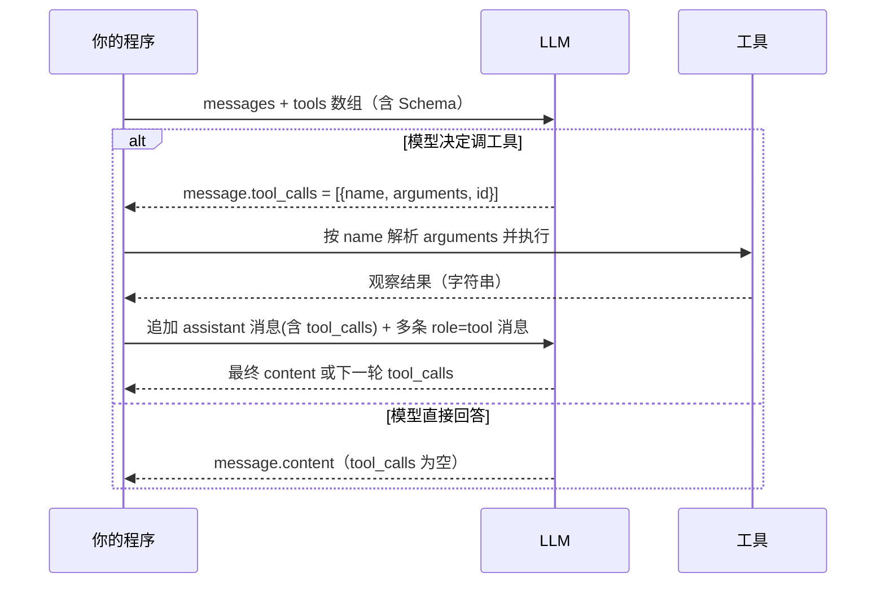

# 第 04 章 工具调用 Function Calling

## 本章目标

读完本章，你应当能够：

1. 说清 Function Calling 协议的三段式结构：`tools` 参数、模型返回 `tool_calls`、用 `role=tool` 消息回喂观察结果；
2. 为一个真实函数写出合格的 JSON Schema（描述、类型、枚举、必填），并知道为什么 `description` 比类型更影响模型选型；
3. 不借助任何框架，手写一个完整的工具循环：注册函数 → 模型决策 → 执行 → 回喂 → 再决策，直到最终回答；
4. 处理工具异常、参数解析失败、并行工具调用这三类工程问题，而不是让循环在第一个报错处崩掉。

---

## 1. 为什么需要 Function Calling

第 01 章的循环骨架靠 Prompt 逼模型输出 JSON：

```
{"type": "action", "tool": "get_time", "args": {}}
```

这种做法能跑，但很脆。模型偶尔会在 JSON 外面包一句解释、漏个引号、或者编造一个工具名，程序就解析失败。OpenAI 在 2023 年把这件事从「Prompt 约定」升级成了**协议约定**：模型原生支持输出结构化的工具调用请求，SDK 帮你把它和普通文本分开。

一句话区分：

- **Prompt 硬编码 JSON**：模型自由生成文本，程序用正则/JSON 解析去猜它想干什么；
- **原生 Function Calling**：模型的输出被分成两个互斥通道——一段面向用户的 `content`，和一段结构化的 `tool_calls`，后者由协议保证格式合法。

> [!note]
> Function Calling 不是「模型真的去执行函数」。模型本身没有执行能力，它只是**输出一个结构化的请求**；真正执行函数的仍然是你的程序。这一点必须想清楚，否则会反复掉进「为什么模型自己调不了 API」的坑里。

## 2. 协议三段式

一次完整的工具往返由三段消息构成：



### 2.1 第一段：`tools` 参数（告诉模型有什么工具）

`tools` 是一个数组，每一项形如：

```python
{
    "type": "function",
    "function": {
        "name": "get_weather",                # 函数名，模型用它指代工具
        "description": "查询指定城市的当前天气",  # 模型靠这句话判断「什么时候该用」
        "parameters": {                       # 入参的 JSON Schema
            "type": "object",
            "properties": {
                "city": {"type": "string", "description": "城市名"},
                "unit": {
                    "type": "string",
                    "enum": ["celsius", "fahrenheit"],
                },
            },
            "required": ["city"],
        },
    },
}
```

要点：

- `name` 与你程序里真正注册的函数名必须**完全一致**，大小写敏感；
- `description` 写给模型看，不是写给人看。它决定了模型「什么时候想起这个工具」，写得含糊等于没注册；
- `parameters` 是标准 JSON Schema 的子集。模型**不校验必填**，它只根据你给的字段猜，所以必填校验仍要在程序里做；
- `enum` 是最便宜的约束手段：把允许值列出来，比让模型自由生成字符串再报错便宜得多。

### 2.2 第二段：模型返回 `tool_calls`

模型响应里，`message.tool_calls` 是一个列表。空列表表示模型认为不需要工具，直接给出 `content`；非空列表的每一项包含：

| 字段 | 含义 |
|---|---|
| `id` | 这次调用的唯一标识，回喂时必须原样带回去 |
| `function.name` | 模型选择的工具名 |
| `function.arguments` | 一个 **JSON 字符串**（注意是字符串，不是对象），需要你自己 `json.loads` |

### 2.3 第三段：`role=tool` 消息回喂

拿到观察结果后，你要做两件事，顺序不能错：

1. 把模型这一轮的 assistant 消息**原样追加回历史**（包括它发出的 `tool_calls`），否则下一次请求模型会忘记自己刚才答应要调什么；
2. 为**每一个** `tool_call` 追加一条 `role=tool` 消息，`tool_call_id` 与对应的 `tc.id` 一一对应。

```python
messages.append(msg.model_dump(exclude_none=True))
for tc in msg.tool_calls:
    messages.append({
        "role": "tool",
        "tool_call_id": tc.id,
        "content": observation_string,
    })
```

少了任何一条 `role=tool`，下一次请求都会被 API 拒绝——这是协议硬约束。

## 3. 与 Anthropic tool_use 的对比

OpenAI 不是唯一做这件事的厂商，Anthropic 的 Claude 系列也有原生工具调用。两者语义等价，字段名不同：

| 维度 | OpenAI | Anthropic |
|---|---|---|
| 注册工具 | `tools=[{"type":"function","function":{...}}]` | `tools=[{"name":..., "description":..., "input_schema": {...}}]` |
| 模型请求调用 | `message.tool_calls[].function.{name,arguments}` | `message.content` 中 `type="tool_use"` 的块，字段为 `name` / `input`（已是对象） |
| 回喂结果 | 追加 `role="tool"` 消息，带 `tool_call_id` | 追加 `role="user"` 消息，含 `type="tool_result"` 块，带 `tool_use_id` |
| 参数形态 | 字符串，需自行 `json.loads` | 已经是 dict |

你只要掌握 OpenAI 这套，迁移到 Anthropic 是把消息结构换个壳的事。社区里大量「Agent 框架」本质上就是在帮你抹平这层差异。

## 4. 并行工具调用

`tool_calls` 是一个列表，不是单个对象——这是 OpenAI 在 2023 年 11 月引入的**并行工具调用**。模型一次可以决定同时调多个工具，典型场景：

- 用户问「北京和上海的天气」，模型并行发两个 `get_weather`；
- 一个研究任务同时查多个数据源。

你的循环不需要特殊处理：照常遍历列表，依次执行，依次追加 `role=tool` 消息即可。但要注意两点：

1. **执行顺序**：并行工具之间没有依赖关系，串行执行就行，不必真的开线程——多数工具调用的瓶颈在模型而不在你本地；
2. **不要在并行调用之间穿插中间推理**：模型已经一次性做完了这一轮的决策，你把所有观察都喂回去，它才会进入下一轮。

## 5. Schema 设计与错误返回

工具写得好不好，一半在实现，一半在 Schema。下面是几条踩过坑的经验：

**`description` 要写「什么时候用」，不要只写「是什么」。**
差的：`"calculates math"`。
好的：`"对算术表达式求值。涉及数值运算时优先调用本工具，不要心算。"`——后半句直接告诉模型行为边界。

**错误要以「字符串观察」的形式回喂，而不是抛异常中断循环。**
模型看到 `[工具执行失败] ValueError: 未知城市：广州，目前支持 ['北京','上海','深圳']`，它会自己在下一轮改正：换一个城市名，或者直接告诉用户「暂不支持广州」。这是 Agent 自我修正的关键。

**参数校验分两层**：

- 协议层：模型输出的 `arguments` 是字符串，可能 JSON 解析失败，要兜底成 `{}`；
- 业务层：函数签名本身要做参数检查（城市在不在白名单、表达式语法合不合法），并把异常信息写成对模型友好的文本。

## 6. 实战：手写完整工具循环

示例位于仓库 [`examples/ch04-function-calling/`](https://github.com/thomaslwq/AgentTutorial/tree/main/examples/ch04-function-calling)，包含两个工具（天气、计算器）和一个完整循环。

`tools.py` 节选——工具实现与注册分离：

```python
_MOCK_WEATHER = {
    "北京": {"temp_c": 8, "condition": "晴", "humidity": 30},
    "上海": {"temp_c": 14, "condition": "多云", "humidity": 65},
    "深圳": {"temp_c": 22, "condition": "小雨", "humidity": 80},
}

def get_weather(city: str, unit: str = "celsius") -> Dict[str, Any]:
    if city not in _MOCK_WEATHER:
        raise ValueError(f"未知城市：{city}，目前支持 {list(_MOCK_WEATHER)}")
    ...

TOOLS = {
    "get_weather": {"function": get_weather, "schema": {...}},
    "calculate":   {"function": calculate,   "schema": {...}},
}

def dispatch(name: str, arguments: Dict[str, Any]) -> str:
    """统一把结果或异常转成字符串回喂模型。"""
    entry = TOOLS.get(name)
    if entry is None:
        return f"[错误] 不存在的工具：{name}"
    try:
        return json.dumps(entry["function"](**arguments), ensure_ascii=False)
    except Exception as e:
        return f"[工具执行失败] {type(e).__name__}: {e}"
```

`handrolled_loop.py` 是循环主体，不到 60 行：

```python
def run(user_message: str, max_turns: int = 6) -> str:
    messages = [
        {"role": "system", "content": SYSTEM},
        {"role": "user", "content": user_message},
    ]
    tool_schemas = [entry["schema"] for entry in TOOLS.values()]

    for turn in range(1, max_turns + 1):
        resp = client.chat.completions.create(
            model=MODEL,
            messages=messages,
            tools=tool_schemas,
            tool_choice="auto",
            temperature=0,
        )
        msg = resp.choices[0].message
        messages.append(msg.model_dump(exclude_none=True))

        if not msg.tool_calls:
            return msg.content or ""

        for tc in msg.tool_calls:
            args = json.loads(tc.function.arguments or "{}")
            observation = dispatch(tc.function.name, args)
            messages.append({
                "role": "tool",
                "tool_call_id": tc.id,
                "content": observation,
            })

    return "（达到最大轮次仍未完成）"
```

跑一次默认任务「北京和上海的天气如何？把温差算出来」，典型的 trace 是：

1. 第 1 轮模型并行发起两个 `get_weather(city="北京")` 与 `get_weather(city="上海")`；
2. 两条观察回喂后，第 2 轮模型发起 `calculate("14 - 8")`；
3. 第 3 轮模型拿到计算结果，输出最终中文回答，`tool_calls` 为空，循环结束。

> [!warning]
> `max_turns` 必须设。哪怕协议再成熟，模型也可能在两个工具之间来回横跳（比如反复查同一个城市）。没有终止条件的 Agent 就是一个烧 token 的死循环。

## 动手练习

1. **跟做**：`pip install -r requirements.txt && python handrolled_loop.py`，观察每一轮打印；把用户问题换成「广州今天天气怎么样？」，看模型如何处理「未知城市」这个错误观察。
2. **加工具**：在 `TOOLS` 里注册一个 `convert_temperature(celsius, to_unit)`，让模型先查摄氏温度再主动调用换算工具；注意在 Schema 里写清楚什么时候用。
3. **强制工具**：把 `tool_choice="auto"` 改成 `tool_choice={"type":"function","function":{"name":"calculate"}}`，再跑一次天气问题，观察模型行为——这能帮你理解「自动 vs 强制」的区别。

> 练习参考答案见 `examples/ch04-function-calling/README.md`。

## 本章小结

- Function Calling 是协议而非 Prompt：三段式——`tools` 注册、`tool_calls` 返回、`role=tool` 回喂，缺一不可。
- Schema 的 `description` 决定模型「何时用」，`enum` 与 `required` 约束「怎么填」，业务校验仍要在你的代码里做。
- 工具异常不能中断循环，要写成对模型友好的观察字符串，让它自我修正。
- 并行工具调用是 `tool_calls` 列表的天然语义，遍历执行即可；`max_turns` 是最后一道保险丝。

## 思考题

1. 为什么协议要求「每个 `tool_call` 都必须配一条 `role=tool` 消息」？少配一条会发生什么？
2. 如果一个工具的执行可能耗时 30 秒（比如调一个外部爬虫），你会在循环里怎么改？并行调用还要不要真的并行？
3. 把 `description` 写得很长很短对模型选型有什么影响？你会怎么衡量一个工具 Schema 写得好不好？

---

下一章：[第 05 章 ReAct 推理与行动](ch05-react.md)
