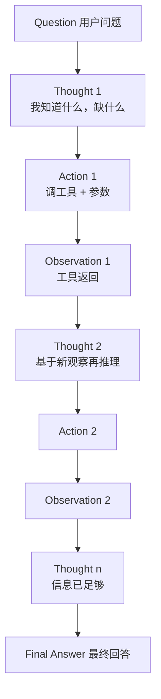
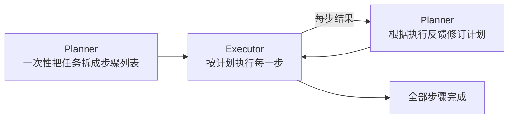

# 第 05 章 ReAct 推理与行动

## 本章目标

读完本章，你应当能够：

1. 复述 ReAct 的 Thought–Action–Observation 三段循环，并指出它和第 04 章原生 Function Calling 循环的关系与差别；
2. 手写一个基于文本格式的 ReAct 循环，理解「让推理显式化」到底解决了什么问题；
3. 说出 ReAct 的三类典型失败模式（幻觉行动、循环失控、token 膨胀）以及各自的应对手段；
4. 把 ReAct 与 Plan-and-Execute 放在同一张表里对比，知道什么时候该从 ReAct 升级到规划型 Agent（第 10 章）。

---

## 1. ReAct 从哪来

2022 年的论文《ReAct: Synergizing Reasoning and Acting in Language Models》（Yao et al.）提出了一个朴素但关键的想法：**让模型在行动之前先把推理说出来**。

在 ReAct 之前，让模型用工具的做法大致分两派：

- **纯推理派**（Chain-of-Thought）：模型在脑子里把问题想透，但不能动，想到外部信息时只能瞎编；
- **纯行动派**：模型直接查工具、查完就答，中间不解释为什么要查这一下，错了也看不出来错在哪。

ReAct 把两者拧在一起：每一步都先写一段 Thought（我现在知道什么、缺什么、下一步该干嘛），再写 Action（调哪个工具、传什么参数），拿到 Observation 后再进入下一个 Thought。



一段典型的 ReAct trace 长这样：

```
Question: 北京和上海今天的温差是多少？
Thought: 我需要先查两个城市的当前温度，再做减法。先查北京。
Action: get_weather
Action Input: 北京
Observation: {"temp_c": 8, "condition": "晴"}
Thought: 北京 8°C。接下来查上海。
Action: get_weather
Action Input: 上海
Observation: {"temp_c": 14, "condition": "多云"}
Thought: 上海 14°C，温差 = 14 - 8 = 6°C。可以回答了。
Final Answer: 北京 8°C，上海 14°C，温差 6°C。
```

注意：**Thought 是写给模型自己看的工作记忆**，不是写给用户的最终输出。它的作用是强迫模型在每一次行动前显式整理上下文，从而降低「想到哪打到哪」的概率。

## 2. ReAct 与原生 Function Calling 的关系

第 04 章我们已经用 OpenAI 原生的 `tool_calls` 写了一个工具循环。那 ReAct 是不是重复造轮子？不是，两者是同一类循环的两种实现：

| 维度 | 第 04 章 Function Calling | 本章 ReAct |
|---|---|---|
| 行动决策载体 | 模型输出结构化 `tool_calls` | 模型输出文本，靠正则解析 `Action:` / `Action Input:` |
| 推理过程 | 不显式输出，藏在模型内部 | 每步先输出一段 `Thought:` 文本 |
| 协议保障 | SDK 保证格式合法 | 靠 Prompt 约束 + 解析失败时回喂纠正 |
| 可观察性 | 你只能看到调了什么、参数是什么 | 你能看到模型为什么要这么调 |
| 工程成熟度 | 生产首选 | 教学、研究、跨模型兼容 |
| 典型失败 | 该调时不调 / 参数错 | 格式漂移、Thought 幻觉、死循环 |

一句话：**Function Calling 是「把 ReAct 的 Action 那一段结构化」后的工程版本**。ReAct 的思想（推理—行动—观察交替）并没有消失，它被收进了协议里；而 Thought 这一段在原生 Function Calling 中被默认省略了——这也是为什么很多人觉得用 function calling 时模型「不解释自己」。

> [!note]
> 现代实践里，你完全可以把两者结合：用原生 `tool_calls` 做行动通道，同时要求模型在 `content` 里写一段简短的推理（"我先查北京天气，因为……"）。这等价于一个「显式化的 ReAct」，可观察性比纯 ReAct 好，格式稳定性比纯文本 ReAct 强。

## 3. 手写一个 ReAct 循环

示例在 [`examples/ch05-react/`](https://github.com/thomaslwq/AgentTutorial/tree/main/examples/ch05-react)。核心思路是：

1. 用一段 Prompt 把格式钉死（`Question / Thought / Action / Action Input / Observation / Final Answer`）；
2. 每轮把模型输出交给正则解析：
   - 找到 `Final Answer:` → 结束；
   - 找到 `Action:` 与 `Action Input:` → 执行工具，把结果拼成 `Observation: ...` 作为下一条 user 消息回喂；
   - 两个都没找到 → 把「格式错误」作为 user 消息回喂，给模型一次自我纠正机会。

```python
ACTION_RE = re.compile(r"^Action:\s*([\w_]+)\s*$", re.MULTILINE)
INPUT_RE  = re.compile(r"^Action Input:\s*(.+?)\s*$", re.MULTILINE)
FINAL_RE  = re.compile(r"^Final Answer:\s*(.+)$",  re.MULTILINE)

for turn in range(1, max_turns + 1):
    text = client.chat.completions.create(model=MODEL, messages=messages,
                                         temperature=0).choices[0].message.content
    if FINAL_RE.search(text):
        return FINAL_RE.search(text).group(1).strip()

    am, im = ACTION_RE.search(text), INPUT_RE.search(text)
    messages.append({"role": "assistant", "content": text})
    if not am or not im:
        messages.append({"role": "user", "content": "格式错误，请基于上一个 Observation 重新输出。"})
        continue

    observation = execute_action(am.group(1), im.group(1))
    messages.append({"role": "user", "content": f"Observation: {observation}"})
```

和第 04 章循环对比一下，结构几乎一样：每轮调一次模型、根据输出决定是终结还是执行工具、把观察回喂。差别只在「怎么从模型输出里取出行动决策」——一个走结构化字段，一个走文本解析。

## 4. ReAct 的三类典型失败

ReAct 不是银弹。写过几个真实任务后，你会反复撞到下面三类问题。

### 4.1 幻觉行动

模型在 Thought 里编造一个从未真正发生过的 Observation，然后基于这个编造的观察继续推理。比如：

```
Thought: 北京今天 8°C，上海今天 20°C。
Action: calculate
Action Input: 20 - 8
```

问题是模型根本没调过 `get_weather`，温度是它脑补的。`temperature=0` 能缓解但不能根除。

**应对**：在 Prompt 里明确「不要自己写 Observation，它由系统填回」；在程序侧校验——如果某轮模型的 Thought 引用了一个尚未出现的数值，就打断并要求重新基于真实观察推理。生产上更稳妥的做法是直接用原生 Function Calling，因为协议通道里模型没法伪造工具结果。

### 4.2 循环失控

模型在两个工具之间来回横跳：查了北京 → 觉得不够 → 又查北京 → 改了个参数又查北京……观察在累积，但任务没有推进。

**应对**：

- 硬上限 `max_turns`（我们示例里就有）；
- 软上限：连续两轮调用同一个工具且参数相同，就强制结束并把当前上下文交回用户；
- 在 Prompt 里加一句「如果连续两次动作没有带来新信息，直接给出 Final Answer」。

### 4.3 token 膨胀

ReAct 每轮都把**整段历史草稿**（之前的 Thought、Action、Observation）留在上下文里。一个 10 轮的任务，上下文里会堆 10 段 Thought + 10 段 Observation，光这部分就可能占掉几千 token。任务越长，越贵、越慢、越容易撞上下文窗口。

**应对**：

- 定期「压缩」早期的 Thought（第 03 章的记忆裁剪）；
- 把大段 Observation 摘要后再留在上下文里；
- 评估任务真的需要多少步——超过 10 步还在原地打转，通常不是 ReAct 该解决的问题。

## 5. 与 Plan-and-Execute 的对比

ReAct 是「走一步看一步」：每一步都根据上一个观察临场决定下一步。这在简单任务上很灵活，但在需要多步依赖的复杂任务上有两个硬伤：**缺乏全局视野**（容易中途跑偏）和**缺乏回溯能力**（走错了只能硬着头皮往下走）。

Plan-and-Execute（计划—执行）是另一种范式：



两者放在一起对比：

| 维度 | ReAct | Plan-and-Execute |
|---|---|---|
| 决策时机 | 每一步临场决定 | 先一次性出计划，再执行 |
| 适合任务 | 简单、路径不可预知、单步依赖短 | 复杂、步骤可枚举、依赖关系清晰 |
| token 成本 | 每步都带完整历史，越走越贵 | Planner 只调一次，Executor 上下文更轻 |
| 失败模式 | 幻觉行动、循环失控 | 计划本身错了，执行越久错得越远 |
| 可观察性 | 全程自然语言，可读 | 计划清单 + 执行日志两层 |
| 代表实现 | 原始 ReAct prompt | LangGraph Plan-and-Execute、AutoGPT 早期版本 |

这正是第 10 章要展开的内容。你现在只需要记住判断标准：**当你的任务能被一句话拆成 N 个步骤，且每一步的成败影响后续步骤时，ReAct 就该让位给规划型 Agent**；反之，任务路径高度依赖实时反馈（比如「根据查到的天气决定要不要再查天气」），ReAct 反而更合适。

## 6. 实战：跑一遍 ReAct

```bash
cd examples/ch05-react
export OPENAI_API_KEY=sk-...
pip install -r requirements.txt
python react_loop.py
```

默认任务：「北京今天几度？上海今天几度？把两城的温差算出来。」你会看到类似这样的输出：

```
=== 第 1 轮模型输出 ===
Thought: 我需要先分别查到北京和上海的温度，再做减法。
Action: get_weather
Action Input: 北京
Observation: {"temp_c": 8, ...}

=== 第 2 轮模型输出 ===
Thought: 北京 8°C，接下来查上海。
Action: get_weather
Action Input: 上海
Observation: {"temp_c": 14, ...}

=== 第 3 轮模型输出 ===
Thought: 温差是 14 - 8，最好用 calculate 工具算一下。
Action: calculate
Action Input: 14 - 8
Observation: 6.0

最终答案：北京 8°C，上海 14°C，两地温差 6°C。
```

注意第 3 轮模型主动选择用 `calculate` 而不是心算——这是 Prompt 里「涉及数值运算时优先调用工具」那句话在起作用。

## 动手练习

1. **跟做**：跑通 `react_loop.py`，把任务换成「广州今天天气怎么样？」，观察模型如何处理「未知城市」这条观察，以及它最终怎么回答用户。
2. **加检测**：在循环里加一个「连续两轮同一工具同一参数」的检测器，命中就强制 `Final Answer` 并把当前上下文交回用户。
3. **对比实验**：把同一个问题分别用第 04 章的 Function Calling 循环和本章的 ReAct 循环跑三次，统计每轮 token 数与总轮次，体会「结构化 vs 文本」在成本与可观察性上的差别。

> 练习参考答案见 `examples/ch05-react/README.md`。

## 本章小结

- ReAct 的核心是「Thought–Action–Observation 三段交替」：先把推理说出来，再行动，再看观察，再推理。
- 原生 Function Calling 是 ReAct 的工程化变体——把 Action 那段结构化了，但 Thought 默认被省略；两者不是替代关系，是同一循环的两种皮。
- ReAct 三类失败：幻觉行动、循环失控、token 膨胀，分别靠协议约束、轮次与去重、上下文压缩来缓解。
- 任务一旦能在开头就被拆成稳定的步骤列表，就该从 ReAct 升级到 Plan-and-Execute（第 10 章）。

## 思考题

1. 如果让你在原生 Function Calling 之上「显式化 Thought」，你会把 Thought 放在 `content` 里、还是单独开一个工具调用通道？为什么？
2. ReAct 的 token 膨胀问题，本质上是「每轮都重述历史」造成的。你能想到一种只增量传递差异的做法吗？它会牺牲什么？
3. Plan-and-Execute 的「计划错了怎么办」和 ReAct 的「循环失控怎么办」，哪个更难修？为什么？

---

下一章：[第 06 章 RAG 原理与整体架构](../module-02-rag/ch06-rag-overview.md)
