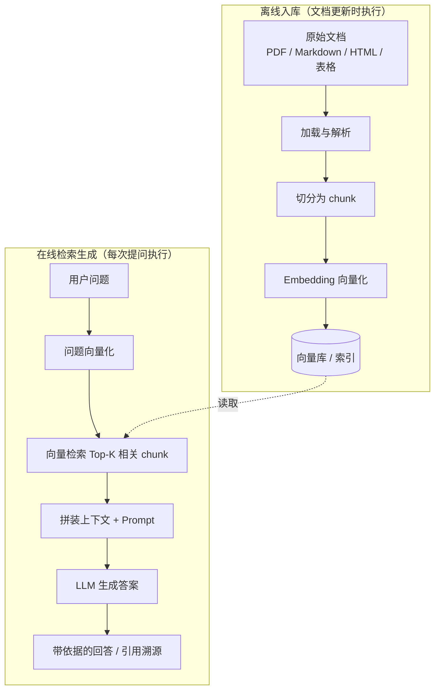

# 第 06 章 RAG 原理与整体架构

## 本章目标

读完本章，你应当能够：

1. 说清大模型直接回答在知识截止、私有数据、幻觉三方面的局限，以及 RAG 分别如何对症；
2. 画出 RAG 的完整链路：加载 → 切分 → Embedding → 入库 → 检索 → 拼上下文 → 生成，并指出哪一步在离线、哪一步在在线；
3. 用一张对比表讲清 RAG 与微调的分工，知道什么场景该选哪一个；
4. 跑通本章的最小端到端 demo，识别其中可替换的组件边界，为第 07、08、09 章的工程化改造留出接口。

---

## 1. 为什么需要 RAG

直接把问题丢给大模型，看起来什么都能答，但落到企业场景，有三类问题绕不开。

### 1.1 模型知识有截止日期

模型参数里记住的是训练数据截止之前的世界。新发布的产品版本、刚出台的制度、昨天发生的事件，参数里都没有。重新训练模型代价极高，且每次知识更新都要重走一遍训练流程，业务节奏根本跟不上。

### 1.2 私有数据进不了训练集

企业的内部文档、工单、合同、研发知识库、产品手册，既不会出现在公开语料里，也不适合上传到外部训练。模型对这些内容天然是「失明」的。如果靠人工把私有资料逐段贴进对话窗口，既受上下文长度限制，也无法规模化复用。

### 1.3 信息不足时模型会编造幻觉

大模型的优化目标是生成「通顺、像答案」的文本，而不是「只说有依据的事实」。当它不知道答案时，倾向于补一段看起来合理的解释：错误的版本号、不存在的接口、张冠李戴的引用。在客服、法务、研发支持这类对事实准确性敏感的场景，幻觉的代价很高。

需要区分两种幻觉：一种是参数里本就没有该知识，模型靠语言习惯拼凑；另一种是资料里有依据，但模型在转述时把细节记错、夸大或曲解。RAG 主要缓解第一种——给模型明确的检索依据；对第二种，还要靠上下文约束、引用标注与答案校验来兜底，这也是第 09 章评测要覆盖的问题。

### 1.4 朴素的「贴进对话框」为什么不够

面对私有资料，最直接的做法是把文档全文贴进对话窗口。这条路在小规模临时问答里可行，但规模化后有三个硬限制：上下文窗口长度有限，长文档贴不下；每次对话都重复携带全文，token 成本高；多份资料之间无法复用，换一个问题就要重新贴一遍。RAG 把「资料存储与检索」从对话窗口中剥离出来，只把与当前问题最相关的片段带进上下文，这是它能规模化的根本原因。

**RAG（Retrieval-Augmented Generation，检索增强生成）** 的思路是：回答之前先从外部知识库里取回与问题相关的资料片段，把这些片段作为依据拼进 Prompt，让模型基于给定资料作答。知识放在可随时更新的外部存储里，而不是固化在参数中。

> [!note] RAG 的本质
> RAG 不是一个模型，而是一条「先检索、再生成」的工程链路。模型负责理解和表达，知识库负责提供事实依据，两者解耦。

## 2. RAG 整体架构

一条标准 RAG 链路分成**离线入库**和**在线检索生成**两段。离线侧在文档更新时批量跑一次；在线侧每次用户提问时实时执行。



各环节的职责：

| 环节 | 所在阶段 | 职责 | 本章示例中的对应组件 |
|---|---|---|---|
| 加载与解析 | 离线 | 从 PDF、HTML、Markdown 等格式中抽出正文与结构 | 第 07 章展开，demo 中以 `Document` 占位 |
| 切分 | 离线 | 把长文档切成语义相对完整、长度适中的块 | `split_into_paragraphs`（占位实现） |
| Embedding | 离线 | 把文本块转成向量，使语义相近的文本向量接近 | `EmbeddingModel` |
| 入库 | 离线 | 保存块文本、元数据与向量，建立可检索索引 | `InMemoryVectorStore` |
| 检索 | 在线 | 把问题向量化，按相似度召回 Top-K 相关块 | `Retriever` |
| 拼上下文 | 在线 | 把召回块编号、标注来源，组装进 Prompt | `build_context` |
| 生成 | 在线 | 模型依据上下文作答，约束其不脱离资料 | `RagChain` |

> [!warning] 不要把 RAG 理解成「检索器替模型回答」
> 检索器只负责找出候选片段，并不判断答案；最终答案仍由模型基于片段生成。检索质量差（漏掉关键片段）或上下文拼装不当（塞进无关内容），生成环节再强也救不回来。

### 2.1 元数据为什么不能丢

入库时除了正文向量，还要保留来源信息：文件名、页码、标题层级、段落位置等。原因有两个：一是回答需要溯源，用户可以顺着来源核对原文；二是后续可以按来源、时间、文档类型做过滤检索。本章 demo 在 `Document` / `Chunk` 的 `metadata` 字段中保留 `source`，第 07 章会展开元数据的完整做法。

## 3. RAG 与微调的对比

RAG 和微调（Fine-tuning）都用于让模型适配特定领域，但解决的问题不同，实践中经常配合使用。

| 对比维度 | RAG | 微调 |
|---|---|---|
| 知识形态 | 外部存储中的事实性资料，随时增删改 | 固化进模型参数的领域知识与表达习惯 |
| 更新成本 | 更新文档并重新入库即可，无需训练 | 需要准备数据集、训练与评测，周期长 |
| 可溯源性 | 答案可对应到具体文档片段与来源 | 知识在参数中，难以指出依据出处 |
| 擅长内容 | 频繁变化的事实、私有文档、需要引用的知识 | 稳定的风格、语气、输出格式、领域推理范式 |
| 上下文长度 | 受召回片段总量与模型窗口限制 | 不受外部检索限制，但泛化能力受训练数据约束 |
| 成本结构 | 检索与推理 token 成本；离线入库一次 | 训练算力与数据标注成本；推理成本相对稳定 |
| 幻觉控制 | 可通过限定依据、引用标注约束，但仍依赖生成质量 | 领域表达更贴合，但对参数中没有的事实同样会编造 |

典型组合：**微调塑造模型怎么说话、按什么格式输出；RAG 提供模型该引用的事实依据**。例如一个法律助手，先用微调让模型掌握法律文书的格式与论证方式，再用 RAG 接入最新法规与判例库。

## 4. RAG 适用与不适用的场景

### 4.1 适合用 RAG 的情况

- **知识频繁更新**：产品文档、价格政策、公告类内容，更新比训练模型快得多；
- **私有或受限数据**：内部制度、工单、合同、研发资料，不适合进入公开训练集；
- **答案需要溯源**：客服答复、合规审查、技术支持，要求能指出依据出自哪份文档；
- **长尾事实查询**：知识条目多、单条被查询频率低，靠参数记忆不经济，检索更划算；
- **需要引用外部最新信息**：如结合实时检索回答近期事件。

### 4.2 不适合优先用 RAG 的情况

- **需要改变模型风格或输出格式**：统一语气、结构化输出、特定任务范式，微调或 Prompt 工程更直接；
- **知识高度稳定且体量小**：几条固定规则写进系统 Prompt 即可，不必搭一套检索链路；
- **推理链条长、依赖领域计算**：RAG 提供的是片段知识，复杂数学、代码生成、多步推理仍需模型自身能力与工程编排；
- **检索质量无法保证的语料**：文档本身混乱、语义重复严重、缺少可区分的特征，召回效果差，应先治理文档；
- **对延迟极其敏感且无离线检索空间**：RAG 多一次检索加一次上下文拼装，链路比单次调用长。

> [!note] 判断顺序
> 先问：需求是「知识不足」还是「表达不当」？知识不足且可外部化 → RAG；表达不当、格式不统一 → 微调或 Prompt。两者都有，再考虑组合。

## 5. 实战：最小端到端 RAG

示例代码位于仓库 [`examples/ch06-rag-overview/`](https://github.com/thomaslwq/AgentTutorial/tree/main/examples/ch06-rag-overview)。下面按链路顺序讲解关键实现，完整可运行脚本见 `minimal_rag.py`。

### 5.1 数据结构与占位切分

先定义文档与块结构，元数据随块一起保留：

```python
@dataclass
class Document:
    text: str
    metadata: dict = field(default_factory=dict)

@dataclass
class Chunk:
    text: str
    metadata: dict = field(default_factory=dict)

def split_into_paragraphs(doc: Document) -> list[Chunk]:
    chunks: list[Chunk] = []
    for para in doc.text.split("\n\n"):
        para = para.strip()
        if len(para) >= 20:
            chunks.append(Chunk(text=para, metadata=dict(doc.metadata)))
    return chunks
```

这里按空行切分只是占位。真实文档的切分要考虑段落边界、标题层级、表格与重叠窗口，第 07 章会给出不依赖 LangChain 的递归字符切分实现。

### 5.2 Embedding 与内存向量库

Embedding 是对 OpenAI 接口的薄封装；向量库用内存列表保存块与向量，检索时逐对计算余弦相似度：

```python
class EmbeddingModel:
    def __init__(self, client: OpenAI, model: str):
        self.client = client
        self.model = model

    def embed(self, texts: list[str]) -> list[list[float]]:
        if not texts:
            return []
        resp = self.client.embeddings.create(model=self.model, input=texts)
        return [item.embedding for item in resp.data]

def cosine_similarity(a, b) -> float:
    dot = sum(x * y for x, y in zip(a, b))
    norm_a = math.sqrt(sum(x * x for x in a))
    norm_b = math.sqrt(sum(y * y for y in b))
    if norm_a == 0 or norm_b == 0:
        return 0.0
    return dot / (norm_a * norm_b)
```

内存库的 `add` 负责写入，`search` 按相似度排序后返回 Top-K。这个实现刻意保持简单，目的是暴露组件边界：后续把 `InMemoryVectorStore` 换成 FAISS 或向量数据库，`Retriever` 与 `RagChain` 的调用方式不变。

### 5.3 检索与上下文拼装

检索器把「问题向量化 → 查库」封装成一个组件；上下文拼装时给每个块编号并标注来源：

```python
class Retriever:
    def __init__(self, store, embedder, top_k=3):
        self.store = store
        self.embedder = embedder
        self.top_k = top_k

    def retrieve(self, query: str) -> list[RetrievedChunk]:
        query_vec = self.embedder.embed([query])[0]
        return self.store.search(query_vec, self.top_k)

def build_context(chunks: list[RetrievedChunk]) -> str:
    lines: list[str] = []
    for idx, chunk in enumerate(chunks, start=1):
        source = chunk.metadata.get("source", "未知来源")
        lines.append(f"[资料 {idx}]（来源：{source}）\n{chunk.text}")
    return "\n\n".join(lines)
```

### 5.4 生成环节的约束

系统 Prompt 明确要求模型只能依据参考资料作答，资料不足时直接说明，不编造：

```python
SYSTEM_PROMPT = (
    "你是一名严谨的技术助手。只能依据下面给出的「参考资料」回答问题；"
    "如果参考资料中没有相关信息，直接说明资料不足，不要编造。"
)

class RagChain:
    def answer(self, query: str) -> str:
        retrieved = self.retriever.retrieve(query)
        context = build_context(retrieved)
        messages = [
            {"role": "system", "content": SYSTEM_PROMPT},
            {"role": "user", "content": f"参考资料：\n{context}\n\n问题：{query}"},
        ]
        resp = self.client.chat.completions.create(
            model=self.model, messages=messages, temperature=0.2,
        )
        return resp.choices[0].message.content or ""
```

### 5.5 入库流水线与主流程

入库把切分、向量化、写库串成一条流水线；主流程先离线入库，再在线问答：

```python
class IngestPipeline:
    def ingest(self, docs: list[Document]) -> None:
        chunks: list[Chunk] = []
        for doc in docs:
            chunks.extend(split_into_paragraphs(doc))
        vectors = self.embedder.embed([chunk.text for chunk in chunks])
        self.store.add(chunks, vectors)
```

### 5.6 这条链路上的常见失败点

跑通最小 demo 后，需要知道问题通常出在哪一段，便于后续排查：

- **入库侧**：文档解析丢正文、切分把语义切碎、Embedding 批量调用失败或文本过长被截断；这些问题在入库时就固化进索引，在线阶段很难补救；
- **检索侧**：问题与文档表述不一致（用户口语、文档书面语）导致召回偏差，Top-K 过小漏掉关键片段，或过大塞进噪声；
- **生成侧**：上下文里相关片段排在后面被忽略，模型脱离资料凭参数记忆作答，或把多个片段的信息错误拼接。

本章 demo 的组件边界正是按这三段划分：`IngestPipeline` 对应入库，`Retriever` 对应检索，`RagChain` 对应生成。后续章节分别细化每一段，出现问题时可以先定位是哪一段的输出不符合预期。

运行方式与预期输出见示例目录的 `README.md`。demo 内置两段 RAG 基础资料，第三个问题故意取资料之外的内容，用来观察模型在约束下是否承认资料不足。

> [!warning] Key 与模型配置
> API Key 一律从环境变量 `OPENAI_API_KEY` 读取，兼容服务可另设 `OPENAI_BASE_URL`；模型名通过环境变量覆盖，不要在代码里硬编码密钥。

## 动手练习

1. **跟做**：运行 `minimal_rag.py`，把 `TOP_K` 从 3 改成 1，对比第一个问题的答案要点覆盖情况，体会召回数量对答案完整性的影响。
2. **观察检索**：在 `RagChain.answer` 中把每条召回结果的相似度得分、来源与正文前 50 字打印出来，观察相关块与无关块的得分差距。
3. **辨析**：选一个你熟悉的内部问答需求，对照第 4 节判断它是否适合 RAG，写下三条理由；如果其中包含风格统一的要求，说明哪部分该交给微调或 Prompt。

> 练习参考答案见 `examples/ch06-rag-overview/README.md`。

## 本章小结

- RAG 对症三类局限：知识截止、私有数据、幻觉；做法是回答前先检索外部资料，再让模型基于资料生成。
- 链路分两段：离线完成加载、切分、向量化、入库；在线完成问题向量化、检索、拼上下文、生成。
- RAG 管事实依据，微调管风格与格式；两者按知识是否频繁变化、是否需要溯源来分工，常组合使用。
- 本章 demo 以内存库和占位切分暴露组件边界，切分质量、向量检索与评测分别在第 07、08、09 章展开。

## 思考题

1. 如果检索召回的片段里混入了无关内容，模型在生成时可能出现什么倾向？除了优化检索，Prompt 层面可以加哪些约束？
2. 离线入库和在线检索对延迟、成本的要求不同，哪些环节适合做成批量预处理，哪些必须实时执行？
3. 本章的内存向量库在数据量增大后会遇到什么问题？你预期向量数据库会提供哪些能力？（提示：索引、过滤、并发）

---

下一章：[第 07 章 文档解析与切分](ch07-parse-chunk.md)
