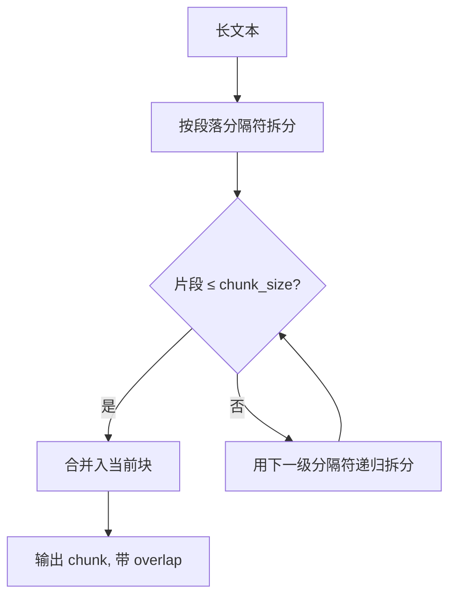

# 第 07 章 文档解析与切分

## 本章目标

读完本章，你应当能够：

1. 说清 PDF、HTML、Markdown、表格四类常见文档在解析时各自的坑，以及对应的清洗动作；
2. 对比固定长度、递归字符、标题/语义、重叠窗口等切分策略的适用边界；
3. 解释 chunk size 与 overlap 的权衡逻辑，能根据文档类型给出初始取值；
4. 自己实现一个不依赖 LangChain 的递归字符切分器，并在切分过程中保留来源、页码、标题层级等元数据。

---

## 1. 为什么解析与切分值得单独一章

第 06 章的链路里，检索质量的上限往往在入库前就被决定了。文档解析抽不出正文、表格被打散、切分把一句话从中间截断，后面的 Embedding 模型和检索器再强，也只能在破碎的材料上工作。

工程上常见的反模式是：拿到 PDF 直接整篇塞进向量库，或者按固定字符数硬切，然后抱怨检索不准。解析与切分要解决两个问题：**抽出干净、结构可辨的正文**；**把长文档切成语义相对完整、长度适合检索与上下文窗口的块（chunk）**。

## 2. 文档解析

### 2.1 PDF

PDF 的排版是坐标式的，不是流式文本，解析时最容易出问题：

- **多栏排版**：按坐标顺序抽取时，左右栏文字会交错混排，读起来语义断裂；
- **页眉页脚、页码、水印**：反复出现在每页，污染正文；
- **扫描件**：本质是图片，纯文本抽取拿不到内容，需要 OCR；
- **表格**：单元格之间的阅读顺序容易错乱，合并单元格会丢列归属。

本章示例用 `pypdf` 按页抽取文本，页码写入元数据。生产中复杂版式可换 `pdfplumber`（对表格与坐标控制更细），扫描件再叠加 OCR。解析阶段先做基础清洗：去掉重复页眉页脚、压缩多余空白、按页保留边界。

> [!warning] 扫描件不要硬走文本抽取
> 如果 `extract_text()` 返回空或只有零散字符，说明是图片型 PDF，应走 OCR 流程；继续在空文本上切分没有意义。

### 2.2 HTML

HTML 里混着导航、脚本、样式、广告等大量非正文内容。清洗顺序：

1. 先整块移除 `<script>`、`<style>`；
2. 再去掉其余标签，保留文本；
3. 反转义 HTML 实体（`&amp;` → `&`、`&lt;` → `<`）；
4. 规整空白：压缩连续空格，保留段落空行。

标题标签（`h1`–`h6`）在去标签前应先记录层级，供后续标题切分使用，而不是一并丢掉。

### 2.3 Markdown / 纯文本

Markdown 结构最友好：标题行、列表、代码块都有明确语法标记。解析时重点保留标题层级关系，代码块与普通正文区别对待——代码块内部不应按自然语言句子切分。纯文本则按段落与标点处理。

### 2.4 表格清洗

表格直接按行抽成文本往往不可读。常见做法是把每行转成「列名：值」的描述性句子，例如：

```
套餐：标准版；价格：99
套餐：企业版；价格：299
```

清洗时剔除空行、分隔行（`---`）与空单元格。表头要随数据行一起保留，否则切分后只剩数值、丢失列含义。

### 2.5 解析产物与元数据

无论哪种格式，解析产物都应是统一的 `Document` 结构：正文 + `metadata`。元数据至少包含来源标识，能拿到的页码、标题层级、文档类型一并记录。这些信息会随切分传递到每个 chunk，是后续溯源与过滤检索的基础。

### 2.6 解析阶段容易忽略的清洗项

除了格式抽取本身，几类噪声需要在入库前处理掉：

- **重复页眉页脚与页码**：每页固定出现的导航文字、页码、版权声明，不携带正文信息，却会被反复切进 chunk；
- **超链接与脚注标记**：链接文本可保留，URL 与上标编号在正文里往往只是干扰；
- **全角半角与空白**：连续空格、换行、不可见字符要规整，但段落边界不能被一并抹掉；
- **重复内容**：同一资料在多个版本里重复入库，会让相似 chunk 在检索时扎堆出现，应在入库前去重。

清洗动作要可逆、可审计：保留原始文本与清洗后文本的对应关系，便于排查「检索到的片段为什么读不通」时回溯是解析问题还是原文问题。

## 3. 切分策略对比

### 3.1 固定长度切分

按固定字符数（或 token 数）硬性切开，实现最简单，块长度整齐。缺点是不考虑边界：可能从句子、词语甚至代码标识符中间断开，语义破碎。适合作为兜底基线，或用于本身没有自然段落边界的均匀文本。

### 3.2 递归字符切分

这是实践中最常用的策略。思路是按优先级维护一组分隔符：段落（`\n\n`）→ 换行 → 句末标点（`。！？；`）→ 逗号 → 空格 → 字符。先用最粗的分隔符拆，能在自然边界放下就放下；某个片段仍然超长，就用下一级更细的分隔符递归再拆；最后才退到按字符硬切。



递归切分在「语义完整」和「长度可控」之间取平衡：优先保住句子和段落，实在放不下才牺牲边界。

### 3.3 按标题 / 语义切分

按文档结构归组：Markdown 标题、章节小节、HTML 标题标签。同一个小节的内容尽量留在一个块里，标题层级写入元数据。适合结构清晰的手册、规范、论文。如果单个小节仍然过长，再交给递归字符切分兜底。

语义切分更进一步：用相邻句子的向量相似度判断主题是否切换，在语义转折处断开。效果好但成本高（需要先算向量），且对短文档收益有限，通常在进阶场景使用。

### 3.4 重叠窗口（overlap）

被截断的句子，其上下文往往落在相邻块里。overlap 让相邻块保留一段尾部重复文本，使跨块的推理不至于断线。代价是索引体积和检索 token 成本上升，重复内容也可能在检索时被重复召回。

### 3.5 策略对比

| 策略 | 边界意识 | 实现复杂度 | 块长度均匀度 | 适用场景 |
|---|---|---|---|---|
| 固定长度 | 无 | 低 | 高 | 均匀文本、兜底基线 |
| 递归字符 | 句子/段落级 | 中 | 中 | 通用正文，最常用 |
| 标题/结构切分 | 章节级 | 中 | 低 | 手册、规范、论文 |
| 语义切分 | 主题级 | 高 | 低 | 长文档、主题转换明显 |
| 重叠窗口 | 不独立成策略，叠加在上述策略上 | 低 | — | 防止跨块语义断裂 |

## 4. chunk size 与 overlap 的权衡

### 4.1 chunk size 怎么定

chunk size 同时受两端约束：

- **太小**：单个块信息不足，一个完整论点被拆到多块，检索召回单块后模型拼不出全貌；
- **太大**：块内混入多个主题，向量被平均稀释，相似度检索容易失准；同时占用更多上下文窗口，增加 token 成本。

初始经验值：中文正文常在 300–600 字符（或按 token 计 200–500 token）起步；代码、表格等结构型内容按语法单元切，不按自然语言长度。实际取值要结合 Embedding 模型的有效长度、目标模型上下文窗口，以及第 09 章的召回评测结果反复调整。

### 4.2 overlap 怎么定

overlap 一般取 chunk size 的 10%–20%。overlap 为 0 时跨块衔接最容易丢上下文；过大则重复内容挤占窗口、抬高成本。句子短小、段落边界清晰的文档可以取小；长句多、逻辑连贯的文档取大一些。

> [!note] 长度计数用字符还是 token
> 本章示例按字符计数便于理解。接入真实 Embedding 模型后，建议改用 tokenizer 按 token 计数——字符数相同的中文与英文，token 量差别很大，按 token 切分对上下文窗口的控制更准确。

### 4.3 切分与检索、上下文的联动

chunk size 不是孤立的解析参数，它同时受下游两端约束：

- **检索侧**：Embedding 模型对短文本的语义刻画更集中；块过大，一个向量要代表多个主题，相似度被平均。检索时通常按块召回，块内信息越聚焦，命中越准；
- **生成侧**：召回的多个块会拼进同一个上下文窗口。块越大，Top-K 能容纳的块数越少，覆盖的资料面就越窄；块太小，则需要更多块才能拼出完整论点。

因此调参时要把「切分 → 检索 → 生成」串起来看：固定检索 Top-K，对比不同 chunk size 下答案的完整性与依据相关性，而不是只盯着块长度一个指标。第 09 章会给出可复用的评测方法。

### 4.4 元数据必须随块保留

切分过程中，以下信息要从 `Document` 传递到每个 `Chunk`：

| 元数据 | 来源 | 用途 |
|---|---|---|
| `source` | 文件名 / 文档标识 | 回答溯源、按来源过滤 |
| `page` | PDF 页码 | 定位原文位置 |
| `heading` / `heading_level` | 标题解析 | 按章节过滤、展示出处 |
| 文档类型、时间等 | 解析阶段 | 后续权限控制与时间过滤 |

元数据要在加载阶段就拿到、随切分逐层传递；切完再回查，表格、标题等信息往往已经在清洗中丢失。

## 5. 实战：解析与切分实现

示例代码位于仓库 [`examples/ch07-parse-chunk/`](https://github.com/thomaslwq/AgentTutorial/tree/main/examples/ch07-parse-chunk)。`loader.py` 负责加载清洗，`chunkers.py` 负责切分，下面讲解关键实现。

### 5.1 加载与清洗

HTML 清洗先删脚本样式，再去标签、反转义、规整空白：

```python
_TAG_RE = re.compile(r"<(script|style)[^>]*>.*?</\1>", re.S | re.I)
_ANY_TAG_RE = re.compile(r"<[^>]+>")

def load_html(path: str | Path) -> Document:
    raw = Path(path).read_text(encoding="utf-8")
    raw = _TAG_RE.sub(" ", raw)
    raw = _ANY_TAG_RE.sub(" ", raw)
    raw = html.unescape(raw)
    raw = re.sub(r"[ \t]+", " ", raw)
    raw = re.sub(r"\n\s*\n+", "\n\n", raw)
    return Document(text=raw.strip(), metadata={"source": Path(path).name, "format": "html"})
```

PDF 用 pypdf 逐页抽取，页码写入元数据；表格行转成「列名：值」的描述文本，剔空行与分隔行。

### 5.2 固定长度切分

```python
class FixedSizeChunker:
    def __init__(self, chunk_size: int = 400, overlap: int = 50):
        if overlap >= chunk_size:
            raise ValueError("overlap 必须小于 chunk_size")
        self.chunk_size = chunk_size
        self.overlap = overlap

    def split(self, text: str, metadata: dict | None = None) -> list[Chunk]:
        metadata = metadata or {}
        chunks: list[Chunk] = []
        step = self.chunk_size - self.overlap
        start = 0
        while start < len(text):
            piece = text[start:start + self.chunk_size].strip()
            if piece:
                chunks.append(Chunk(text=piece, metadata=dict(metadata)))
            if start + self.chunk_size >= len(text):
                break
            start += step
        return chunks
```

### 5.3 递归字符切分

分隔符按优先级排列；拆分时片段超长就递归到下一级分隔符，合并时控制块长，最后按 overlap 补前一块尾部：

```python
DEFAULT_SEPARATORS = ["\n\n", "\n", "。", "！", "？", "；", "，", " ", ""]

class RecursiveCharacterChunker:
    def __init__(self, chunk_size=400, overlap=50, separators=None):
        self.chunk_size = chunk_size
        self.overlap = overlap
        self.separators = separators or DEFAULT_SEPARATORS

    def _split_text(self, text: str, separators: list[str]) -> list[str]:
        sep = separators[0]
        rest = separators[1:]
        if sep == "":
            return [text[i:i + self.chunk_size] for i in range(0, len(text), self.chunk_size)]
        result: list[str] = []
        for part in text.split(sep):
            if not part:
                continue
            if len(part) <= self.chunk_size:
                result.append(part)
            elif rest:
                result.extend(self._split_text(part, rest))
            else:
                result.append(part)
        return result
```

合并阶段把短片段攒入当前块，超出长度就先落块；`_with_overlap` 给当前块头部补上前一块尾部的 overlap 字符。完整实现见 `chunkers.py`。

### 5.4 标题层级切分

正则识别 `#` 标题，按小节归组，标题与层级写入元数据；小节超长再递归切分兜底：

```python
_HEADING_RE = re.compile(r"^(#{1,6})\s+(.*)$")

def split_by_headings(text: str, metadata=None, max_chars: int = 600) -> list[Chunk]:
    # 遍历标题行，归组各小节；长小节交给 RecursiveCharacterChunker 兜底
    ...
```

运行 `python chunkers.py` 可以在同一段示例文本上对比三种策略的块边界与长度；`python loader.py` 演示 HTML 抽取与表格清洗。

> [!warning] 重库按需安装
> `pypdf` 在 `requirements.txt` 中声明，本地未安装时 PDF 函数会给出明确报错提示；Markdown、HTML、CSV 与切分逻辑仅依赖标准库。

## 动手练习

1. **跟做**：运行 `chunkers.py`，对比固定长度与递归字符切分在同一段文本上的块首尾，标出被固定切分断开的句子。
2. **调参**：把 `overlap` 从 0 逐步调到 chunk size 的四分之一，观察块数量、重复文本占比与跨块衔接的变化，记录你认为合适的取值与理由。
3. **补元数据**：为 PDF 解析补充页码归属——切分后根据块正文在原文中的起止位置反查所属页码，写入 `metadata["page"]`。

> 练习参考答案见 `examples/ch07-parse-chunk/README.md`。

## 本章小结

- 解析要按格式对症：PDF 防多栏交错与扫描件，HTML 先删脚本样式再去标签，表格转成「列名：值」文本，Markdown 保留标题层级。
- 切分策略按边界意识选择：固定长度做基线，递归字符最通用，标题切分适合结构清晰的文档，语义切分成本高用于长文档。
- chunk size 在「信息完整」与「主题聚焦」之间权衡，overlap 取 chunk size 的 10%–20%，防止跨块语义断裂。
- 来源、页码、标题层级等元数据必须在加载阶段拿到，随切分传递到每个 chunk。

## 思考题

1. 同一份文档分别用很小和很大的 chunk size 入库，检索结果可能出现什么不同？你会用什么指标判断哪种更好？
2. 代码文档的切分如果套用自然语言的句号、逗号分隔符，会出什么问题？应当按什么语法单元切分？
3. 重叠窗口带来的重复内容，在向量检索时可能造成什么重复召回问题？可以在检索阶段怎么缓解？

---

下一章：[第 08 章 Embedding 与向量检索](ch08-embedding-retrieval.md)
