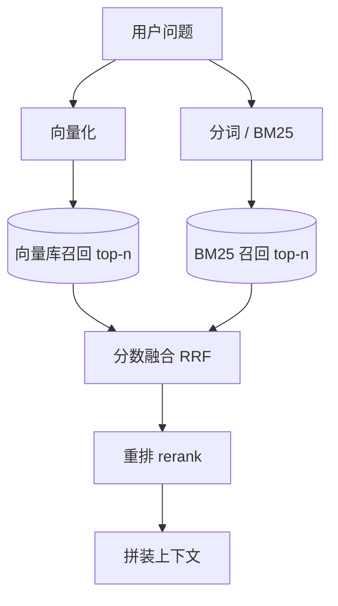

# 第 08 章 Embedding 与向量检索

## 本章目标

读完本章，你应当能够：

1. 说清 Embedding 把文本映射成向量的原理，知道线上 API 模型与本地开源模型各自怎么选；
2. 手写余弦相似度计算，区分余弦相似度、欧氏距离、内积三种距离度量的适用场景；
3. 按规模与运维能力在 numpy 自建库、Chroma、Qdrant、pgvector 之间做选型；
4. 理解混合检索（BM25 关键词 + 向量语义）为什么互补，以及 RRF 融合解决了什么问题；
5. 讲清召回与重排两阶段的分工，知道交叉编码器 rerank 在链路里的位置和代价。

---

## 概念讲解

### 1. Embedding：把文本变成可比较的向量

大模型本身只能处理 token 序列，无法直接衡量「两段话说的是不是一回事」。Embedding（嵌入）模型解决的就是这个问题：它把一段文本映射成一个固定维度的实数向量，使得**语义相近的文本在向量空间里距离更近**。用户问「怎么退款」和工单里写「申请原路退回」字面不同，但在嵌入空间中会被映到相近的方向上，这正是语义检索区别于关键词匹配的根本能力。

工程上最常见的两类来源：

| 来源 | 代表模型 | 特点 |
|---|---|---|
| 云端 API | OpenAI `text-embedding-3-small`（1536 维）、`text-embedding-3-large`（3072 维） | 免部署、维度高、效果稳；按调用量计费，数据需出域，受网络与配额约束 |
| 本地开源 | BGE 系列（`bge-small-zh-v1.5`、`bge-m3`）、m3e、sentence-transformers 系列 | 数据不出内网、可批量离线入库；需自己部署推理服务，中文场景优先选中文优化模型 |

选型时先看语言：中文知识库不要直接套用英文为主的通用模型，优先在中文评测上表现好的开源模型或明确支持中文的 API。再看维度与成本：维度越高，存储和相似度计算越贵，`small` 级别通常已能满足问答场景。最后注意一个容易踩的约束——**入库时用的嵌入模型必须和检索时一致**，不同模型产出的向量不在同一个空间，互相算相似度没有意义；更换嵌入模型必须全量重新入库。

> [!note] 嵌入向量建议做 L2 归一化
> 归一化后向量模长为 1，余弦相似度退化为向量内积，计算更快；很多向量库在写入时也会要求或自动归一化。无论哪条路线，查询向量与文档向量要用同一套归一化方式。

### 2. 相似度怎么算：余弦、欧氏、内积

向量之间的「接近程度」有多种度量，最常用的是余弦相似度：

$$
\cos(A, B) = \frac{A \cdot B}{\lVert A \rVert \cdot \lVert B \rVert}
$$

取值范围在 [-1, 1]：1 表示方向完全一致，0 表示正交（无关），-1 表示方向相反。它只看**方向**，不看模长，因此适合判断「两段话语义是否相近」。

| 度量 | 比较的是什么 | 适用场景 | 注意点 |
|---|---|---|---|
| 余弦相似度 | 向量方向夹角 | 文本语义相似度，RAG 检索的默认选择 | 向量归一化后等价于内积 |
| 欧氏距离 | 向量在空间中的绝对距离 | 特征绝对值有意义的场景（如图像、推荐向量） | 模长差异会直接影响结果 |
| 内积 | 模长与方向的综合乘积 | 向量已归一化、且库只暴露内积接口时 | 未归一化时大模长向量天然占优，不能直接当相似度 |

检索时取相似度最高的 `top-k` 个文档块。`k` 不是越大越好：召回太少可能漏掉分散在多个块里的要点；召回太多会把低相关片段塞进上下文，稀释模型注意力、推高 token 成本。具体取值要结合切分粒度和第 09 章的评测结果定，常见在线取值在 3–10。

### 3. 向量库选型对比

把所有文档向量存起来并支持相似度检索，就是向量库。下面四类方案覆盖了从教学原型到生产系统的典型选择：

| 方案 | 部署形态 | 适合规模 | 优势 | 局限 | 典型场景 |
|---|---|---|---|---|---|
| numpy 自建 | 纯内存矩阵，无服务 | 几千条以内教学原型 | 零依赖、逻辑透明、便于理解原理 | 全量扫描、无持久化、无元数据过滤、不可水平扩展 | 本章示例、算法验证 |
| Chroma | 嵌入式/单机文件库 | 中小规模本地应用 | API 简单、上手快、随进程启动 | 分布式与大规模检索能力弱 | 本地 Demo、单机知识库 |
| Qdrant | 独立服务或托管云 | 中大规模生产 | 支持 payload 过滤、标量/向量索引、量化压缩，生态成熟 | 需要运维服务或接入托管 | 线上 RAG 服务、多租户检索 |
| pgvector | PostgreSQL 扩展 | 已有 PG 栈的中小规模 | 向量与业务数据同库，可用 SQL 做事务与权限过滤 | 超大规模纯向量检索不如专用库 | 内部系统、结构化数据 + 向量混合查询 |

判断顺序可以反过来：先问数据规模和并发，再问是否已有 PostgreSQL 运维能力，最后问是否需要多租户、过滤、权限等企业级特性。原型阶段用 numpy 或 Chroma 把链路跑通，上线前再替换成 Qdrant 或 pgvector，调用方接口保持不变即可。

### 4. 混合检索：关键词与语义互补

纯向量检索有两个短板：一是对**精确词项**不敏感，型号、编号、专有名词（如「订单 88213」「API 2024-10-15」）容易被语义相近的其他条目分散；二是嵌入模型本身没覆盖到的表述可能失配。纯关键词检索（BM25 为代表）正好相反：词项命中强，但用户换个说法就匹配不上。

混合检索（Hybrid Search）把两路结果都召回来再合并：



两路分数量纲不同：BM25 是词频加权得分，向量是余弦相似度，不能直接相加。工程上常用两种融合方式：**加权融合**先把两路分数各自归一化到同一区间再加权；**RRF（Reciprocal Rank Fusion，倒数排名融合）**只看排名，第 `r` 名贡献 `1 / (k + r)`，`k` 是平滑常数。RRF 不依赖原始分数量纲，调参简单，是混合检索的常见默认做法。

### 5. 召回之后：交叉编码器重排

混合检索解决的是「粗召回」：尽量把可能相关的块都捞上来，追求不漏。捞上来的 top-20 到 top-50 条里，相关性参差，直接全量交给生成模型既浪费又干扰。重排（rerank）是第二阶段：用一个更强的相关性模型对「问题 + 候选块」逐条打分，再取最靠前的 3–5 条。

嵌入模型属于**双塔结构**：问题和文档分别编码成向量再算相似度，快但交互不充分；rerank 常用的**交叉编码器（cross-encoder）**把问题和文档拼在一起送进模型，模型能看到两者的逐词交互，打分更准，但每条都要过一次模型，延迟和成本更高。因此分工是：嵌入/BM25 负责广召回，交叉编码器负责精排，只对召回后的小名单做重排。开源可选 BGE 系列 reranker，云端也有对应的重排接口，选型标准与嵌入模型类似：语言匹配、延迟预算、部署方式。

## 实战：可运行源码

示例代码位于仓库 [`examples/ch08-embedding-retrieval/`](https://github.com/thomaslwq/AgentTutorial/tree/main/examples/ch08-embedding-retrieval)，包含两个脚本：`simple_vector_store.py` 用 numpy 手写余弦相似度的最小向量库；`hybrid_retrieval.py` 演示 BM25 + 向量两路召回与 RRF 融合。

### 1. 最小向量库：向量化与余弦排序

`simple_vector_store.py` 的核心是把文档批量嵌入成归一化矩阵，检索时用矩阵乘法一次算出全部余弦相似度，再按分数排序取 top-k：

```python
import numpy as np

def embed_texts(texts: list[str]) -> np.ndarray:
    """批量向量化，返回 L2 归一化后的矩阵，形状 (n, dim)。"""
    resp = client.embeddings.create(model="text-embedding-3-small", input=texts)
    arr = np.array([item.embedding for item in resp.data], dtype=np.float32)
    norms = np.linalg.norm(arr, axis=1, keepdims=True)
    norms[norms == 0] = 1.0
    return arr / norms


@dataclass
class VectorStore:
    documents: list[str] = field(default_factory=list)
    vectors: np.ndarray | None = None

    def add(self, documents: list[str]) -> None:
        new_vecs = embed_texts(documents)
        self.documents.extend(documents)
        if self.vectors is None:
            self.vectors = new_vecs
        else:
            self.vectors = np.vstack([self.vectors, new_vecs])

    def search(self, query: str, top_k: int = 3) -> list[tuple[float, str]]:
        query_vec = embed_texts([query])[0]
        scores = self.vectors @ query_vec  # 已归一化，内积即余弦相似度
        order = np.argsort(-scores)[:top_k]
        return [(float(scores[i]), self.documents[i]) for i in order]
```

> [!warning] 离线兜底向量不等于真实语义嵌入
> 仓库示例在未配置 `OPENAI_API_KEY` 时退化为哈希词袋向量，仅用于在无网环境跑通排序逻辑；它只记录词项是否出现，不具备语义相似度能力。教学和评测结论请基于真实嵌入模型得出。

### 2. 混合检索：BM25 召回 + RRF 融合

`hybrid_retrieval.py` 先实现一个轻量 BM25（IDF、词频饱和、文档长度归一化），再与向量路各自召回 top-n，最后用 RRF 按排名融合：

```python
def rrf_fuse(rank_lists: list[list[int]], n: int, k: int = 60) -> np.ndarray:
    """RRF：每路召回按排名给分，排名越靠前贡献越大；不依赖原始分数量纲。"""
    scores = np.zeros(n, dtype=np.float64)
    for ranks in rank_lists:
        for rank, idx in enumerate(ranks):
            scores[idx] += 1.0 / (k + rank + 1)
    return scores


class HybridRetriever:
    def __init__(self, docs: list[str], top_k: int = 5, recall_k: int = 10):
        self.docs = docs
        self.top_k = top_k
        self.recall_k = recall_k
        self.bm25 = BM25(docs)
        self.store = VectorStore()
        self.store.add(docs)

    def retrieve(self, query: str) -> list[tuple[float, str]]:
        vector_hits = self.store.search(query, top_k=self.recall_k)
        vector_ranks = [self.docs.index(doc) for _, doc in vector_hits]
        bm25_ranks = self.bm25.rank(query, top_k=self.recall_k)

        fused = rrf_fuse([vector_ranks, bm25_ranks], n=len(self.docs))
        order = np.argsort(-fused)[: self.top_k]
        return [(float(fused[i]), self.docs[i]) for i in order]
```

运行方式与预期输出见示例目录的 `README.md`：带编号的查询由 BM25 路顶到前面，纯语义改写由向量路命中，RRF 分数只用于排名，不代表相似度绝对值。

## 动手练习

1. **跟做**：在配置与不配置 `OPENAI_API_KEY` 两种情况下分别运行 `simple_vector_store.py`，对比语义改写类问题的命中差异，体会嵌入模型语义能力对检索质量的影响。
2. **改造**：把 `VectorStore.search` 的 `top_k` 从 3 调到 5，观察尾部文档的得分变化，思考 top-k 过大对上下文成本和注意力的影响。
3. **辨析**：对「订单 88213 物流状态」这类带编号的查询，纯向量检索和 BM25 各自的短板是什么？混合检索如何互补？

> 练习参考答案见 `examples/ch08-embedding-retrieval/README.md`。

## 本章小结

- Embedding 把文本映成向量，语义相近则向量相近；选型看语言匹配、维度成本、部署方式，且入库与检索必须用同一模型。
- 余弦相似度衡量方向接近程度，归一化后等价于内积；欧氏距离看绝对距离，内积受模长影响。
- 向量库按规模与运维能力选择：numpy 自建用于原型，Chroma 适合单机，Qdrant 面向生产，pgvector 复用已有 PostgreSQL 栈。
- 混合检索用 BM25 保精确词项、向量保语义改写，两路分数量纲不同，用 RRF 或归一化加权融合。
- 召回求广、重排求精：嵌入/BM25 粗召回，交叉编码器对小名单精排，以延迟换取相关性。

## 思考题

1. 如果知识库每隔几天就更新一批文档，嵌入模型也升级了版本，入库流程需要做哪些处理？为什么不能只追加新文档？
2. RRF 只使用排名而丢弃原始分数，在什么情况下这种做法会吃亏？是否存在某一路召回明显更强、应当给更高权重的场景？
3. 交叉编码器重排更准但更慢，线上延迟受限时，你会怎样在召回数量、重排数量和最终上下文长度之间做取舍？

---

下一章：[第 09 章 RAG 增强技术与评测](ch09-rag-advanced-eval.md)
