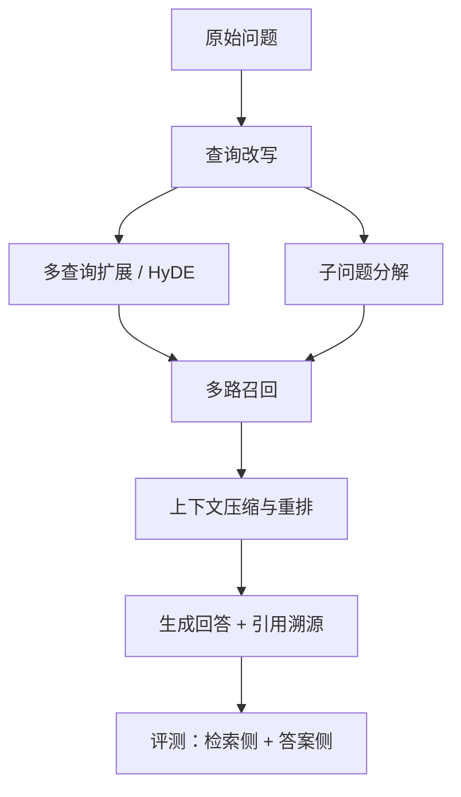

# 第 09 章 RAG 增强技术与评测

## 本章目标

读完本章，你应当能够：

1. 说清查询改写、多查询扩展、HyDE、子问题分解四种查询增强策略各自解决什么问题；
2. 理解上下文压缩与重排在召回之后的作用，知道怎样把带溯源信息的片段交给生成模型；
3. 掌握 RAG 检索侧指标（召回率、命中率、MRR）的计算口径，区分检索侧与答案侧评测；
4. 了解 RAGAS 一类框架评测哪些维度，能动手构造一份可回归对比的手工评测集；
5. 用纯标准库脚本算出 Hit@k、Recall@k 与 MRR，不依赖安装重评测框架。

---

## 概念讲解

### 1. 查询侧增强：问题先处理再检索

用户提问往往口语化、有指代、信息不全，直接拿去检索容易失配。查询侧增强在召回之前先把问题加工成更适合检索的形态，常见有四种策略。

**查询改写（Rewrite）**：把口语、省略、指代补全成规范检索式。例如用户说「它什么时候到的」，结合上下文改写为「订单 88213 的物流送达时间」。改写去除冗余词，保留核心实体与限定条件，让嵌入和 BM25 都更容易命中。

**多查询扩展（Multi-Query）**：围绕同一意图生成多条表述不同的查询，分别检索，再把各路结果合并去重。用户的说法千变万化，单条查询只覆盖一种表述，多条同义查询能抬高召回率。代价是嵌入与检索次数成倍增加，通常取 2–3 条即可。

**HyDE（Hypothetical Document Embeddings）**：先让模型针对问题写一段假设性参考答案，再用这段答案文本去做向量检索。问题是简短的，答案文本是陈述性的，与知识库文档的文体更接近；即便假设答案里有细节错误，其语义方向仍能把检索引向正确区域。

**子问题分解（Sub-question Decomposition）**：面对「差旅报销有哪些审批步骤、发票有什么要求」这类复合问题，先拆成可独立检索的子问题，逐个召回、逐个回答，最后再汇总成完整答案。它适合多要点、多章节的复杂提问，也便于在答案里标注每个结论的出处。



### 2. 上下文压缩与重排

召回环节求广，拿到的候选块里既有相关内容也有冗余：同一段事实可能在相邻块重复出现，一个块里只有一句话与问题有关，其余是背景。直接把整段塞进上下文会浪费窗口、稀释注意力。

**上下文压缩**在重排前后做减法：抽取块内与问题相关的句子、去掉重复表述、合并同义内容，只保留支撑答案所必需的信息。压缩可以用规则（按词项重合度截取句子），也可以交给模型做语句级提炼。**重排**则是上一章讲的交叉编码器精排：对候选逐条打相关性分，把最相关的排到前面。两者配合的典型链路是：多路召回 top-20~50 → 重排取 top-5~10 → 压缩到最终上下文长度。

### 3. 引用溯源：让每条结论可回溯

RAG 相比纯参数生成的一个核心优势是可溯源。上下文拼装时，每个块都应保留来源元数据（文档名、章节、编号），并在上下文中编号；生成回答时要求模型按编号引用，例如「差旅申请需部门负责人审批〔资料 2〕」。这样最终答案里的每条事实都能回溯到具体片段，便于人工核对，也为答案忠实度检查留下依据。

> [!warning] 溯源不能只靠 Prompt 自觉
> 要求模型「标注引用」只是第一道约束。工程上还应在生成后校验：答案中的结论是否能在引用块中找到依据；引用编号是否真实存在；模型是否回答了资料之外的内容。第 13 章的可观测性会把这些校验落到日志与指标里。

### 4. 评测指标：先分检索侧与答案侧

RAG 链路长，单看最终回答容易说不清问题出在哪。评测要分两层：检索侧看「找得对不对、全不全、靠前不靠前」，答案侧看「答得忠不忠实、切不切题」。

**检索侧指标**（可用标注数据纯计算）：

| 指标 | 口径 | 衡量什么 |
|---|---|---|
| Recall@k（召回率） | 前 k 条中命中的相关文档数 / 全部相关文档数 | 相关信息被覆盖得全不全 |
| Hit@k（命中率） | 前 k 条至少命中一条相关文档的用例占比 | 这道题有没有找到可作答的资料，不要求命中几条 |
| MRR（平均倒数排名） | 每条用例第一条相关文档排名的倒数，再取平均 | 相关文档排得够不够靠前 |

**答案侧指标**（通常需要模型评判或人工标注）：

- **忠实度（Faithfulness）**：答案中的陈述是否都能由检索到的上下文支撑，是否存在脱离资料的编造；
- **答案相关性（Answer Relevance）**：回答是否切题，有没有答非所问、堆砌无关内容；
- **上下文精确率 / 上下文召回**：交给模型的片段里有多少真正相关，该相关的片段有没有交上来。

**RAGAS** 是一类常用的 RAG 自动评测框架，把上述答案侧与上下文侧维度固化成可计算的指标，配合评测集批量跑分。它属于重依赖框架，本地示例不安装；理解其指标划分后，接入方式与第 13 章的线上评测对齐。

> [!note] 召回率高不等于答案好
> 相关文档被召回只是必要条件。块被切散、无关片段混入、模型脱离资料自由发挥、子问题答案未正确汇总，都会让答案变差。因此调优时先看检索侧指标定位召回问题，再看答案侧指标定位生成问题，两层不能互相替代。

### 5. 手工评测集怎么构造

自动化指标再全，也要先有一份可信的标注评测集。构造方法如下：

1. **收集真实问题**：从客服工单、搜索日志、对话记录里抽样，覆盖高频问法、口语化表达和边缘案例，而不是自己凭空造句；
2. **标注金标准文档**：为每个问题标出正确答案对应的文档块 id（可多块），作为 Recall、Hit、MRR 的参照；
3. **定答案评判标准**：写清忠实度与相关性的判定规则，例如「结论必须出现在引用块中」「不回答资料外内容」，必要时人工写参考答案；
4. **分层抽样**：按问题类型、业务板块、难度分层，保证样本覆盖主要场景；评测集规模从几十条起步，够用即可，重在可回归；
5. **版本回归对比**：每次调整切分、嵌入、检索或 Prompt 后，用同一套评测集重跑，对比指标变化，避免凭感觉调参。

评测集本身也要随业务演进补充：线上出现的答错案例应回流进评测集，形成「发现问题 → 标注 → 回归验证」的闭环。

## 实战：可运行源码

示例代码位于仓库 [`examples/ch09-rag-advanced-eval/`](https://github.com/thomaslwq/AgentTutorial/tree/main/examples/ch09-rag-advanced-eval)：`query_rewrite.py` 演示四类查询增强，`rag_eval.py` 用纯标准库计算检索侧指标。

### 1. 查询增强的四个策略

`query_rewrite.py` 把每种策略封装成独立函数：改写返回一条规范查询，多查询返回同义列表，HyDE 返回假设答案文本，子问题分解返回子问题列表。配置 `OPENAI_API_KEY` 时走聊天模型，未配置时返回原始查询兜底，保证控制流可跑通：

```python
def expand_multi_query(query: str, n: int = 3) -> list[str]:
    """多查询扩展：同一意图的多种表述，分别召回后合并去重。"""
    fallback = [query]
    if _client is None:
        return fallback
    system = (
        f"围绕用户问题生成 {n} 条表述不同但意图相同的检索查询，覆盖同义说法与不同侧重。"
        '输出 JSON 对象：{"queries": ["...", "..."]}。'
    )
    data = _load_json(_chat(system, query), {})
    queries = data.get("queries")
    return queries if isinstance(queries, list) and queries else fallback


def hyde(query: str) -> str:
    """HyDE：生成假设性参考答案，用这段文本参与向量检索。"""
    if _client is None:
        return query
    system = (
        "你是一名知识库助手。针对用户问题，先写一段简短的假设性参考答案，"
        "即使细节不确定也按最合理的方式写出；这段文本将用于向量检索。直接输出答案文本。"
    )
    return _chat(system, query).strip()
```

子问题分解与多查询扩展一样要求模型输出 JSON，解析失败时回退到原始问题，避免格式异常中断链路。

### 2. 检索侧指标纯计算

`rag_eval.py` 不依赖 ragas 或任何第三方库，用标准库实现三个指标。数据结构把相关文档 id 集合和按排名排序的召回列表分开存放：

```python
@dataclass
class EvalCase:
    query: str
    relevant_ids: set[str]          # 金标准：相关文档 id 集合
    retrieved_ids: list[str]         # 检索结果，按相关度降序


def recall_at_k(case: EvalCase, k: int) -> float:
    if not case.relevant_ids:
        return 0.0
    hit = len(set(case.retrieved_ids[:k]) & case.relevant_ids)
    return hit / len(case.relevant_ids)


def hit_at_k(cases: list[EvalCase], k: int) -> float:
    if not cases:
        return 0.0
    hits = sum(1 for c in cases if set(c.retrieved_ids[:k]) & c.relevant_ids)
    return hits / len(cases)


def reciprocal_rank(case: EvalCase) -> float:
    for rank, doc_id in enumerate(case.retrieved_ids, start=1):
        if doc_id in case.relevant_ids:
            return 1.0 / rank
    return 0.0


def mrr(cases: list[EvalCase]) -> float:
    if not cases:
        return 0.0
    return sum(reciprocal_rank(c) for c in cases) / len(cases)
```

内置 5 条标注用例，运行后打印 `Hit@1`、`Hit@3`、`Recall@3`、`MRR` 与逐条明细。未命中相关文档的用例倒数排名为 0，会直接拉低 MRR，这也是回归对比时最容易暴露的退化案例。

## 动手练习

1. **跟做**：运行 `rag_eval.py`，记录当前 Hit@1、Hit@3、MRR；把最后一条未命中用例的召回列表改为相关文档排第一，重跑观察各指标变化。
2. **改造**：取 `expand_multi_query` 返回的多条查询，分别送入第 08 章的 `HybridRetriever` 检索，按文档 id 合并分数、去重截断，对比单查询的召回覆盖。
3. **辨析**：为什么召回率高不能保证答案质量？结合上下文压缩、忠实度和子问题汇总，列出至少三个可能的断点。

> 练习参考答案见 `examples/ch09-rag-advanced-eval/README.md`。

## 本章小结

- 查询侧增强有四类：改写规范检索式、多查询扩展开覆盖、HyDE 用假设答案检索、子问题分解逐个作答再汇总。
- 召回之后先压缩去冗余、再交叉编码器精排；上下文块保留来源元数据，生成时按编号引用，实现可溯源。
- 评测分两层：检索侧用 Recall@k、Hit@k、MRR 纯计算；答案侧看忠实度、答案相关性，RAGAS 一类框架把这些维度固化成自动指标。
- 手工评测集来自真实问题抽样，标注金标准文档与评判规则，分层抽样、版本回归；线上答错案例要回流补充。
- 检索命中只是答案正确的必要条件，两层指标分别定位召回问题与生成问题，不能互相替代。

## 思考题

1. 多查询扩展抬高了召回率，也增加了嵌入和检索成本。你会根据什么信号决定一个场景要不要开多查询？查询条数取多少合适？
2. HyDE 生成的假设答案可能包含错误细节，为什么这些错误通常不会把检索带偏？在什么类型的问题上 HyDE 反而容易失效？
3. 如果评测显示检索侧指标都很好、但答案忠实度偏低，问题更可能出在上下文拼装、Prompt 约束还是生成模型本身？你打算怎样逐步定位？

---

下一章：[第 10 章 任务规划与自我反思](../module-03-planning-multiagent/ch10-planning-reflection.md)
