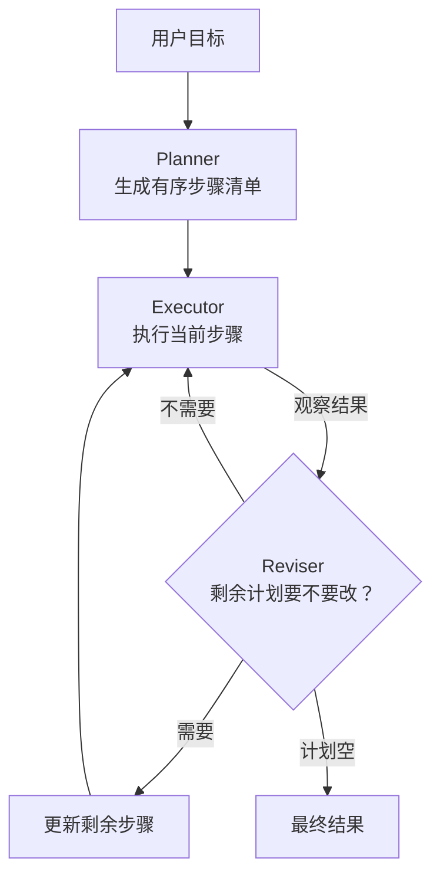
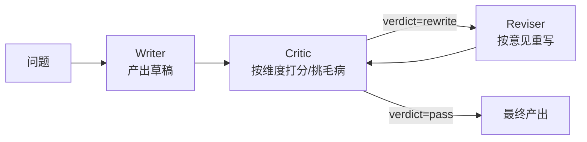

# 第 10 章 任务规划与自我反思

## 本章目标

读完本章，你应当能够：

1. 说清 ReAct 循环在面对长任务时的两个失效模式——「走一步看一步」的短视和「没有事后复盘」的硬扛；
2. 手写一个 Plan-and-Execute 循环，区分 Planner、Executor、Reviser 三个角色各自负责什么；
3. 用 Reflection/Reflexion 三段式（草稿 → 自评 → 重写）改进一次产出，并理解它和 ReAct 的差别；
4. 知道树形（ToT）与图式规划（Graph/TODO）大致在解决什么问题，能在选型时判断要不要上它们；
5. 能在团队评审中一句话说出「这个任务该不该先规划再动手」。

---

## 1. 为什么需要规划：ReAct 的两个失效点

第 05 章的 ReAct 循环是「思考 → 行动 → 观察 → 再思考」。它在大多数短任务上工作良好，但任务一长就会暴露两个问题。

**第一，短视。** ReAct 每一步只基于「当前观察」决定下一步，没有全局路线。遇到一个 10 步的任务，模型可能第 3 步就拐到一条看似有效、实则偏离目标的支路上去，并且因为没有「计划」这面镜子，它不会意识到自己已经偏了。

**第二，硬扛。** 同一段循环里，模型既要想下一步、又要执行、还要评估结果好不好。当它产出一份质量不佳的回答时，它没有一个「跳出来批评自己」的独立视角——自己写的自己看，盲区很难被发现。

规划型 Agent 就是给这两个失效点分别打补丁：

- **Plan-and-Execute**：先在动手之前把目标拆成步骤清单，再逐步执行；执行中根据观察动态修订剩余计划。对应「短视」。
- **Reflection / Reflexion**：在产出之后，用一个独立的 Critic 角色按维度打分、提意见，再让 Writer 按意见重写。对应「硬扛」。

这两个补丁可以单独用，也可以叠在一起——生产系统里经常叠在一起：先规划，每步做完再反思一下质量。

## 2. Plan-and-Execute：先画图，再走路



注意这个循环和 ReAct 的差别：

- ReAct 里「下一步做什么」和「执行」是同一个模型在同一轮里决定的；Plan-and-Execute 把「决定整体路线」和「走当前这一步」拆给了两次独立的调用，Planner 看到的是**全局目标**，Executor 看到的是**当前这一步**。
- 计划不是一次性写死的。`Reviser` 在每一步执行完之后被调用，根据观察结果决定剩余步骤要不要增、删、合并、换顺序。这是它能适应真实世界反馈的关键——否则就退化成「先写死一个 TODO 再机械执行」，比普通脚本还脆弱。

> [!note]
> 计划清单要落在代码里，而不是只在 Prompt 里口头说一声。代码里维护一个 `list[str]`，每执行完一步 `pop(0)`，这样循环终止条件、成本统计、日志都有抓手。

### 2.1 手写一个最小循环

示例代码位于 [`examples/ch10-planning-reflection/plan_execute.py`](https://github.com/thomaslwq/AgentTutorial/tree/main/examples/ch10-planning-reflection)。下面是核心三段：

```python
def plan(goal: str) -> list[str]:
    """Planner：一次性产出初始计划。"""
    resp = client.chat.completions.create(
        model="gpt-4o-mini",
        messages=[
            {"role": "system", "content": PLANNER_PROMPT},
            {"role": "user", "content": goal},
        ],
        response_format={"type": "json_object"},
        temperature=0,
    )
    return json.loads(resp.choices[0].message.content)["steps"]


def execute(step: str) -> str:
    """Executor：真实项目里这里是一组工具；本示例用一次 LLM 调用顶替。"""
    resp = client.chat.completions.create(
        model="gpt-4o-mini",
        messages=[{"role": "user", "content": f"请用一句话完成这一步：{step}"}],
        temperature=0.3,
    )
    return resp.choices[0].message.content.strip()


def revise(remaining: list[str], observation: str) -> list[str]:
    """Reviser：基于上一步的观察，决定剩余计划要不要改。"""
    ...
```

跑起来之后，你会在终端看到这样的节奏：先打印一份 3-6 步的初始计划，然后每一轮打印「执行了哪一步、观察到什么、修订后的剩余计划是什么」，直到计划清空或达到 `max_rounds`。

> [!warning]
> 这个示例里的 Executor 用一次 LLM 调用顶替，是为了让你不装任何工具也能跑通控制流。**生产代码里 Executor 必须是一组具体工具**（搜索、写文件、调 API），让 LLM 既当规划器又当干活的人，token 成本和延迟都会爆炸。

### 2.2 工程上的几个坑

- **Planner 拆得太粗**：比如「调研竞品」「写方案」这种步骤，Executor 根本没法独立执行。Prompt 里要明确要求「每一步必须是原子动作」。
- **Reviser 改得太勤**：模型每步都想改计划，结果计划在风中飘。实践上要么让 Reviser 只在「观察明显偏离预期」时才动手，要么加一个「计划冻结期」（前 N 步不许改）。
- **没有预算上限**：`max_rounds` 不是成本上限，token 才是。生产里要在每轮累加 `usage.total_tokens`，超预算立即停。

## 3. Reflection / Reflexion：跳出来批评自己

Plan-and-Execute 解决的是「路线」问题，Reflection 解决的是「质量」问题。它的形态非常朴素：



关键在 **Critic 是一个独立调用**，它和 Writer 不是同一个上下文。同一个模型既当运动员又当裁判时，盲区很难被自己识别；哪怕 Prompt 完全一样，「以审稿人身份」和「以写作者身份」两次调用产生的输出也会显著不同。这是 Reflection 论文里被反复验证的现象。

示例代码 [`examples/ch10-planning-reflection/reflection_loop.py`](https://github.com/thomaslwq/AgentTutorial/tree/main/examples/ch10-planning-reflection) 把这个三段式完整跑了一遍：

```python
def critique(question: str, draft_text: str) -> str:
    resp = client.chat.completions.create(
        model="gpt-4o-mini",
        messages=[
            {"role": "system", "content": CRITIQUE_INSTRUCTION},
            {"role": "user", "content": f"问题：{question}\n草稿：{draft_text}"},
        ],
        response_format={"type": "json_object"},
        temperature=0,
    )
    return resp.choices[0].message.content
```

Critic 的 Prompt 里最关键的是两件事：**给出具体的评审维度**（事实准确性、结构清晰度、是否切题），以及**强制输出结构化 verdict**（`pass` / `rewrite`）。没有维度的 Critic 只会说「写得不错，可以更好」这种废话。

### 3.1 Reflection 不是「多调几次」

新手容易把 Reflection 理解成「让同一个问题多调几次、挑最好的」。那叫采样投票（best-of-N），不是 Reflection。

- Best-of-N：独立采样 N 个答案，挑一个；**没有反馈回路**，每个答案都是一次盲产。
- Reflection：**后一次调用显式看到了前一次的产出和审稿意见**，是基于反馈的重写。

两者可以组合（先 Reflection 一轮，再采样两次挑最好的），但别混淆。

## 4. 与 ReAct 对比

| 维度 | ReAct | Plan-and-Execute | Reflection / Reflexion |
|---|---|---|---|
| 控制流 | 思考→行动→观察，循环到结束 | 先出计划清单，逐步执行，可修订 | 产出→自评→重写，循环到通过 |
| 谁决定下一步 | 当前这一轮的模型 | Planner（全局）+ Reviser（动态） | Critic（质量裁决） |
| 主要解决 | 工具调用、事实查证 | 长任务的路线与偏航 | 单次产出的质量与盲区 |
| 典型成本 | 每轮都要 LLM 决策 | 多一次 Planner/Reviser 调用 | 多一轮 Critic + Reviser |
| 失败模式 | 走偏了不自知 | 计划拆错、反复修订 | Critic 与 Writer 同质化 |
| 适合任务 | 2-5 步的工具型任务 | 10 步以上的长任务 | 写作、代码、评审类产出 |

一句话：**ReAct 是「边想边做」，Plan-and-Execute 是「先想清楚再做、边做边调整」，Reflection 是「做完回头看、不满意就重写」。** 三者不互斥，生产系统经常三者叠用。

## 5. 树形与图式规划：什么时候要升级

Plan-and-Execute 的计划是一条**线性清单**——它假设任务可以排成一个有序序列。但有些任务天然带分支和回溯，比如写一段代码：第一条路跑不通，要回退到上一个决策点换方案。这时候线性清单就不够用了。

- **Tree-of-Thoughts（ToT）**：把规划展开成一棵树，每个节点是一个「中间状态 + 候选下一步」，模型评估几条候选分支、挑最有希望的继续走，必要时回溯。适合数学题、创意写作这种「多条路并行、最后选最好的」的场景。代价是 token 成本指数级上涨，不适合日常业务。
- **图式规划（Graph / TODO-style）**：把计划建模成一张有向图，节点是子任务，边是依赖关系；可以并行、可以条件分支。LangGraph（第 12 章）就是这种思路的工程化——节点是函数/Agent，边是转移条件，状态在图上流动。
- **LLMCompiler / Plan-and-Solve 类**：把「生成计划」本身当成一个一次成型的编译器步骤，再按依赖调度执行。

> [!note]
> 对绝大多数业务 Agent，线性 Plan-and-Execute 已经够用。ToT 和图式规划是「把简单问题复杂化」和「真的需要分支与回溯」之间的分水岭——只有当你的任务确实存在「并行子任务」或「失败要换路」时，升级才划算。

## 6. 实战：跑通两个示例

完整代码在 [`examples/ch10-planning-reflection/`](https://github.com/thomaslwq/AgentTutorial/tree/main/examples/ch10-planning-reflection)：

```bash
export OPENAI_API_KEY=sk-...
pip install -r requirements.txt

python plan_execute.py        # 看 Planner/Executor/Reviser 三段分工
python reflection_loop.py     # 看 草稿 → 审稿 → 重写 的一轮闭环
```

跑完之后建议做一件事：把同一个目标分别用纯 ReAct（第 05 章的循环）和 Plan-and-Execute 跑一遍，对比最终产出长度、轮次数和 token 用量。你会直观看到「先规划」在长任务上省下来的是什么。

## 动手练习

1. **加预算**：在 `plan_execute.py` 的 `run()` 里加一个 `token_budget` 参数，每轮累加 `usage.total_tokens`，超预算立即停。
2. **闭环化**：把 `reflection_loop.py` 末尾固定重写改成「解析 `verdict`，pass 就直接输出，否则重写；最多重写 3 次」。
3. **换 Executor**：把 `execute()` 从一次 LLM 调用替换成一个真实工具（比如本地 `open()` 写文件），观察 Planner 的 Prompt 要不要跟着改。

> 练习参考答案见 [`examples/ch10-planning-reflection/README.md`](https://github.com/thomaslwq/AgentTutorial/tree/main/examples/ch10-planning-reflection/README.md)。

## 本章小结

- ReAct 在长任务上有两个失效点：短视（没有全局路线）和硬扛（没有独立评审）。
- Plan-and-Execute 用「Planner + Executor + Reviser」三段式打补丁：先拆清单、逐步执行、动态修订。
- Reflection 用「Writer + Critic + Reviser」打另一个补丁：独立视角审稿、按意见重写。
- 三者不是替代关系，生产系统经常叠用；ToT 和图式规划只在真有分支/并行需求时才升级。
- 规划不是一次性产物：计划要落在代码里的 `list` 或图上，循环要带成本预算。

## 思考题

1. 如果 Planner 一开始就把目标拆错了，Reviser 能救回来吗？在什么情况下救不回来？（提示：想想「目标本身被误解」和「路线选错」的差别。）
2. Reflection 的 Critic 如果和 Writer 用同一个 Prompt、同一个 temperature，还能产生有价值的审稿意见吗？为什么？
3. 你手上有没有一个真实任务，是「先规划再动手」明显比「直接干」更划算的？是哪一类信号让你这么判断的？

---

下一章：[第 11 章 多智能体协作](ch11-multi-agent.md)
