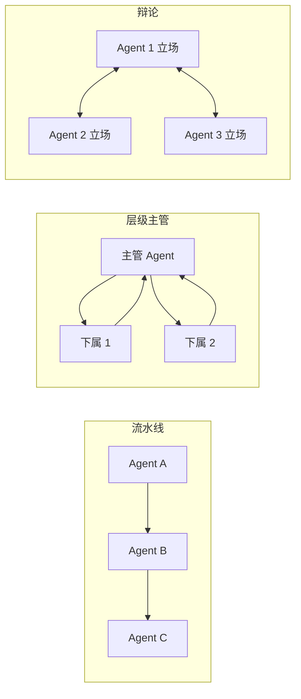

# 第 11 章 多智能体协作

## 本章目标

读完本章，你应当能够：

1. 说清多智能体系统解决的真问题是什么，以及「什么时候不要上多 Agent」的判断标准；
2. 讲出 CrewAI 的角色（Agent）、任务（Task）、流程（Crew/Process）三件套各自负责什么；
3. 写出一个 researcher → writer → reviewer 三角色流水线的最小可运行 demo；
4. 对比 CrewAI 的「声明式角色任务」范式和 AutoGen 的「会话式协商」范式，知道各自适合什么；
5. 识别三种常见协作模式（流水线、层级主管、辩论）的形态与代价；
6. 理解消息传递与状态共享在多 Agent 系统里的工程含义，知道为什么「共享一份全局状态」不是免费的。

---

## 1. 多智能体解决的真问题

第 10 章把「规划」和「反思」加到了单个 Agent 身上。但单个 Agent 无论怎么加循环，都有一个绕不开的限制：**它的上下文窗口和角色定位是单一的**。

- 让一个 Agent 同时做「调研、写稿、审稿」，它在写稿时很难切到「挑刺模式」——这和上一章说的「自己写的自己看不出盲区」是同一个问题。
- 让一个 Agent 同时管「搜索、写文件、发邮件」，它的系统提示会被三种角色互相污染，工具列表越长，乱调的概率越高。
- 当任务天然能拆成「谁负责什么、谁把结果交给谁」时，用代码硬写一个状态机，会比让模型临场决定更可控。

多智能体系统就是把一个大任务拆给多个**角色独立、上下文独立**的 Agent，由它们之间通过消息或共享状态协作完成。每个 Agent 只带自己需要的工具和 Prompt，上下文更干净，行为更可预测。

但这里要先泼一盆冷水。

## 2. 反模式：什么时候不要上多 Agent

多 Agent 这几年被过度包装，很多团队把它当成「更高级的 Agent」来用。下面这些信号出现时，**单 Agent + 良好的 Prompt 和工具集**几乎总是更好的选择：

- **任务一步就能完成**：比如「总结这段文本」。拆两个 Agent（一个总结、一个审稿）只会多烧一倍 token，质量提升有限。
- **流程是固定的**：「查订单 → 退款 → 发邮件」这种三步顺序，直接写代码调用函数比让两个 Agent 对话可靠得多。
- **沟通成本高于分工收益**：两个 Agent 之间每传一次消息就是一次 LLM 调用。如果你的任务总共就三四步，光「打招呼、交接、确认」就吃掉一半预算。
- **你想不出每个角色独立的工具集**：如果 researcher 和 writer 用的是同一批工具、同一个模型，那它们只是同一个 Agent 的两个名字。
- **需要强一致/可审计**：多 Agent 之间的对话链越长，越难复盘「谁在哪一步做了什么决定」。财务、合规、医疗场景慎用。

> [!warning]
> 判断标准很简单：**任务是否真的需要「不同角色在不同上下文里各自工作，再把结果汇总」？** 不是，就别拆。多 Agent 不是目标，是手段。

## 3. 协作模式的三种典型形态



- **流水线（Sequential Pipeline）**：输出按固定顺序传递，上游的产出是下游的输入。最简单、最可控，也是 CrewAI 默认的 `Process.sequential`。适合「调研 → 写作 → 审稿」这种线性工作。
- **层级主管（Hierarchical）**：一个主管 Agent 负责分派任务、汇总结果，下属只干活不决定下一步。灵活，但主管的 Prompt 设计难度大，调试成本高。CrewAI 提供 `Process.hierarchical` + `manager_llm`，AutoGen 的 GroupChat + Manager 也是这一类。
- **辩论（Debate / Multi-vote）**：多个 Agent 各自从不同立场出发，互相质疑，最后由一个裁决者综合。适合「需要权衡多方案」的决策场景（要不要上这个技术选型、这个设计有没有漏洞）。代价是 token 翻几倍，结论不一定更对。

## 4. CrewAI 范式：角色、任务、流程

CrewAI 是目前「声明式多 Agent」的代表。它的核心抽象就三件套：

1. **Agent（角色）**：声明 `role / goal / backstory`，挂一组工具、一个 LLM。**不写控制流**——这是它和 AutoGen 最大的差别。
2. **Task（任务）**：声明 `description / expected_output / agent`，用 `context=[...]` 显式依赖前序任务的产出。
3. **Crew（流程）**：把 Agent 列表和 Task 列表组装起来，选一个 `Process`（sequential 或 hierarchical），`kickoff()` 一把跑完。

下面是一个最小可运行 demo，完整代码在 [`examples/ch11-multi-agent/crew_demo.py`](https://github.com/thomaslwq/AgentTutorial/tree/main/examples/ch11-multi-agent)：

```python
from crewai import Agent, Task, Crew, Process, LLM

llm = LLM(model="openai/gpt-4o-mini")

researcher = Agent(
    role="资深研究员",
    goal="围绕用户主题归纳 3 个关键事实要点",
    backstory="你擅长从公开常识中快速抓住要点，只列事实、不抒情。",
    llm=llm,
    allow_delegation=False,
)

writer = Agent(
    role="技术文案",
    goal="基于研究要点写一段 200 字以内的中文短评",
    backstory="你写东西直接、克制，不堆形容词。",
    llm=llm,
    allow_delegation=False,
)

reviewer = Agent(
    role="审稿人",
    goal="检查短文是否切题、是否与研究要点一致",
    backstory="你只看成品，不重写；结论必须是一行。",
    llm=llm,
    allow_delegation=False,
)

t1 = Task(
    description="围绕主题「{topic}」列出 3 个关键事实要点。",
    expected_output="一个 markdown 无序列表，3 条要点，每条不超过 30 字。",
    agent=researcher,
)
t2 = Task(
    description="基于上一步的要点，写一段 200 字以内的中文短评。",
    expected_output="200 字以内的短评正文，不要标题。",
    agent=writer,
    context=[t1],
)
t3 = Task(
    description="审稿：判断短文是否切题、事实是否与要点一致。",
    expected_output="一行结论：通过 / 打回：<原因>。",
    agent=reviewer,
    context=[t2],
)

crew = Crew(
    agents=[researcher, writer, reviewer],
    tasks=[t1, t2, t3],
    process=Process.sequential,
)

result = crew.kickoff(inputs={"topic": "为什么团队应该优先写文档"})
```

跑起来之后你会看到：三个角色依次被调用，`t2` 的 `context=[t1]` 让 writer 自动拿到 researcher 的要点，`t3` 拿到 writer 的短文。**没有一行手写的「把 A 的输出塞进 B 的 Prompt」**——这就是声明式框架的价值。

但它的边界也很明显：CrewAI 原生不支持「审稿打回 → 重写 → 再审稿」这种循环。你要么在 Task 描述里硬塞「如果不满意就自己改到满意」，要么退回到代码层自己控循环（第 12 章 LangGraph 就是干这个的）。

> [!note]
> CrewAI 基于 litellm，`LLM(model="openai/gpt-4o-mini")` 这种带 provider 前缀的写法会自动从环境变量读 `OPENAI_API_KEY`（以及兼容服务的 `OPENAI_BASE_URL`）。不要在代码里硬编码 key。

## 5. AutoGen 范式：会话式协商

AutoGen 走的是另一条路：**把多 Agent 系统建模成一个可对话的群聊**。每个 Agent 是一个能收发消息的参与者，由一个 `GroupChatManager`（或人工）决定下一个说话的是谁。

```python
# 伪代码示意，不是可运行片段——只为说明范式差异
conversable.reviewer.send(
    message="请根据以下短文审稿：...",
    recipient=conversable.writer,
    request_reply=True,
)
```

- **CrewAI**：你描述「谁、做什么、产出什么」，框架负责调度。
- **AutoGen**：你描述「谁和谁说话、什么时候说」，框架提供消息总线。

| 维度 | CrewAI | AutoGen |
|---|---|---|
| 抽象 | 角色 + 任务 + 流程 | 可对话的 Agent + 群聊 |
| 控制流 | 声明式（Task 的 context 决定顺序） | 会话式（消息驱动下一步） |
| 适合 | 流水线型工作流、内容生产 | 多轮协商、辩论、工具协商 |
| 可预测性 | 高（顺序固定） | 中（下一个说话者由 manager 决定） |
| 调试难度 | 低 | 中高（消息链长） |
| 典型用户 | 业务工程师、内容生产 | 研究型任务、复杂多轮协商 |

> [!warning]
> 这两个框架不是「谁更先进」的关系。**流水线任务用 CrewAI，协商/辩论任务用 AutoGen，需要精细控制循环和状态的回到 LangGraph（第 12 章）**——这是工程上比较稳的分工。

## 6. 消息传递与状态共享

多 Agent 之间协作，本质上就是两种数据通路：

- **消息传递（Message Passing）**：上游把产出作为一条消息发给下游。CrewAI 的 `context=[t1]`、AutoGen 的 `send()` 都是这种。优点是边界清晰、好审计；缺点是消息一多，上下文会重复堆积。
- **共享状态（Shared State）**：所有 Agent 读写同一份数据结构（一份 dict、一个数据库、一个黑板）。优点是不必每个字段都当消息传；缺点是并发写入要加锁、字段含义要靠人约定，调试时容易「这个字段是谁改的」。

工程上一个稳妥的做法是**消息为主、状态为辅**：每个 Task 只关心自己的输入消息，全局需要跨轮次保留的东西（比如最终草稿、审稿历史）放进一份显式 state，由框架或你自己维护。第 12 章 LangGraph 的状态图就是把这件事做成一等公民。

## 7. 实战：跑通 CrewAI demo

```bash
cd examples/ch11-multi-agent
export OPENAI_API_KEY=sk-...
pip install -r requirements.txt   # 会装 crewai，依赖较重，建议虚拟环境
python crew_demo.py
```

预期输出：依次看到三个角色的产出，最后打印一段 200 字以内的短评。把 `topic` 换成你自己的主题，立刻就能复用。

## 动手练习

1. **打回重写**：让 reviewer 如果判「打回」，把原因作为新输入再 kickoff 一次。体会声明式框架的边界。
2. **加工具**：给 researcher 配一个真实搜索工具，重新跑——观察工具越多 Prompt 越要收窄。
3. **换流程**：把 `Process.sequential` 改成 `Process.hierarchical` 并设 `manager_llm`，对比一下灵活度和可预测性的权衡。

> 练习参考答案见 [`examples/ch11-multi-agent/README.md`](https://github.com/thomaslwq/AgentTutorial/tree/main/examples/ch11-multi-agent/README.md)。

## 本章小结

- 多 Agent 解决的是「单一上下文装不下多角色」的问题，不是「Agent 的更高级形态」。
- 反模式：任务一步能完成、流程固定、沟通成本高于分工收益、角色工具集相同、需要强一致可审计——这些都别拆。
- 三种协作模式：流水线（最可控）、层级主管（灵活但难调）、辩论（适合多方案权衡，token 翻倍）。
- CrewAI 用「Agent + Task + Crew」三件套声明式组装；AutoGen 用「可对话 Agent + 群聊」会话式驱动。
- 数据通路以消息传递为主、共享状态为辅；复杂循环和精细状态控制交给第 12 章 LangGraph。

## 思考题

1. 如果你要做一个「自动周报生成器」，需要拉取本周邮件、会议纪要、Git 提交，再汇总成 500 字。你会拆几个 Agent？还是单 Agent + 三个工具？为什么？
2. CrewAI 的 `Process.hierarchical` 让主管自动分派任务。在什么业务下你愿意接受「主管偶尔分错任务」的代价，以换取写起来更快？
3. 多 Agent 系统的成本通常是单 Agent 的几倍。如果你是 CTO，在什么指标下你会叫停「为了多 Agent 而多 Agent」的内部项目？

---

下一章：[第 12 章 LangGraph 状态图编排](ch12-langgraph.md)
