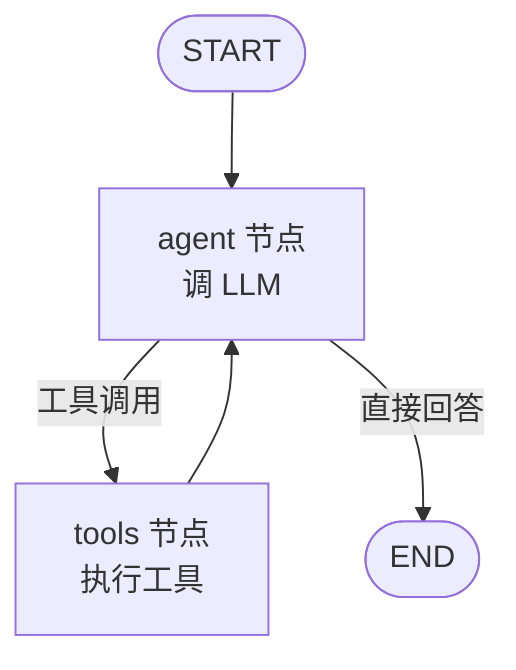
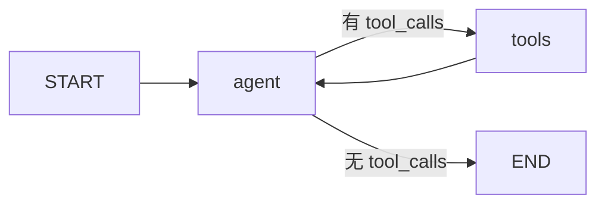

# 第 12 章 LangGraph 状态图编排

## 本章目标

读完本章，你应当能够：

1. 用自己的话讲清 LangGraph 的四个原子概念——State、Node、Edge、Conditional Edge，并能把一个 ReAct 循环画成图；
2. 用 `create_react_agent` 几十行代码拉起一个带工具调用的 Agent，再把它拆开成手写 `StateGraph`，看清封装到底省了什么；
3. 给图挂上 `checkpointer`，理解 `thread_id` 为什么是会话恢复的关键；
4. 用 `interrupt` + `Command(resume=...)` 实现「关键动作前等人审批」的人机协同；
5. 判断什么时候该上 LangGraph，什么时候直接写一个 `while` 循环更划算。

---

## 1. 为什么需要状态图

第 01 章我们手写过一个 Agent 循环：`for turn in range(max_turns)`，模型要么 `final`、要么 `action`。这个骨架在单 Agent、单工具、单路径时够用。但任务一旦复杂——多角色分工、循环里夹一个人审批、失败要回退重跑、跨进程恢复——把所有分支继续塞进 `while` 循环和 `if/else`，代码很快会变成一坨难以调试的面条。

LangGraph 的思路是：**把 Agent 的运行过程显式地建模成一张图**。节点是函数，边是控制流，节点之间只通过一份共享的 State 通信。图可以编译成一个可执行对象，由框架负责调度、持久化、中断与恢复。

> [!note]
> LangGraph 不是要取代你写代码，而是把「控制流、状态、中断」这三件最容易写乱的事情从业务代码里抽出来，变成可可视化、可检查、可回放的结构。

## 2. 四个原子概念



这张图就是一个 ReAct Agent 的全貌。拆开看只有四块：

| 概念 | 作用 | 你要写的东西 |
|---|---|---|
| **State** | 节点之间共享的数据结构（通常是 `TypedDict` 或 Pydantic 模型） | 定义字段，以及字段的合并规则（reducer） |
| **Node** | 一个普通 Python 函数：吃 State，返回 State 的更新分片 | 业务逻辑：调 LLM、跑工具、做判断 |
| **Edge** | 固定的控制流：从 A 执行完一定去 B | `add_edge("A", "B")` |
| **Conditional Edge** | 根据当前 State 动态选下一个节点 | `add_conditional_edges("A", 路由函数, 映射表)` |

### 2.1 State 不是普通字典

State 的关键在 **reducer**。以消息列表为例：

```python
class AgentState(dict):
    messages: Annotated[list[BaseMessage], add_messages]
```

`add_messages` 告诉框架：每个节点返回 `{"messages": [新消息]}` 时，**不是覆盖整个列表，而是追加**。这避免了每个节点都要自己读出、拼接、再写回。其他字段（比如计数器、审批结果）如果不写 reducer，默认行为是覆盖——这个差异是最常见的 bug 来源。

### 2.2 Node 是无副作用偏好的纯函数

节点函数签名很简单：接收当前 State，返回一个字典（要更新的字段）。框架负责把这个字典合并回 State。副作用（调 LLM、写数据库、发请求）当然可以在节点里做，但**节点本身不决定下一步去哪**——那是边的职责。把「做什么」和「去哪」分开，图才好测、好改。

### 2.3 条件路由：第 01 章那个 if/else 的显式化

第 01 章骨架里，你手写了 `if decision["type"] == "final": return ...`。在 LangGraph 里，这个判断变成一个路由函数 + 一张映射表：

```python
def route(state: AgentState) -> str:
    last = state["messages"][-1]
    if last.tool_calls:
        return "tools"
    return END

builder.add_conditional_edges("agent", route, {"tools": "tools", END: END})
```

绝大多数 ReAct 场景不需要自己写这个函数——LangGraph 在 `langgraph.prebuilt` 里提供了 `tools_condition`，它就是上面这段逻辑的通用实现。

## 3. 先快后慢：create_react_agent 与手写 StateGraph

### 3.1 三十行拉起一个工具调用 Agent

LangGraph 把最常见的 ReAct 模式封装成了 `create_react_agent`：

```python
from langchain_openai import ChatOpenAI
from langchain_core.tools import tool
from langgraph.prebuilt import create_react_agent

@tool
def get_weather(city: str) -> str:
    """查询天气。"""
    return f"{city}：晴，12°C"

model = ChatOpenAI(model="gpt-4o-mini", temperature=0)
agent = create_react_agent(model, tools=[get_weather])

result = agent.invoke({"messages": [("user", "北京天气如何？")]})
print(result["messages"][-1].content)
```

这就是第 01 章骨架的生产版本：消息循环、工具节点、终止判断全被封装好了。日常写「一个模型 + 几个工具 + 多轮对话」时，这一段就够。

### 3.2 拆开看封装：它替你做了什么

`create_react_agent` 背后等价于这样一张图：



- 它替你定义了 `messages` 字段和 `add_messages` reducer；
- 替你注册了 `agent` 节点（绑定工具后的模型调用）和 `tools` 节点（`ToolNode`）；
- 替你接好了条件边 `tools_condition` 和回边 `tools -> agent`。

本章配套的 `state_graph.py` 把这一切手动拼了一遍。**先快后慢**的价值在于：一旦你要在循环里夹东西——比如在 `agent` 之前加一个「意图分类」节点、在 `tools` 之后加一个「结果校验」节点、在某个危险工具前加一个人审批——封装就不够用了，你得回到手写 `StateGraph`。

## 4. Checkpoint：让状态可中断、可恢复

裸跑的图一旦进程退出，所有上下文都没了。LangGraph 用 **checkpointer** 解决这件事：每个节点执行完，框架把当前 State 序列化一份存起来，按 `thread_id` 分区。

```python
from langgraph.checkpoint.memory import MemorySaver

graph = builder.compile(checkpointer=MemorySaver())

config = {"configurable": {"thread_id": "user-123"}}
graph.invoke({"messages": [("user", "第一轮")]}, config=config)
# 同一 thread_id 再 invoke，消息历史自动带回来
graph.invoke({"messages": [("user", "第二轮，我刚说的是什么？")]}, config=config)
```

| 实现 | 存储 | 适用场景 |
|---|---|---|
| `MemorySaver` | 进程内字典 | 开发调试、单进程 demo |
| `SqliteSaver` | 本地 SQLite 文件 | 单机持久化、小流量服务 |
| `PostgresSaver` | PostgreSQL | 生产多实例部署（需额外包 `langgraph-checkpoint-postgres`） |

> [!warning]
> `thread_id` 不是可选项——挂了 checkpointer 之后每次 `invoke` 都必须在 `config` 里给它。它同时承担两件事：会话隔离（不同用户互不串）和恢复锚点（中断后凭它续跑）。

## 5. Interrupt：人机协同不是「中途 input()」

Agent 真要干活，绕不开一类场景：**发邮件、转钱、删数据**这类有副作用的动作，执行前必须等人点头。最土的做法是在节点里 `input()`，但那样进程就阻塞在那里，没法横向扩展，也没法把审批推到另一个终端。

LangGraph 的做法是 `interrupt`：节点执行到这里时，框架把当前 State 序列化成 checkpoint，然后**把中断的现场作为返回值抛给调用方**。进程可以退出、请求可以断开，等审批结果回来了，再用 `Command(resume=结果)` 从同一个 `thread_id` 续跑。

```python
from langgraph.types import interrupt, Command

def review_node(state):
    # 第一次执行到这里会暂停，把 payload 抛出去
    decision = interrupt({"to": state["recipient"], "body": state["body"]})
    # 第二次执行时，decision 就是人给的 resume 值
    return {"approved": decision == "approve"}

# 第一次：跑到 review 就停
paused = graph.invoke({"messages": [...]}, config={"configurable": {"thread_id": "e1"}})
print(paused["__interrupt__"])

# 人在外部系统（工单、IM、邮件）里批完了，再续：
graph.invoke(Command(resume="approve"), config={"configurable": {"thread_id": "e1"}})
```

关键差别在于：`interrupt` 不是「阻塞等待输入」，而是「序列化当前现场、交还控制权、之后可恢复」。这让审批可以异步、跨设备、跨进程发生。

## 6. 可视化：图不只是用来跑的

`graph.get_graph()` 能拿到图的结构对象，可以输出 Mermaid 或 ASCII：

```python
print(graph.get_graph().draw_ascii())
# 或者在 notebook 里：
# from IPython.display import Image, display
# display(Image(graph.get_graph().draw_mermaid_png()))
```

> [!note]
> 工程上最值得养成的习惯是：改完图先把结构打印出来跟自己对一遍，再去跑 LLM。很多「为什么模型乱调工具」的问题，根因其实是边接错了——比如漏掉了 `tools -> agent` 回边，工具执行完直接 END 了。

## 7. 实战：可运行源码

示例代码位于仓库 [`examples/ch12-langgraph/`](https://github.com/thomaslwq/AgentTutorial/tree/main/examples/ch12-langgraph)，两个脚本分别对应本章两条主线。

### 7.1 `state_graph.py`：手写带工具调用的状态图

```python
class AgentState(dict):
    messages: Annotated[list[BaseMessage], add_messages]


@tool
def get_weather(city: str) -> str:
    """查询某城市当前天气。"""
    fake = {"北京": "晴，8°C", "上海": "多云，12°C"}
    return fake.get(city, f"没有 {city} 的天气数据。")


model = ChatOpenAI(model="gpt-4o-mini", temperature=0).bind_tools([get_weather])


def agent_node(state: AgentState) -> dict:
    return {"messages": [model.invoke(state["messages"])]}


builder = StateGraph(AgentState)
builder.add_node("agent", agent_node)
builder.add_node("tools", ToolNode([get_weather]))
builder.add_edge(START, "agent")
builder.add_conditional_edges("agent", tools_condition)
builder.add_edge("tools", "agent")

graph = builder.compile(checkpointer=MemorySaver())

config = {"configurable": {"thread_id": "demo-thread-1"}}
graph.invoke({"messages": [("user", "北京今天天气怎么样？")]}, config=config)
# 同一个 thread_id 再问「上海呢」，checkpoint 会把上文带回来
graph.invoke({"messages": [("user", "那上海呢？")]}, config=config)
```

注意它和第 01 章骨架的对应关系：`agent_node` 就是「模型决策」，`tools` 节点就是「执行动作」，`tools_condition` 就是「要不要继续循环」的那个 `if`，`MemorySaver` 就是把消息历史自动管起来。

### 7.2 `human_in_loop.py`：interrupt 审批邮件草稿

```python
def review_node(state: EmailState) -> dict:
    decision = interrupt({
        "to": state["recipient"],
        "subject": state["subject"],
        "body": state["body"],
        "question": "是否允许发送？",
    })
    return {"approved": decision == "approve"}


# 第一次跑：停在 review
paused = graph.invoke({"messages": [("user", "跟进售后工单")]}, config=config)
print(paused["__interrupt__"])

# 审批通过，续跑
graph.invoke(Command(resume="approve"), config=config)
```

跑一遍你会看到：第一次 `invoke` 返回的不是最终答案，而是一个带 `__interrupt__` 的中间状态；第二次 `invoke` 用 `Command(resume=...)` 从断点继续，最后才拿到「已发送」。

## 动手练习

1. **跟做**：跑通 `state_graph.py`，把 `thread_id` 在两次调用之间改成一个新值，问「那上海呢」，观察模型是否还能记得上一轮。
2. **拆封装**：用 `graph.get_graph().draw_ascii()` 打印 `create_react_agent` 返回对象的图结构，和 `state_graph.py` 手写的那张图对比，节点命名是否一致？边是否一致？
3. **加节点**：在 `state_graph.py` 的 `START -> agent` 之间插一个 `classify` 节点，让它先判断用户问的是天气还是闲聊，再决定去 `agent` 还是直接 END。

> 练习参考答案见 `examples/ch12-langgraph/README.md`。

## 本章小结

- LangGraph 用 State / Node / Edge / Conditional Edge 四个概念把 Agent 的控制流显式化，业务逻辑写在节点里，分支写在边上。
- `create_react_agent` 是 ReAct 模式的封装；需要自定义节点或分支时回到手写 `StateGraph`。
- `checkpointer` + `thread_id` 让状态可持久化、可恢复，从 `MemorySaver` 换到 SQLite/Postgres 即可从 demo 走向生产。
- `interrupt` + `Command(resume=...)` 把人审批变成一次可序列化、可异步的暂停-恢复，而不是代码里的阻塞输入。
- 图结构本身值得可视化：很多「模型行为奇怪」的问题，根因是边接错了。

## 思考题

1. 第 01 章的手写循环和 LangGraph 的图，在什么规模之前前者更划算？什么时候你会觉得「为了 Agent 而 LangGraph」？
2. `interrupt` 把 State 序列化到 checkpoint 再恢复。如果在审批期间底层 State 的字段 schema 改了（比如加了一个必填字段），恢复会发生什么？这对版本管理提出了什么要求？
3. 多 Agent 系统（第 11 章的 CrewAI 模式）能不能直接用 LangGraph 表达？把两个 Agent 当成两个节点、在它们之间加一条条件边，够不够？

---

下一章：[第 13 章 可观测性与评测](../module-04-engineering/ch13-observability-eval.md)
