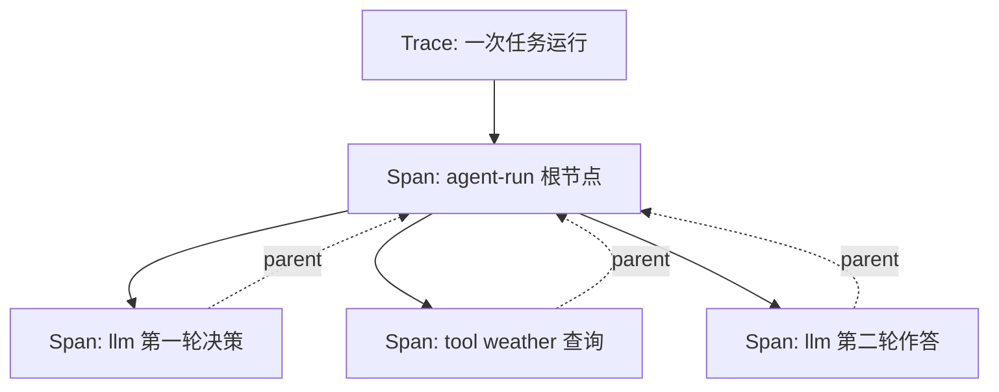

# 第 13 章 可观测性与评测

## 本章目标

读完本章，你应当能够：

1. 说清 Trace 与 Span 的层级关系，知道一次 Agent 运行该记录哪些字段；
2. 在 LangSmith、Langfuse、OpenTelemetry 三条接入路线之间按团队条件做选择；
3. 构造一套固定评测集，定义任务成功率、工具调用正确率、延迟、token 消耗四类指标；
4. 把评测接成回归测试，在 Prompt、模型、工具变更后量化回退；
5. 用本地 JSONL 记录器先跑通观测闭环，再决定是否上平台。

---

## 概念讲解

### 13.1 为什么 Agent 比传统应用更需要可观测性

普通后端服务的控制流是代码写死的：请求进来，函数 A 调函数 B，出了问题顺着调用栈查就行。Agent 的控制流有一部分握在模型手里——调哪个工具、传什么参数、什么时候结束，都是运行时决定的。这带来三个传统监控覆盖不到的问题：

- **失败不可复现**：同一问题这次成功、下次失败，往往是多轮上下文漂移或工具返回异常导致，没有逐轮记录就只能靠猜；
- **成本不透明**：多轮循环里每一轮都在烧 token，不逐轮统计就无法回答「这次任务花了多少 token、钱花在哪一步」；
- **质量无法量化**：「回答得好不好」不能只靠线上用户反馈，需要固定评测集在发版前给出分数。

可观测性要回答的就是三个问题：**这次任务发生了什么（Trace）、花了多少资源（token / 延迟）、结果对不对（评测）**。

传统监控的日志、指标、链路三件套在 Agent 场景依然成立，但语义要重新定义：日志对应逐轮的模型输入输出与工具返回，指标对应 token、延迟、成功率等聚合数字，链路对应 Trace/Span 调用树。差别在于，传统应用的异常通常是报错或超时，而 Agent 大量失败是「静默错误」——模型给出一段通顺但错误的回答，或者调错工具却没抛异常。这类问题只能靠逐轮记录加事后评测暴露，靠进程级健康检查发现不了。

### 13.2 Trace 与 Span

沿用 OpenTelemetry 的概念：

- **Trace（链路）**：一次完整的 Agent 任务运行，从用户输入到最终回答，有唯一 `trace_id`；
- **Span（跨度）**：链路中的一个可观测单元，一次模型调用、一次工具调用、一次检索都各占一个 Span；Span 之间用 `parent_span_id` 串成调用树；
- **Span 关键字段**：名称、类型（llm / tool / chain）、开始与结束时间、耗时、属性（模型名、工具名、入参、结果预览）、token 用量。



> [!note] 记录内容要脱敏
> Span 里的入参与结果预览可能包含用户隐私或业务敏感信息。落盘前应做截断与脱敏，预览字段控制在一两百字，不要把完整对话历史写进观测系统。

常见误区是只记最终回答、不记中间过程。Agent 的问题大多出在中间某一轮——工具参数拼错、检索召回偏差、模型过早结束循环——缺少逐轮 Span 就定位不到这一层。

### 13.3 观测平台接入思路对比

自建 JSONL 记录器适合开发期与离线评测；上线后通常接入专门平台。三条主流路线的取舍如下：

| 维度 | LangSmith | Langfuse | OpenTelemetry 标准 |
|---|---|---|---|
| 归属 | LangChain 官方托管 / 可自托管 | 开源，可自托管，兼容 LangChain | 厂商中立的可观测标准 |
| 接入方式 | SDK 包装 client / 装饰器，自动记录 LangChain 链路 | Python SDK，手动 `@observe` 或包装 LLM 调用 | SDK 埋点后导出到任意 OTLP 后端（Jaeger、Tempo 等） |
| 数据留存 | 托管在 LangSmith 云端；自托管版本另议 | 数据留在自己服务器，适合合规要求高的场景 | 数据落到你自选的后端，平台可替换 |
| 评测能力 | 内置数据集、打分器、在线标注 | 自带 Prompt 管理与评测面板 | 不提供模型评测语义，需自行在采集层实现 |
| 适用团队 | 主栈用 LangChain / LangGraph，想少写埋点 | 要开源可控、数据自持、多模型混用 | 已有 OTel 监控体系，希望 Agent 链路并入现有看板 |
| 成本 | 按追踪量计费，托管版有额度限制 | 自托管零 License 成本，需自己运维 | 后端成本与现有监控栈共用 |

三条路线不互斥：开发期用本地 JSONL 快速迭代，上线后把同样的 Span 结构导出到平台。无论选哪个，Span 字段设计都应保持一致，避免换平台时重写埋点。

埋点位置建议固定在三处：模型调用前后记录 llm Span，工具执行前后记录 tool Span，整条任务包一个根 chain Span。框架提供自动包装时优先用框架能力，避免在业务循环里散落手写计时代码；自动埋点覆盖不到的自定义环节，再补手动 Span。

### 13.4 评测：先有固定评测集，再谈指标

**评测集构造**：把真实业务中典型的、边界的、易失败的问题整理成固定用例。每条用例至少包含：问题、预期调用的工具集合、回答中必须命中的关键词（或参考答案）。评测集要覆盖三类样本：常规成功路径、需要多工具配合的复杂路径、已知会失败的回归样本。评测集应随线上发现的坏案例持续补充，但一次回归所用的版本要冻结，保证前后分数可比。

**指标口径**：

| 指标 | 定义 | 用途 |
|---|---|---|
| 任务成功率 | 回答命中全部预期关键词（或通过参考答案比对）的用例占比 | 衡量端到端能不能把事做成 |
| 工具调用正确率 | 实际调用工具集合与预期集合完全一致的用例占比；可拆精确率 / 召回率 | 衡量决策层是否选对工具、有无多余或遗漏调用 |
| 延迟 | 单用例端到端耗时，看平均值与 P50 / P95 | 衡量体验，发现慢轮次 |
| token 消耗 | prompt / completion / total，按用例与按任务汇总 | 衡量成本，定位吃 token 的环节 |

> [!warning] 成功率高不代表工具行为正确
> 内置样例中有一条：模型没调预期的时间工具，却靠参数化措辞蒙对了答案。这类「结果对、过程错」的用例只看成功率会漏过去，所以工具正确率必须单独统计。

**回归测试**：每次改 Prompt、换模型版本、调整工具 Schema 之后，跑同一套冻结评测集，对比四项指标。成功率或工具正确率下降即视为回退，阻断发版。评测可以分两层：线上抽样做轻量监控，CI 里跑固定集合做门禁。

**成本与 token 统计**：token 从模型返回的 `usage` 字段取，逐轮累加进 Trace。汇总口径分三层：单轮调用、单条 Trace、整批评测。成本估算时用 prompt 与 completion 分别乘以对应单价——多轮循环里 prompt 会随历史累积变长，往往是成本大头，只看 completion token 会严重低估。

### 13.5 评测落地时的常见偏差

| 偏差 | 表现 | 纠正方式 |
|---|---|---|
| 样本偏差 | 评测集全是演示过的顺利问题，线上坏案例没进来 | 把线上工单、失败会话定期回灌进评测集，单独留回归样本区 |
| 口径过宽 | 用「回答是否相关」代替任务是否完成，分数虚高 | 指标拆成可核对的硬条件：工具集合、关键词、结构化字段 |
| 只看单次 | 同一用例跑一次就计分，低温下的偶发失败被忽略 | 关键用例重复跑 3 次以上，报告成功率与波动区间 |
| 环境漂移 | 评测时工具返回、检索库版本与线上不一致，分数不可比 | 固定工具桩数据或记录评测时的外部依赖版本 |
| 指标单一 | 只追成功率，忽略延迟与 token，上线后体验和成本失控 | 四类指标同屏对比，任一维度恶化都要进入评审 |

> [!note] 评测集不是越多越好
> 早期几十条覆盖主路径与已知坑位的用例，价值高于几百条重复样本。每条用例都要能说清它在防哪一类回退；无法对应失败模式的样本，打分时只会增加噪音。

落地顺序建议：先在本地用 JSONL 记录器把真实运行的逐轮数据攒下来，从中挑出典型与失败案例组成第一版评测集；评测脚本跑通后再考虑接入平台做在线标注与看板。不要一上来就搭重型观测系统——没有固定评测集支撑，平台里堆积的 Trace 也只能用于事后翻查。

观测与评测是一个闭环：线上 Trace 暴露出失败会话，人工标注后补进评测集；评测分数回过来指导 Prompt、工具与模型的调整；调整后的版本再跑同一套评测集验证。Trace 回答「这次发生了什么」，评测回答「改动后是变好还是变坏」，两者缺一个，迭代就只能靠主观感受。

## 实战：可运行源码

示例代码位于仓库 [`examples/ch13-observability-eval/`](https://github.com/thomaslwq/AgentTutorial/tree/main/examples/ch13-observability-eval)，两个脚本均为纯标准库实现，离线可跑通；接入真实模型时把执行器替换成你的 Agent 循环即可。

### 13.6 本地 JSONL Trace 记录器

`local_tracer.py` 实现 Trace / Span 的落盘与汇总。核心结构是 `Span` 数据类加 `LocalTracer` 记录器：

```python
class Span:
    """单个可观测单元。"""

    trace_id: str
    span_id: str
    parent_span_id: Optional[str]
    name: str
    span_type: str  # chain / llm / tool
    start_ts: float
    end_ts: Optional[float] = None
    attributes: dict = field(default_factory=dict)
    token: dict = field(default_factory=dict)  # prompt / completion / total


class LocalTracer:
    def __init__(self, output_path: str = "traces.jsonl") -> None:
        self.output_path = Path(output_path)
        self._spans: dict[str, Span] = {}

    def start_span(self, trace_id, name, span_type,
                   parent_span_id=None, attributes=None) -> str:
        span_id = f"span-{uuid.uuid4().hex[:10]}"
        self._spans[span_id] = Span(
            trace_id=trace_id, span_id=span_id,
            parent_span_id=parent_span_id, name=name, span_type=span_type,
            start_ts=time.perf_counter(), attributes=attributes or {},
        )
        return span_id

    def end_span(self, span_id, token=None, attributes=None) -> None:
        span = self._spans[span_id]
        span.end_ts = time.perf_counter()
        if token:
            span.token = token
        if attributes:
            span.attributes.update(attributes)

    def record_llm_call(self, trace_id, model, prompt_tokens, completion_tokens,
                        latency_ms, parent_span_id=None, message_preview="") -> None:
        # 记录一次模型调用：模型名、token 用量、耗时、输入预览
        ...

    def record_tool_call(self, trace_id, tool_name, arguments, result_preview,
                         latency_ms, parent_span_id=None, status="ok") -> None:
        # 记录一次工具调用：工具名、入参、结果预览、耗时、状态
        ...

    def flush(self) -> None:
        """把缓冲的 Span 追加写入 JSONL，并清空缓冲。"""
        records = [span.to_record() for span in self._spans.values()]
        with self.output_path.open("a", encoding="utf-8") as f:
            for record in records:
                f.write(json.dumps(record, ensure_ascii=False) + "\n")
        self._spans.clear()

    def trace_summary(self, trace_id: str) -> dict:
        """汇总单个 trace 的总 token、总耗时、Span 数量。"""
        ...
```

真实接入时，在模型调用与工具调用前后埋点，从 `response.usage` 回填 token：

```python
with tracer.span(trace_id, "llm:gpt-4o-mini", "llm") as sid:
    resp = client.chat.completions.create(model="gpt-4o-mini", messages=messages)
    tracer.end_span(sid, token={
        "prompt": resp.usage.prompt_tokens,
        "completion": resp.usage.completion_tokens,
    })
```

### 13.7 评测集打分脚本

`eval_runner.py` 定义用例结构、评分函数与汇总指标。评分口径：关键词全部命中记为成功；工具集合与预期完全一致记为匹配，同时保留精确率与召回率。

```python
@dataclass
class EvalCase:
    case_id: str
    question: str
    expected_tools: list[str]
    expected_keywords: list[str]
    notes: str = ""


def _keyword_hit(answer: str, keywords: list[str]) -> float:
    if not keywords:
        return 1.0
    hit = sum(1 for kw in keywords if kw.lower() in answer.lower())
    return hit / len(keywords)


def _tool_set_metrics(expected, actual) -> tuple[bool, float, float]:
    exp, act = set(expected), set(actual)
    if not exp and not act:
        return True, 1.0, 1.0
    if not act:
        return False, 0.0, 0.0
    precision = len(exp & act) / len(act)
    recall = len(exp & act) / len(exp)
    return exp == act, precision, recall


def score_case(case: EvalCase, result: CaseResult) -> ScoredCase:
    hit = _keyword_hit(result.answer, case.expected_keywords)
    tool_match, precision, recall = _tool_set_metrics(
        case.expected_tools, result.tools_called)
    return ScoredCase(
        result=result, success=hit >= 1.0,
        keyword_hit=round(hit, 3), tool_match=tool_match,
        tool_precision=round(precision, 3), tool_recall=round(recall, 3),
    )
```

汇总部分输出成功率、工具匹配率、平均与 P50 延迟、总 token 与平均 token：

```python
def summarize(scored: list[ScoredCase]) -> dict:
    n = len(scored)
    latencies = [s.result.latency_ms for s in scored]
    totals = [s.result.token.get("total", 0) for s in scored]
    return {
        "case_count": n,
        "task_success_rate": round(sum(s.success for s in scored) / n, 3),
        "tool_match_rate": round(sum(s.tool_match for s in scored) / n, 3),
        "avg_latency_ms": round(statistics.mean(latencies), 2),
        "p50_latency_ms": round(statistics.median(latencies), 2),
        "total_tokens": sum(totals),
        "avg_tokens": round(statistics.mean(totals), 2),
    }
```

运行方式：

```bash
python eval_runner.py                          # 内置样例数据集
python eval_runner.py dataset.json --output report.json
```

内置样例中 `case-04` 故意不调用预期工具，可以看到工具匹配率低于任务成功率——这正是 13.4 节提醒的「结果对、过程错」场景。

## 动手练习

1. **跟做**：运行 `local_tracer.py` 与 `eval_runner.py`，打开生成的 `traces.jsonl`，对照调用树理解每个 Span 的父子关系与 token 字段。
2. **接真实模型**：把 `eval_runner.py` 的 `stub_runner` 替换为真实 Agent 调用，用 `local_tracer.py` 记录每轮模型与工具调用，回填延迟与 token。
3. **加回归门禁**：在 `eval_runner.py` 中读取一份基线指标 JSON，本次汇总的成功率或工具匹配率低于基线时以非 0 退出码结束，便于接入 CI。

> 练习参考答案见 `examples/ch13-observability-eval/README.md`。

## 本章小结

- Trace 是一次完整任务运行，Span 是其中的模型调用、工具调用等单元，靠父子 ID 串成调用树；记录要覆盖中间轮次，并做好脱敏。
- 观测平台三条路线：LangSmith 省埋点、Langfuse 数据自持、OpenTelemetry 厂商中立，按技术栈与合规要求选择。
- 评测先冻结固定评测集，再分四类指标：任务成功率、工具调用正确率、延迟、token 消耗；工具正确率必须独立于成功率统计。
- 回归测试把固定评测集接进发版流程，指标下降即阻断；token 按轮次累加，prompt 累积是多轮场景的成本大头。

## 思考题

1. 为什么线上监控不能替代固定评测集？两者在样本选择、运行口径、触发时机上有什么差别？
2. 如果评测集里只有「常规成功路径」样本，统计出的成功率会掩盖哪类问题？
3. 多轮 Agent 的 prompt token 随历史增长，除了缩短上下文，还有哪些手段可以压低这部分成本？（提示：结合第 03 章记忆系统，为第 14 章成本控制做铺垫）

---

下一章：[第 14 章 安全与成本控制](ch14-security-cost.md)
