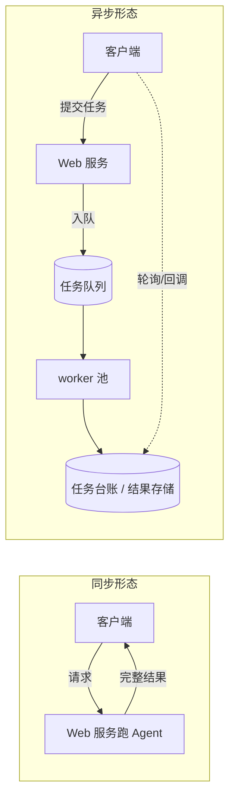
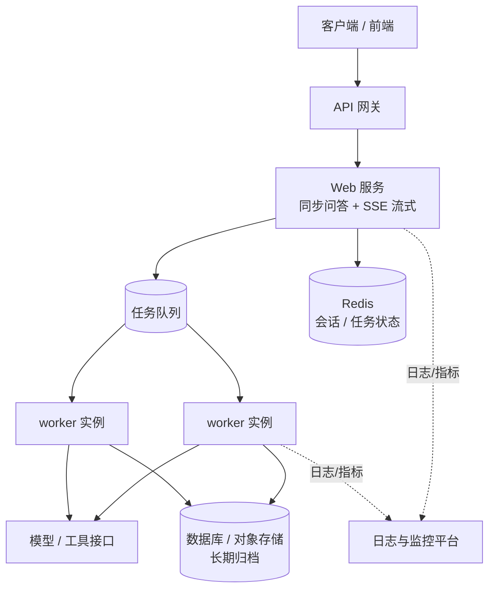

# 第 15 章 部署与运维

## 本章目标

读完本章，你应当能够：

1. 区分 Agent 服务化的两种形态——同步请求/响应与异步任务，按任务时长选择合适的链路；
2. 说清单进程 `asyncio`、Celery、RQ 等并发与队列方案的适用边界，能根据任务特征做取舍；
3. 规划长期运行任务的状态台账与会话存储，知道内存存储在什么阶段必须换成 Redis 或数据库；
4. 搭起结构化日志、基础指标与告警的雏形，并设计超时、重试、退避、死信等故障恢复策略；
5. 对比长驻进程、容器化、Serverless 三种部署方式，给出与自身场景匹配的部署拓扑。

---

## 1. Agent 的两种服务化形态

把一个能跑的 Agent 交给业务方使用，第一步是决定它以什么形态对外提供能力。本质上只有两种：**同步请求/响应**与**异步任务**。

### 1.1 同步请求/响应

客户端发起请求，服务端当场跑完整条 Agent 链路（理解 → 决策 → 工具调用 → 再决策 → 出答案），把最终结果写回响应。连接在整个执行期间一直挂着。这种形态实现最简单，前端就是一次普通的 HTTP 调用，适合单轮问答、简单工具调用这类几秒内可以结束的短任务。

它的硬限制也来自连接长期挂起：Agent 循环可能跑十几步、调用多个外部工具，耗时几十秒甚至几分钟；HTTP 网关、负载均衡、浏览器都有默认超时，长连接容易在中途被掐断；同时每个在跑任务都占用一份服务端连接与内存，并发一上来资源就被耗尽。

### 1.2 异步任务

客户端提交任务后立即拿到一个 `task_id`，任务进入队列由后台 worker 执行；结果先落库，客户端通过轮询、WebSocket 推送或 Webhook 回调获取最终产物。这种形态适合多步规划、长文档处理、批量任务等耗时不确定的长任务，也天然支持任务取消、进度查询与失败重试。



| 维度 | 同步请求/响应 | 异步任务 |
|---|---|---|
| 首字节/完成时间 | 等待整条链路跑完才返回 | 提交即返回 `task_id`，结果后置获取 |
| 连接占用 | 全程占用 HTTP 连接 | 请求短连接，执行在后台 |
| 客户端复杂度 | 低，一次调用 | 高，需要轮询/回调/推送配合 |
| 长任务适应性 | 差，易被超时掐断 | 好，支持进度查询与断点恢复 |
| 失败可见性 | 失败体现在响应里 | 失败体现在任务状态与重试记录里 |
| 典型场景 | 短问答、单次工具调用 | 长文档总结、批量处理、多步规划 |

> [!note] 两种形态可以共存
> 同一个后端通常同时提供两类接口：短问答走同步端点（第 16 章的 `/chat`），长任务走异步队列。不要把长任务硬塞进同步接口，也不要让一个三秒能答完的问题绕一圈队列。

## 2. 并发模型与队列取舍

### 2.1 单进程内：asyncio 够用，注意别阻塞

Agent 的绝大部分时间花在等待上：等模型响应、等工具接口返回、等检索结果。这类 IO 密集场景用单进程的 `asyncio` 并发协程就足够高效——一个事件循环挂起等待时可以去跑别的协程，不需要为每个任务开线程。

需要警惕的是阻塞调用：OpenAI 的同步 SDK、`time.sleep`、同步数据库驱动一旦在协程里直接执行，会卡住整个事件循环。异步环境里要么用对应的异步客户端（`AsyncOpenAI`），要么用 `asyncio.to_thread` 把阻塞调用丢到线程池。CPU 密集的计算则应交给进程池，协程帮不上忙。

### 2.2 跨进程：队列框架怎么选

任务量上来、需要多台机器分担时，单进程内存队列就不够了。主流方案的取舍如下：

| 方案 | 队列后端 | 复杂度 | 擅长场景 | 短板 |
|---|---|---|---|---|
| `asyncio.Queue` | 进程内存 | 最低 | 原型、单进程、低并发 | 重启丢失、不能跨进程/跨机、无持久化 |
| RQ | Redis | 低 | 轻量后台任务、Python 项目快速接入 | 任务编排与生态弱于 Celery |
| Celery | Redis / RabbitMQ / 数据库 | 中高 | 生产级任务调度、重试编排、多后端、大规模 worker | 组件多、配置与运维成本高 |
| 自研队列 | Redis Streams / 消息队列 | 视实现 | 有特殊调度或隔离要求 | 需要自己处理投递、重试、幂等 |

选型的朴素顺序：原型和单进程服务先用 `asyncio.Queue`；任务需要持久化、要跨 worker 进程，且逻辑简单，选 RQ；任务有复杂编排、定时调度、多路由、大规模部署需求，选 Celery。不要在只有几个后台任务的内部工具上先上 Celery。

> [!warning] 队列不是万能的
> 队列解决的是「解耦提交与执行」和「削峰填谷」，不解决任务本身的可靠性。下游模型接口超时、工具写操作失败，仍然要靠重试、幂等与死信机制兜底，见第 4 节。

## 3. 长期运行任务与会话存储

### 3.1 任务台账：让长任务可追踪、可恢复

一个长任务从提交到结束跨越多次进程调度，执行到哪一步、成功没有、产物在哪，都必须落在外部存储里，而不是只放在内存变量中。台账至少记录：任务 ID、提交参数、当前状态（排队/运行/成功/失败）、已尝试次数、中间结果、错误信息、创建与更新时间。有了这份台账，服务重启后可以根据状态恢复或重跑未完成的任务，也能对外提供进度查询接口。

### 3.2 会话存储：区分「会话」与「任务」

会话（session）和任务（job）是两个概念：会话是跨轮次的对话上下文，保存历史消息；任务是某一次执行实例，保存这次执行的状态与产物。二者存储路径通常分开：

| 存储阶段 | 会话实现 | 任务实现 | 适用条件 |
|---|---|---|---|
| 起步 | 进程内 `dict` | 进程内台账 | 单机原型、重启可接受丢失 |
| 多副本/持久化 | Redis（历史消息 + TTL） | Redis（任务 Hash + 状态索引） | 需要多实例共享、结果可回查 |
| 长期归档 | 关系库 / 文档库 | 关系库 / 对象存储（大产物） | 需要审计、长期留存、复杂查询 |

会话历史在写入存储前要做裁剪：固定窗口保留最近 N 轮，更早的内容交给摘要记忆（第 03 章），否则历史无限膨胀会持续推高 token 成本。多副本部署时尤其注意：内存 `dict` 只对当前进程有效，请求被负载均衡打到另一个实例就会丢会话，这是早期服务化最常见的坑之一。

## 4. 日志、监控与故障恢复

### 4.1 结构化日志

生产环境不能只靠 `print`。每条日志应是一行结构化记录，带固定字段：时间、级别、事件名、任务/会话/请求 ID、耗时、错误信息。这样日志进入 ELK、Loki 或云日志服务后，可以按任务 ID 串起整条链路，也能按事件名统计频次。字段命名保持一致，比日志文案华丽更重要。

### 4.2 指标与告警

Agent 服务至少要采集这几类指标：

- **队列与并发**：队列深度、在跑任务数、等待时长；
- **结果质量**：成功率、失败率、重试次数分布；
- **延迟**：任务完成时间的平均值与分位数（P50 / P95 / P99）；
- **成本**：token 消耗量（第 13 章已有观测与评测的讨论）；
- **下游健康**：模型接口、工具接口的错误率与超时率。

告警要挂在指标上而不是挂在感觉上：失败率超过阈值、队列深度持续堆积、P95 延迟明显抬升、下游错误率上涨，分别对应不同的处理动作。单次偶发失败不告警，持续恶化才通知人。

### 4.3 故障恢复策略

真实链路里失败是常态，策略要在代码里事先写好：

- **超时**：每次模型调用、每个工具调用都设超时，不能无限等；整体任务也设最大执行时长；
- **重试**：对可恢复错误（限流 429、临时 5xx、网络抖动）重试，配合指数退避与次数上限；对参数错误、鉴权失败这类不可恢复错误直接失败，不要重试；
- **幂等**：涉及写操作的工具（发邮件、改订单）要保证重复执行不会产生重复副作用，重试才安全；
- **死信**：重试到上限仍失败的任务进入死信队列或失败表，配合人工排查，不能静默丢弃；
- **熔断**：下游持续故障时短暂熔断，避免请求堆积把故障扩散到自己这边。

> [!warning] 重试会放大故障
> 下游已经过载时，无退避、无上限的重试等于给它再压一批流量。重试次数、退避间隔、熔断阈值都要基于下游容量设定，并在日志里留痕，便于事后判断是上游问题还是下游问题。

## 5. 部署方式对比

### 5.1 三种基础形态

| 维度 | 长驻进程（VM / 裸机 + systemd） | 容器化（Docker + 编排） | Serverless / 函数计算 |
|---|---|---|---|
| 环境一致性 | 依赖手工维护，环境易漂移 | 镜像固化环境，多机一致 | 平台托管，按镜像或代码包部署 |
| 启动方式 | 开机常驻，进程守护 | 镜像启动，编排拉起与重启 | 请求触发实例，存在冷启动 |
| 长任务支持 | 好，进程可长期运行 | 好，容器生命周期可控 | 受平台执行时长上限约束 |
| 扩缩容 | 手工或脚本加机器 | 按指标自动伸缩副本 | 平台按并发自动伸缩，缩容到零 |
| 成本模型 | 机器常驻付费 | 容器按实例资源付费 | 按调用次数与时长计费 |
| 适用场景 | 内部服务、状态复杂、需要稳定长连接 | 生产主流形态，多副本、可发布回滚 | 突发短任务、事件触发、低频调用 |

### 5.2 一个常见的生产拓扑

实际项目很少只选一种形态，典型做法是分层部署：对外是 Web 服务（承接同步问答与流式输出，第 16 章展开），长任务进队列由独立的 worker 池消费；状态与会话存 Redis，长期产物归档到数据库或对象存储；日志与指标汇入可观测平台。



容器化是生产的主流落点：Web 服务和 worker 打成同一镜像、用不同启动命令分别部署，便于统一发布；Serverless 适合突发的短任务和事件驱动的钩子，但要先确认平台的执行时长、并发上限与冷启动延迟能否满足 Agent 链路。

## 6. 实战：异步任务队列骨架

示例代码位于仓库 [`examples/ch15-deployment-ops/`](https://github.com/thomaslwq/AgentTutorial/tree/main/examples/ch15-deployment-ops)。下面按组件讲解关键实现，完整可运行脚本见 `worker_skeleton.py`。

### 6.1 结构化日志配置

日志格式器把记录拍成一行 JSON，结构化字段通过 `extra=` 传入：

```python
class JsonLineFormatter(logging.Formatter):
    def format(self, record: logging.LogRecord) -> str:
        payload = {
            "ts": time.strftime("%Y-%m-%dT%H:%M:%S", time.localtime(record.created)),
            "level": record.levelname,
            "logger": record.name,
            "event": record.getMessage(),
        }
        for key in ("job_id", "attempt", "elapsed_ms", "error", "backoff"):
            value = getattr(record, key, None)
            if value is not None:
                payload[key] = value
        if record.exc_info:
            payload["exc"] = self.formatException(record.exc_info)
        return json.dumps(payload, ensure_ascii=False)
```

### 6.2 任务台账

`Job` 保存状态与重试信息，`TaskStore` 把存取隔离成接口，后续换 Redis 时业务代码不用动：

```python
@dataclass
class Job:
    job_id: str
    payload: dict[str, Any]
    status: str = STATUS_QUEUED
    attempts: int = 0
    result: Any = None
    error: str | None = None
    created_at: float = field(default_factory=time.time)
    updated_at: float = field(default_factory=time.time)


class TaskStore:
    def __init__(self) -> None:
        self._jobs: dict[str, Job] = {}

    def put(self, job: Job) -> None:
        self._jobs[job.job_id] = job

    def get(self, job_id: str) -> Job | None:
        return self._jobs.get(job_id)

    def update(self, job: Job, **changes: Any) -> None:
        for key, value in changes.items():
            setattr(job, key, value)
```

### 6.3 Worker 与重试退避

worker 从队列取任务、执行、更新台账；失败后按已尝试次数选择退避间隔，重新入队，达到上限才置为永久失败：

```python
MAX_ATTEMPTS = 3
BACKOFF_SECONDS = [0.2, 0.5, 1.0]


async def worker(name: str, queue: asyncio.Queue[Job], store: TaskStore) -> None:
    while True:
        job = await queue.get()
        started = time.monotonic()
        store.update(job, status=STATUS_RUNNING, attempts=job.attempts + 1)
        try:
            result = await run_agent_task(job.payload)
            store.update(job, status=STATUS_SUCCEEDED, result=result)
        except Exception as exc:
            store.update(job, error=f"{type(exc).__name__}: {exc}")
            if job.attempts >= MAX_ATTEMPTS:
                store.update(job, status=STATUS_FAILED)
            else:
                delay = BACKOFF_SECONDS[min(job.attempts - 1, len(BACKOFF_SECONDS) - 1)]
                await asyncio.sleep(delay)
                await queue.put(job)  # 重新入队，等待下一次消费
        finally:
            queue.task_done()
```

### 6.4 健康检查端点

骨架用标准库 `asyncio.start_server` 起了一个最小 HTTP 服务，`/healthz` 返回存活状态、队列深度与状态统计，供编排系统做存活探测：

```python
async def health_handler(reader, writer, queue, store, started_at):
    request_line = await reader.readline()
    method, path, *_ = request_line.decode().split()
    if method == "GET" and path == "/healthz":
        body = {
            "status": "ok",
            "uptime_s": int(time.time() - started_at),
            "queue_depth": queue.qsize(),
            "stats": store.stats(),
        }
        payload = json.dumps(body, ensure_ascii=False).encode()
        writer.write(b"HTTP/1.1 200 OK\r\nContent-Type: application/json; charset=utf-8\r\n"
                     b"Content-Length: " + str(len(payload)).encode() + b"\r\n\r\n" + payload)
    else:
        writer.write(b"HTTP/1.1 404 Not Found\r\nContent-Length: 0\r\n\r\n")
    await writer.drain()
    writer.close()
```

> [!note] 健康检查要区分存活与就绪
> 骨架的 `/healthz` 只表达「进程活着」。生产环境通常再分一个就绪探针：依赖（Redis、数据库、下游模型）不可用时返回 503，让编排系统先把实例从流量池摘掉，而不是打挂再重启。

运行方式、环境变量与预期输出见示例目录的 `README.md`。

## 动手练习

1. **跟做**：运行 `worker_skeleton.py`，对照日志观察任务从 `queued` 到 `succeeded` 的状态迁移；任务未跑完时另开终端 `curl http://localhost:8081/healthz`，查看队列深度与统计字段。
2. **改骨架**：在 `run_agent_task` 中按概率抛出异常，观察重试次数、退避间隔与最终 `failed` 状态；思考哪些错误值得重试，哪些重试只会浪费资源。
3. **做设计**：把 `TaskStore` 的内存 `dict` 换成 Redis，列出需要持久化的字段、key 结构与 TTL 策略，并说明读取接口为什么可以保持不变。

> 练习参考答案见 `examples/ch15-deployment-ops/README.md`。

## 本章小结

- Agent 服务化分同步与异步两种形态：短任务走同步接口，长任务进队列异步执行，二者常在同一后端共存。
- 并发选型按规模递进：单进程 `asyncio` → 轻量 RQ → 生产级 Celery；异步代码里不能混入阻塞调用。
- 任务台账与会话存储分开管理：内存存储只用于原型，多副本与持久化阶段换成 Redis，长期归档进数据库。
- 运维抓手是结构化日志、分维度指标与挂在指标上的告警；故障恢复靠超时、有限次退避重试、幂等、死信与熔断。
- 部署以容器化为主流落点，Web 服务与 worker 分实例部署；Serverless 只适合受时长与并发限制的短任务。

## 思考题

1. 为什么长任务不适合挂同步 HTTP 长连接？如果网关默认 30 秒超时，而 Agent 链路需要两分钟，会出现什么现象？
2. 重试在什么情况下会把下游故障放大成雪崩？结合退避、上限与熔断，说明你会怎么设阈值。
3. 多副本部署时，内存队列和内存会话分别会带来什么问题？要让两个实例共享任务状态与对话历史，存储层需要补哪些能力？

---

下一章：[第 16 章 FastAPI 后端服务化与流式输出](../module-05-fullstack/ch16-fastapi-service.md)
