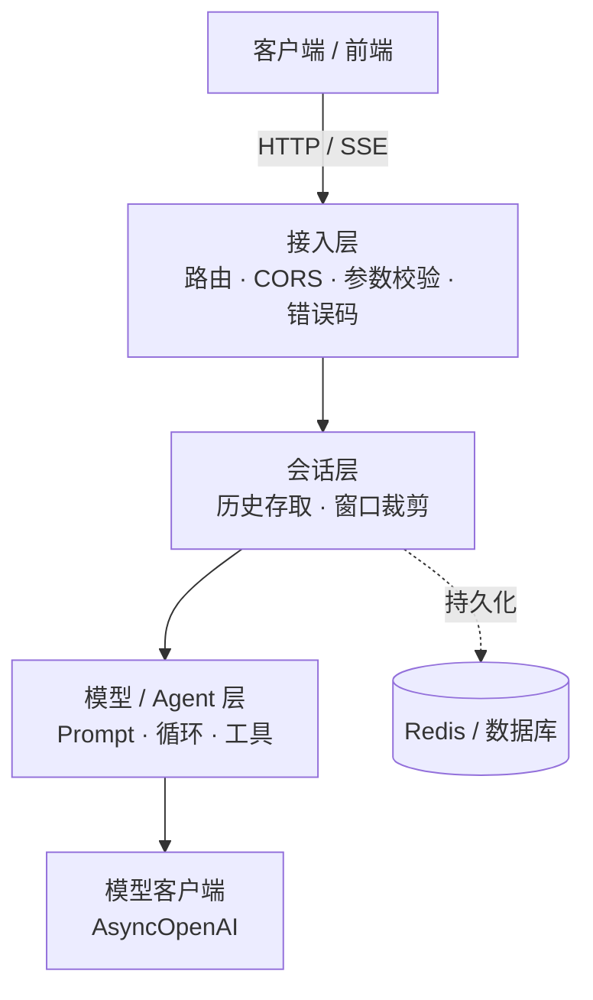

# 第 16 章 FastAPI 后端服务化与流式输出

## 本章目标

读完本章，你应当能够：

1. 用 FastAPI 把一个 Agent 封装成 HTTP 服务，说清接入层、会话层、模型层各自的职责边界；
2. 用 Pydantic 定义请求/响应契约，理解框架自动校验与 OpenAPI 文档生成的机制，并规划统一的错误码；
3. 实现非流式 `POST /chat` 端点，完成会话存取、模型调用与历史回写；
4. 基于 `StreamingResponse` 与异步生成器实现 SSE 流式端点，逐 token 推送增量回答；
5. 识别内存会话的局限，给出向 Redis 迁移的 key 设计与替换路径。

---

## 1. 服务化分层

前面章节的 Agent 都是脚本形态：在本地跑一段代码、打印结果。要被前端或其他系统调用，需要把它包成一个常驻的 HTTP 服务。FastAPI 是 Python 生态里常用的选择：原生异步、类型注解驱动参数校验、自动生成接口文档，与 OpenAI 异步 SDK 的配合也顺畅。

一个聊天服务在代码上分成四层，后续改造时各层可以独立替换：



- **接入层**：定义路由、请求响应模型、跨域中间件、异常到 HTTP 状态码的映射；
- **会话层**：按会话 ID 存取历史消息，做窗口裁剪，隔离存储实现；
- **模型/Agent 层**：拼装 Prompt、跑 Agent 循环或单次调用，本章先从单次对话起步；
- **模型客户端**：封装 SDK 调用，管理端点、模型名与鉴权。

选 FastAPI 的直接原因有三点：路由与类型注解一体，请求参数和响应结构用 Python 类型声明即可，框架自动完成校验；原生基于 `asyncio`，与异步模型 SDK 配合时不会为了等 IO 阻塞 worker；自带 OpenAPI 文档，启动后 `/docs` 就是一份可调试的接口说明，前后端联调不必另外维护接口文档。需要强调的是，Web 框架只负责把请求接进来、把结果送出去，Agent 的决策与循环逻辑属于模型层，后续接入工具调用（第 04 章）和 ReAct 循环（第 05 章）时，改动应集中在这一层，接入层契约保持稳定。

## 2. 请求/响应契约与错误码

服务对外的接口首先是一份契约：请求带哪些字段、响应返回什么结构、出错时怎么表达。FastAPI 用 Pydantic 模型声明这份契约，框架在进入业务代码前完成类型与取值校验，校验失败自动返回 422；同时模型会被写进自动生成的 OpenAPI 文档，前端可以直接据此对接。

```python
class ChatRequest(BaseModel):
    message: str = Field(..., min_length=1, description="用户消息")
    session_id: str | None = Field(None, description="会话 ID；缺省则新建")


class ChatResponse(BaseModel):
    session_id: str
    reply: str
    model: str
```

错误处理要在接入层统一收口。常见错误码规划如下：

| 场景 | HTTP 状态码 | 错误标识 | 处理方式 |
|---|---|---|---|
| 请求字段缺失或格式不符 | 422 | 框架校验错误 | 框架自动返回，附字段级说明 |
| 上游模型鉴权失败 / 限流 / 网络错误 | 502 | `UPSTREAM_ERROR` | 捕获 SDK 异常，转成网关错误 |
| 服务内部未捕获异常 | 500 | `INTERNAL_ERROR` | 全局异常处理记录日志后返回 |
| 路径不存在 | 404 | — | 框架默认 |

> [!warning] 不要把上游异常原样抛给客户端
> SDK 异常里可能带鉴权细节或内部端点信息。接入层应把它转成通用错误码与可读提示，详细堆栈只进服务端日志。

## 3. 非流式端点：`POST /chat`

非流式链路是最直观的实现：取会话 → 追加用户消息 → 调用模型 → 把回答回写历史 → 一次性返回完整响应。

```python
@app.post("/chat", response_model=ChatResponse)
async def chat(req: ChatRequest) -> ChatResponse:
    session_id = get_or_create_session(req.session_id)
    append_message(session_id, "user", req.message)

    reply = await call_model(sessions[session_id])
    append_message(session_id, "assistant", reply)

    return ChatResponse(session_id=session_id, reply=reply, model=MODEL)
```

`call_model` 内部用 `AsyncOpenAI` 发起非流式调用，并把 SDK 异常统一转成 502：

```python
async def call_model(messages: list[dict]) -> str:
    try:
        resp = await client.chat.completions.create(
            model=MODEL, messages=messages, temperature=0.3,
        )
    except OpenAIError as exc:
        raise HTTPException(
            status_code=502,
            detail=f"上游模型调用失败: {exc}",
            headers={"X-Error-Code": "UPSTREAM_ERROR"},
        )
    return resp.choices[0].message.content or ""
```

这条链路的问题和第 15 章讲的同步形态一致：回答越长，客户端等待越久，连接全程挂着。要改善体感，就需要流式输出。

## 4. SSE 流式端点

### 4.1 为什么用 SSE

大模型生成是逐词产出的。如果等整段回答生成完再返回，用户面对的是一段空白等待；流式则是模型吐一个词、服务端推一个词，前端即时渲染，首字延迟显著下降。对长回答（总结、代码、长文写作）来说，非流式的等待时间几乎等于模型完整生成时间，而流式在第一个 token 出现后就开始有反馈，体感差距非常明显。

服务端向前端单向推送，最常用的协议是 **SSE（Server-Sent Events）**：它基于普通 HTTP 长连接，报文格式简单（`data: 载荷\n\n`），浏览器原生提供 `EventSource` 对接（第 17 章的前端 UI 就基于它）。与 WebSocket 相比，SSE 是单向的、自带断线重连、走标准 HTTP 端口，对话场景下足够用；WebSocket 更适合双向高频交互，如协同编辑、实时指令下发。

一条 SSE 报文由若干字段行组成，字段之间用换行分隔，两条事件之间空一行。最常用的是 `data` 字段；需要区分事件类型时可以加 `event` 字段，浏览器端按类型注册不同处理器。示例里把事件类型塞进 JSON 载荷而不是用协议原生的 `event:` 行，是为了让前端用同一套解析逻辑读取 `event` 字段，行为更可控。

### 4.2 实现：异步生成器 + StreamingResponse

FastAPI 用 `StreamingResponse` 承载一个异步生成器：生成器每 `yield` 一段字节，框架就把它写进响应流。模型侧打开 `stream=True`，SDK 返回一个异步流，逐 chunk 读取增量内容：

```python
async def stream_generator(session_id: str, message: str) -> AsyncIterator[bytes]:
    append_message(session_id, "user", message)
    collected: list[str] = []

    try:
        stream = await client.chat.completions.create(
            model=MODEL,
            messages=sessions[session_id],
            temperature=0.3,
            stream=True,
        )
        async for chunk in stream:
            if not chunk.choices:
                continue
            delta = chunk.choices[0].delta.content
            if delta:
                collected.append(delta)
                payload = {"event": "token", "token": delta, "session_id": session_id}
                yield f"data: {json.dumps(payload, ensure_ascii=False)}\n\n".encode()

        reply = "".join(collected)
        append_message(session_id, "assistant", reply)
        done = {"event": "done", "session_id": session_id, "reply": reply, "model": MODEL}
        yield f"data: {json.dumps(done, ensure_ascii=False)}\n\n".encode()
    except OpenAIError as exc:
        err = {"event": "error", "code": "UPSTREAM_ERROR", "message": str(exc)}
        yield f"data: {json.dumps(err, ensure_ascii=False)}\n\n".encode()
```

端点把生成器包进 `StreamingResponse`，响应类型声明为 `text/event-stream`：

```python
@app.post("/chat/stream")
async def chat_stream(req: ChatRequest) -> StreamingResponse:
    session_id = get_or_create_session(req.session_id)
    return StreamingResponse(
        stream_generator(session_id, req.message),
        media_type="text/event-stream",
        headers={
            "Cache-Control": "no-cache",
            "X-Accel-Buffering": "no",  # 关闭反向代理缓冲，保证逐 token 下发
        },
    )
```

报文约定三类事件：`token` 携带增量文本，`done` 表示回答结束并附完整文本，`error` 表示上游失败。前端按 `event` 字段分流处理。

### 4.3 几个容易踩的坑

- **代理缓冲**：Nginx 等反向代理默认会缓冲响应体，token 会攒一批再下发，流式体感被破坏。`X-Accel-Buffering: no` 用于关闭这层缓冲；生产部署时还要检查网关与 CDN 的相关配置。
- **异常不能让连接静默挂死**：生成器内部出错如果直接抛出，连接可能挂着不返回事件。约定在生成器内捕获异常，产出一条 `error` 事件再结束流。
- **历史回写必须用完整回答**：推给前端的是增量片段，存进会话的要拼接后的完整文本，否则下一轮对话拿到的是破碎历史。
- **异步环境不要调同步 SDK**：生成器跑在事件循环里，阻塞调用会卡住整个服务；模型客户端使用 `AsyncOpenAI`。

| 维度 | 非流式 `/chat` | SSE `/chat/stream` |
|---|---|---|
| 响应形态 | 一次性 JSON | `text/event-stream` 持续报文 |
| 首字等待 | 等整段生成完 | 首个 token 到达即开始渲染 |
| 客户端处理 | 解析一次 JSON | 持续接收事件、增量拼接 |
| 断线恢复 | 重发一次请求即可 | 依赖协议重连与会话续接 |
| 适用场景 | 短回答、后台任务、易集成的第三方调用 | 面向终端用户的对话界面 |

### 4.4 异步生成器的生命周期

`stream_generator` 是一个异步生成器：FastAPI 在响应开始后逐次调用它，每段 `yield` 都被写进连接；生成器返回或抛异常后响应结束。理解生命周期有两个实操要点。第一，生成器内的代码运行在事件循环上，任何阻塞调用都会卡住整条服务，模型客户端必须用异步版本。第二，连接断开时生成器会被框架关闭，已分配的资源应在生成器里清理；示例的模型流是 SDK 管理的异步上下文，生产实现里可把流放进 `async with` 语句，确保断开时释放上游连接。

### 4.5 从对话接口到 Agent 循环

本章端点背后只是一次模型调用。把它升级成 Agent 服务时，接入层契约不必改动：`/chat` 与 `/chat/stream` 仍然接收消息、返回回答，变化发生在模型层——在调用模型前后插入工具决策与执行循环（第 04、05 章）。流式场景下要额外处理一个问题：Agent 循环里的工具调用阶段并不产生面向用户的文本，这些步骤可以作为独立事件（如 `event: tool_call`）推给前端展示进度，最终回答阶段再逐 token 推送。也就是说，SSE 的事件类型设计要为后续工具调用、规划步骤留好位置，而不只有文本增量。

## 5. 会话管理：从内存 dict 起步

示例用进程内 `dict` 保存会话历史：`session_id` 对应一条消息列表，首条是 system 消息。会话层的两个函数把存取和裁剪收在一处：

```python
def get_or_create_session(session_id: str | None) -> str:
    if session_id and session_id in sessions:
        return session_id
    new_id = session_id or uuid.uuid4().hex[:12]
    sessions.setdefault(
        new_id, [{"role": "system", "content": SYSTEM_PROMPT}]
    )
    return new_id


def append_message(session_id: str, role: str, content: str) -> None:
    history = sessions[session_id]
    history.append({"role": role, "content": content})
    if len(history) > MAX_HISTORY + 1:
        system = history[0]
        history[:] = [system] + history[-MAX_HISTORY:]
```

内存实现只适合起步阶段，它有两个明确的边界：进程重启后历史全部丢失；服务部署多副本时，不同实例各持一份 `dict`，请求打到另一台就读不到上一轮会话。进入多副本或需要持久化的阶段，应把会话层替换为 Redis：key 设计为 `session:{session_id}`，值存 JSON 消息列表，写入时带 TTL（例如 24 小时无活动自动过期）；客户端用 `redis.asyncio` 异步驱动，避免阻塞事件循环。读取时先按 key 取列表，不存在则新建；写入时追加消息并刷新过期时间。函数签名保持不变，业务端点不需要改动——这正是把会话操作隔离成独立函数的目的。

会话数据量再大、需要跨设备长期归档或复杂检索时，再把历史落到关系库或文档库，Redis 作为热缓存。不要一上来就把所有历史写数据库：对话读写频率高，数据库会成为不必要的瓶颈。

历史裁剪用固定窗口保留最近 N 条；更早的长期信息交给摘要记忆或外部知识库（第 03 章），不要让上下文无限膨胀。裁剪时要保留 system 消息，只裁剪对话部分；窗口大小需要在「上下文够用」和「成本可控」之间权衡，取值应结合实际对话长度与评测结果，而不是拍一个很大的数字。

## 6. CORS 跨域配置

前端页面与后端接口不同源时，浏览器会先发起跨域检查。FastAPI 通过中间件统一处理：

```python
app.add_middleware(
    CORSMiddleware,
    allow_origins=_origins,
    allow_credentials=_origins != ["*"],
    allow_methods=["*"],
    allow_headers=["*"],
)
```

本地开发可以用 `*` 放开来源便于调试；生产环境必须通过 `CORS_ORIGINS` 配置具体域名。注意一个规范约束：来源用通配符 `*` 时不能同时携带凭证（Cookie、Authorization），所以示例里按是否为通配符切换 `allow_credentials`。

## 7. 实战：可运行服务

示例代码位于仓库 [`examples/ch16-fastapi-service/`](https://github.com/thomaslwq/AgentTutorial/tree/main/examples/ch16-fastapi-service)，完整可运行工程包含 `main.py`、`requirements.txt` 与 `README.md`。

启动方式：

```bash
export OPENAI_API_KEY=sk-你的key
pip install -r requirements.txt
uvicorn main:app --host 0.0.0.0 --port 8000
```

启动后 `/docs` 提供交互式接口文档。两个端点的 curl 测试命令、SSE 报文样例与练习答案见示例目录 `README.md`。

> [!note] 模型与密钥配置
> 模型名通过 `CHAT_MODEL` 环境变量覆盖，默认 `gpt-4o-mini`，可换成兼容 OpenAI 协议的其他模型；密钥一律从 `OPENAI_API_KEY` 读取，兼容服务另设 `OPENAI_BASE_URL`，代码中不硬编码任何密钥。

## 动手练习

1. **跟做**：启动服务，先用 `curl` 调 `/chat` 拿一次完整回答，再调 `/chat/stream` 观察报文逐段到达，对比两种端点的首字等待与响应形态。
2. **验证会话**：用同一个 `session_id` 连问两轮，确认第二轮能参考第一轮内容；把 `MAX_HISTORY` 调小后连续多轮追问，观察早期消息被裁剪后的表现。
3. **做设计**：把内存 `sessions` 换成 Redis，写出 key 结构、TTL 策略与异步客户端调用方式，说明为什么会话层函数签名可以保持不变。

> 练习参考答案见 `examples/ch16-fastapi-service/README.md`。

## 本章小结

- FastAPI 服务分接入层、会话层、模型层、客户端层；Pydantic 模型同时承担请求校验、响应契约与接口文档。
- 非流式 `/chat` 完成「取会话 → 追加用户消息 → 调模型 → 回写历史 → 返回」的完整闭环。
- SSE 流式用 `StreamingResponse` 加异步生成器实现：逐 chunk 读模型流，产出 `token` / `done` / `error` 三类事件；注意关闭代理缓冲、在生成器内收口异常、回写完整回答。
- 内存 dict 只用于起步；多副本与持久化阶段替换为 Redis，会话层接口保持稳定，历史按窗口裁剪。
- 跨域用 CORS 中间件统一配置，生产环境不能使用来源通配符。

## 思考题

1. 客户端在流式中途断开（关闭页面或取消请求），后端的异步生成器如何感知这次断开？如果不处理，可能继续消耗 token 并产出无人接收的内容。（提示：请求断开状态与生成器异常）
2. 流式回答已经推了一半 token 后上游报错，前端已经渲染的内容该怎么处理？后端的 `error` 事件需要携带哪些信息才能让前端给出一致的体验？
3. 会话窗口是不是越大越好？上下文过长在 token 成本、模型注意力与响应延迟上分别会带来什么影响？

---

下一章：[第 17 章 前端对话 UI（React + SSE 流式）](ch17-frontend-chat-ui.md)
