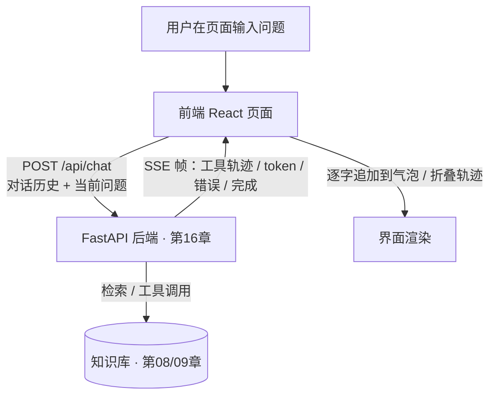

# 第 17 章 前端对话 UI（React + SSE 流式）

## 本章目标

读完本章，你应当能够：

1. 设计一套前后端共用的消息数据模型，区分对话内容、工具轨迹与消息状态；
2. 用 fetch + ReadableStream 在前端正确解析 SSE 流，处理粘包、半帧与中断；
3. 判断 EventSource 与 fetch 流式读取各自的适用边界，能在项目里做出选型；
4. 在界面上把工具调用过程折叠展示，并管理好消息数组、loading、错误三类状态；
5. 处理前端跨域访问后端时的 CORS 配置与常见报错。

---

## 概念讲解

### 17.1 前端在 Agent 链路中的位置

前面章节完成的都是「后端视角」：模型调用、工具执行、RAG 检索、FastAPI 服务化。前端的职责是把这条链路暴露成一个可交互的界面——发送问题、接收流式回答、展示中间过程、处理失败与中断。



前端不做推理决策，只负责三件事：**组装请求、解析流、渲染状态**。理解这一边界很重要：工具该不该调、参数是什么，由后端的 Agent 循环决定；前端只把后端上报的过程如实展示出来。

### 17.2 消息数据模型

聊天界面最容易踩的坑，是直接用一个字符串数组存消息。Agent 对话里一条助手消息除了最终文本，还携带工具轨迹和状态，数据模型至少要包含以下字段：

```ts
type Role = "user" | "assistant";

interface ToolTrace {
  tool: string;
  args: Record<string, unknown>;
  status: "running" | "done";
  observation?: string;
}

interface ChatMessage {
  id: string;
  role: Role;
  content: string;
  traces: ToolTrace[];
  status: "streaming" | "done" | "error";
  error?: string;
}
```

几个设计取舍：

- **`id` 必须稳定**：流式追加内容时靠 id 定位要更新的那条助手消息，不能用数组下标做 key——消息增删时下标会漂移。
- **`traces` 与 `content` 分开**：工具过程是元信息，回答正文是主内容，分开存才能分别折叠、分别渲染。
- **`status` 显式建模**：`streaming` / `done` / `error` 三种状态决定气泡占位符、错误提示和按钮可用性，不要用「content 是否为空」这类隐式判断。

### 17.3 流式协议选型：EventSource 还是 fetch + ReadableStream

浏览器接收服务端推送主要有两条路。SSE（Server-Sent Events）本质是一个长连接的 HTTP 响应，服务端按 `data: ...\n\n` 的格式持续写帧，浏览器侧可以用原生 `EventSource`，也可以用 fetch 拿到响应体流后自行解析。

| 维度 | EventSource | fetch + ReadableStream |
|---|---|---|
| 请求方法 | 只支持 GET | 支持 POST，可携带 JSON body |
| 请求头 | 无法自定义 | 可设置 `Content-Type`、鉴权头 |
| 中断连接 | 只能 `close()` | 配合 `AbortController` 随时取消 |
| 响应解析 | 浏览器自动解析，`onmessage` 回调 | 手动分帧，可区分自定义事件类型 |
| 重连行为 | 内置自动重连 | 需自行实现重连策略 |

Agent 对话通常要把整段对话历史放进 POST body，用户点「停止」时还要主动中断请求，鉴权信息也要放进请求头。这些需求 EventSource 都满足不了，因此本教程统一采用 **fetch + ReadableStream**。EventSource 只适合「无 body、无鉴权头、单向通知」的简单场景，例如行情推送、公告广播。

> [!note]
> SSE 是应用层消息格式，不是某个浏览器 API。无论用 EventSource 还是 fetch，服务端写出的帧格式是一样的：`data: <payload>\n\n`。换的只是客户端解析方式。

### 17.4 SSE 分帧解析的三个坑

拿到流之后，最容易出错的地方是把「网络 chunk」当成「消息帧」。TCP/HTTP 的分块与 SSE 帧边界没有对应关系：一个 chunk 可能含多帧，也可能只到半帧。正确做法是维护一个字符串缓冲区（buffer），每次解码后追加，再按空行切帧：

```ts
const reader = response.body.getReader();
const decoder = new TextDecoder("utf-8");
let buffer = "";

while (true) {
  const { done, value } = await reader.read();
  if (done) break;
  buffer += decoder.decode(value, { stream: true });

  let sep: number;
  while ((sep = buffer.indexOf("\n\n")) >= 0) {
    const frame = buffer.slice(0, sep);
    buffer = buffer.slice(sep + 2);
    handleFrame(frame);
  }
}
```

三个具体的坑：

1. **半帧留在 buffer**：切完一帧后，尾部不足一帧的内容必须留在 buffer 里等下一个 chunk，不能丢弃。
2. **多帧一 chunk**：用 `while` 循环切完当前 buffer 里的所有完整帧，不能只切一帧。
3. **多行 data 与编码**：一帧里可能有多行 `data:`，需要拼接后再 `JSON.parse`；解码用 `TextDecoder("utf-8")` 并在每次 `decode` 时传 `{ stream: true }`，避免跨 chunk 的多字节字符被截断。

帧内负载约定为 JSON，事件类型放在 `type` 字段里，而不是用 SSE 原生的 `event:` 行——这样解析逻辑最简单，也和后端事件模型对齐：

```
data: {"type":"tool_start","tool":"search_kb","args":{"query":"退货"}}
data: {"type":"token","delta":"退货需在签收后 7 天内申请"}
data: {"type":"done"}
```

### 17.5 工具调用过程的折叠展示

Agent 在回答前可能先检索知识库、再查订单。这些中间过程对用户是透明的，但全部摊在气泡里会淹没正文。常见做法是在助手气泡下方挂一个折叠面板（HTML 的 `<details>` 即可实现，无需组件库），标题显示「工具调用 N 步」，展开后按顺序列出每一步的工具名、入参和观察结果。

后端在调用工具前推一条 `tool_start`，返回观察结果后推一条 `tool_end`。前端收到 `tool_start` 时追加一条 `running` 轨迹，收到 `tool_end` 时把同名轨迹更新为 `done` 并补上观察结果。注意：同一条消息里可能两次调用同一个工具（例如先检索再补查），实现时不能按工具名覆盖，应保留多条记录，用自增序号或轨迹 id 区分。

### 17.6 状态管理：消息、loading、错误、中断

一个最小聊天界面需要三组状态：

- **`messages`**：消息数组，流式过程中持续更新最后一条助手消息的 `content`；
- **`loading`**：是否有进行中的请求，控制发送按钮禁用与「停止」按钮显示；
- **错误**：消息级错误挂在对应消息的 `status` / `error` 上，而不是弹一个全局 toast 就丢掉上下文。

中断通过 `AbortController` 实现：发起请求时新建 controller 存入 ref，点「停止」时调用 `abort()`。fetch 会 reject 出一个名为 `AbortError` 的异常，`catch` 里要按错误名区分——主动中断不算故障，保留已收到的文字并把消息置为 `done`；网络错误、后端 5xx 才写入错误提示。

> [!warning]
> 中断只断开浏览器侧的连接。后端是否真的停止生成，取决于服务端有没有监听客户端断连（第 16 章的流式响应在客户端断开后会结束生成）。前端 `abort()` 本身不会通知后端「别再算下去了」。

### 17.7 CORS 对接后端

本地开发时前端页面跑在 `http://localhost:5173`（Vite）或 `http://localhost:3000`（CRA），后端跑在 `http://localhost:8000`，浏览器会按同源策略拦截跨域响应。这不是前端代码问题，而是后端需要在响应里带上 CORS 头：允许的来源、方法、请求头。

FastAPI 侧用 `CORSMiddleware` 配置（第 16 章、第 18 章示例均已接入）。开发环境可以放开本地来源，生产环境必须把 `allow_origins` 收敛到具体域名，不能用 `*` 搭配带凭证的请求。前端排查 CORS 报错时，先看浏览器控制台的具体提示：是预检请求（OPTIONS）没通过，还是实际响应缺少 `Access-Control-Allow-Origin` 头。

## 实战：可运行源码

示例位于仓库 [`examples/ch17-frontend-chat-ui/`](https://github.com/thomaslwq/AgentTutorial/tree/main/examples/ch17-frontend-chat-ui)，包含 React 关键组件 `chat.tsx`、纯 HTML/JS 的 `demo-stream.html` 和依赖声明 `package.json`。

### 17.8 React 组件：消息状态与流式追加

`chat.tsx` 的状态定义与 17.2 节一致。发送消息时先把用户消息和一条空的助手消息推入数组，再发起请求；流事件到达后按类型更新对应消息：

```tsx
const send = useCallback(async () => {
  const text = input.trim();
  if (!text || loading) return;
  setInput("");
  setLoading(true);

  const userMsg: ChatMessage = {
    id: nextId(), role: "user", content: text, traces: [], status: "done",
  };
  const assistantId = nextId();
  const assistantMsg: ChatMessage = {
    id: assistantId, role: "assistant", content: "", traces: [], status: "streaming",
  };
  setMessages((prev) => [...prev, userMsg, assistantMsg]);

  const controller = new AbortController();
  abortRef.current = controller;

  try {
    const resp = await fetch(`${API_BASE}/api/chat`, {
      method: "POST",
      headers: { "Content-Type": "application/json" },
      body: JSON.stringify({ message: text, session_id: "demo" }),
      signal: controller.signal,
    });
    if (!resp.ok) throw new Error(`后端返回 ${resp.status}`);

    await readSSE(resp, (evt) => {
      switch (evt.type) {
        case "token":
          setMessages((prev) =>
            prev.map((m) =>
              m.id === assistantId ? { ...m, content: m.content + evt.delta } : m,
            ),
          );
          break;
        case "tool_start":
          appendTrace(assistantId, { tool: evt.tool, args: evt.args, status: "running" });
          break;
        case "tool_end":
          appendTrace(assistantId, {
            tool: evt.tool, args: {}, status: "done", observation: evt.observation,
          });
          break;
        case "error":
          patchMessage(assistantId, { status: "error", error: evt.message });
          break;
        case "done":
          patchMessage(assistantId, { status: "done" });
          break;
      }
    });
    patchMessage(assistantId, { status: "done" });
  } catch (err) {
    if ((err as Error).name === "AbortError") {
      patchMessage(assistantId, { status: "done" });
    } else {
      patchMessage(assistantId, { status: "error", error: (err as Error).message });
    }
  } finally {
    setLoading(false);
    abortRef.current = null;
  }
}, [input, loading, appendTrace, patchMessage]);
```

渲染层用 `<details>` 折叠工具轨迹，气泡在 `content` 为空且处于 `streaming` 状态时显示「思考中…」占位。完整组件见示例目录下的 `chat.tsx`，只依赖 React 自带 Hooks 和浏览器标准 API，没有引入状态管理库。

### 17.9 纯 HTML/JS 流式 Demo

`demo-stream.html` 不依赖任何构建工具，浏览器直接打开即可。它内置两种模式：

- **模拟流式**：在本地拼出标准 SSE 帧，走与真实链路相同的 `SseParser` 分帧逻辑，验证渲染与轨迹更新；
- **连接后端**：向页面上填写的地址（默认 `http://localhost:8000/api/chat`）发 POST，读取真实 `text/event-stream`。

解析器是一个独立的 `SseParser` 类，`push(text)` 负责缓冲与切帧，`flush()` 处理流结束后的尾部残帧：

```js
class SseParser {
  constructor(onEvent) {
    this.buffer = "";
    this.onEvent = onEvent;
  }
  push(text) {
    this.buffer += text;
    let sep;
    while ((sep = this.buffer.indexOf("\n\n")) >= 0) {
      const frame = this.buffer.slice(0, sep);
      this.buffer = this.buffer.slice(sep + 2);
      const payload = parseFrame(frame);
      if (payload) this.onEvent(payload);
    }
  }
  flush() {
    const tail = this.buffer.trim();
    if (tail) {
      const payload = parseFrame(tail);
      if (payload) this.onEvent(payload);
    }
    this.buffer = "";
  }
}
```

这个 demo 的价值在于：脱离 React 工程也能看清「流 → 缓冲 → 分帧 → JSON 解析 → 状态更新」这条主线，接入框架后只是把 DOM 操作换成框架的状态渲染。

## 动手练习

1. **跟做**：直接打开 `demo-stream.html`，先点「模拟流式」观察逐字出现与轨迹折叠；再启动第 18 章后端，点「连接后端」验证真实链路。
2. **改解析器**：把模拟模式改成每个字符单独推入解析器，再改成所有帧一次性推入，确认两种边界下消息都能正确拼接。
3. **加状态**：为助手消息补充「重新生成」按钮——拿到当前问题后重新走一遍发送流程，并把上一条助手消息标记为已替换。

> 练习参考答案见 `examples/ch17-frontend-chat-ui/README.md`。

## 本章小结

- 前端在 Agent 链路里只做组装请求、解析流、渲染状态三件事，不承担推理决策。
- 消息模型要把正文、工具轨迹、消息状态分开建模，`id` 稳定可定位。
- POST body、自定义请求头、主动中断这三个需求决定了 Agent 对话应选 fetch + ReadableStream，而不是 EventSource。
- SSE 解析必须用 buffer 处理粘包与半帧，按空行切帧后再解析 JSON。
- 工具过程折叠展示，轨迹区分 running / done；中断用 AbortController，并按 `AbortError` 与其他异常分别处理。
- 跨域问题由后端 CORS 中间件解决，生产环境必须收敛允许来源。

## 思考题

1. 如果后端除了文本 token，还要流式推送「思考过程」「引用来源卡片」等不同类型的块，前端的数据模型和事件分发应该怎么扩展？
2. 用户在一条消息流式输出期间又发送了下一条，当前的 `loading` 锁会阻止这种行为。如果要支持并发提问，状态管理需要做哪些调整？有什么风险？
3. 浏览器刷新后消息会丢失。要做会话历史恢复，前端需要向后端请求什么数据？消息模型要不要扩展时间戳与会话标识？

---

下一章：[第 18 章 端到端实战：知识库客服 Agent](ch18-end-to-end-project.md)
