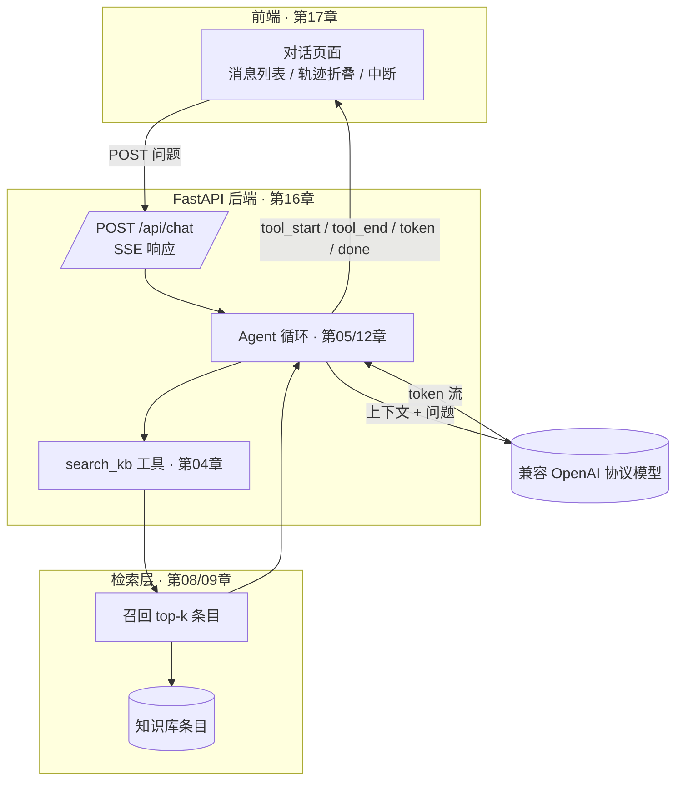

# 第 18 章 端到端实战：知识库客服 Agent

## 本章目标

读完本章，你应当能够：

1. 把前序章节的能力（FastAPI 后端、RAG 检索、工具调用、前端流式界面）拼成一条完整链路；
2. 说清一个全栈 Agent 项目的目录结构、配置项与启动顺序；
3. 按测试清单验证后端接口、流式事件与前端渲染三层是否各自正常；
4. 列出从演示骨架走向生产部署必须补齐的工程项；
5. 知道骨架里每个简化点对应哪一章的生产方案，便于按需替换。

---

## 概念讲解

### 18.1 全栈架构总览

本章的示例是一个知识库客服 Agent：用户在前端提问，后端先检索知识库，再基于召回条目生成回答，过程通过 SSE 流式推回前端。它不是新发明一套技术，而是把前面各章已经讲过的部件按职责接起来：



各层职责边界要划清楚：前端不做检索与推理；后端负责编排、工具执行与上下文组装；检索层只返回相关条目，不生成回答；模型只在给定上下文内组织语言。出问题时按这条链路逐层定位，而不是在界面上猜。

### 18.2 项目目录结构

示例骨架采用前后端分离的最小结构，便于看清每个部件的位置：

```
ch18-end-to-end-project/
├── backend/
│   ├── main.py            # FastAPI 应用：检索工具 + SSE 流式回答
│   ├── requirements.txt
│   └── .env.example       # 环境变量样例
├── frontend/
│   └── index.html         # 最小页面：发送问题、逐字渲染、折叠轨迹
└── README.md
```

真实工程通常会再拆出 `retriever/`、`tools/`、`prompts/`、`schemas/` 等模块。骨架阶段把它们收在一个 `main.py` 里，是为了让控制流一目了然；代码量上来之后再按职责拆分，不要一开始就过度分层。

### 18.3 配置与环境变量

所有外部依赖的配置都走环境变量，不写进代码：

| 变量 | 作用 | 未配置时的行为 |
|---|---|---|
| `OPENAI_API_KEY` | 模型调用凭证 | 后端走本地兜底回答，链路仍可跑通 |
| `OPENAI_BASE_URL` | 兼容 OpenAI 协议的服务地址 | 走官方默认端点 |
| `LLM_MODEL` | 模型名 | 默认 `gpt-4o-mini` |

> [!warning]
> API Key 严禁硬编码进源码或前端页面。前端只持有与后端会话的连接，永远不直接接触模型 Key；Key 只存在于后端环境变量或密钥管理服务中（第 14 章）。

### 18.4 启动顺序

链路有依赖关系，必须先起后端再开前端：

1. 安装后端依赖，配置环境变量；
2. 启动 FastAPI（`uvicorn main:app --port 8000`），先用 `/health` 确认进程存活；
3. 打开前端页面（直接打开 HTML，或用静态服务器托管），页面加载时检查后端可达；
4. 发送问题，观察工具轨迹与逐字回答。

顺序反了不会有神秘报错：前端连不上后端时，状态区会显示「连不上」，消息气泡里记录网络错误。这也是分层测试的意义——先确认服务在，再谈对话。

### 18.5 测试清单

排查全栈问题时，按从底向上的顺序走，每一层单独验证：

| 层级 | 检查项 | 预期 |
|---|---|---|
| 后端存活 | `GET /health` | 返回 `{"status":"ok"}` |
| 检索 | 提问与知识库条目相关的问题 | `tool_end` 事件里能看到召回条目名 |
| 流式协议 | `curl -N` 查看 `/api/chat` | 帧按 `tool_start → tool_end → token… → done` 顺序到达 |
| 兜底路径 | 不配置 Key 提问 | 基于召回条目拼出回答，不报错 |
| 前端渲染 | 浏览器发送问题 | 文字逐字出现，轨迹可折叠，停止按钮可中断 |
| 异常路径 | 问知识库没有的话题 | 明确提示资料不足，不编造条款 |

### 18.6 从骨架到生产的部署 Checklist

演示骨架刻意省略了生产必备项。上线前至少补齐：

- **跨域收敛**：CORS 的 `allow_origins` 从 `*` 改为具体前端域名；
- **鉴权**：`/api/chat` 加登录态或 API Key 校验，不裸奔；
- **密钥管理**：Key 通过部署环境变量或密钥服务注入，不进仓库；
- **会话与记忆**：按 `session_id` 存取对话历史（第 03 章），支持刷新后恢复；
- **可观测性**：记录请求日志、trace 与 token 用量，设置成本上限（第 13、14 章）；
- **检索质量**：关键词打分换成向量 / 混合检索 + 重排，并按第 09 章做召回评测；
- **稳定性**：流式响应设超时与最大生成长度，客户端断连后及时结束生成；
- **静态托管**：前端资源由 CDN 或反向代理托管，后端经网关统一暴露（第 15 章）。

## 实战：可运行源码

完整骨架位于仓库 [`examples/ch18-end-to-end-project/`](https://github.com/thomaslwq/AgentTutorial/tree/main/examples/ch18-end-to-end-project)。下面贴出关键部分。

### 18.7 后端：检索工具与 SSE 事件流

`backend/main.py` 里的检索是关键词重叠打分的最小实现，函数签名与生产检索器一致，后续可整体替换：

```python
def retrieve(query: str, top_k: int = 3) -> List[Dict[str, str]]:
    """关键词重叠打分的最小检索；生产替换为向量 / 混合检索。"""
    q_tokens = set(_tokenize(query))
    if not q_tokens:
        return []

    scored: List[Tuple[int, Dict[str, str]]] = []
    for doc in KB_DOCS:
        d_tokens = set(_tokenize(doc["title"] + " " + doc["text"]))
        overlap = len(q_tokens & d_tokens)
        if overlap > 0:
            scored.append((overlap, doc))
    scored.sort(key=lambda item: item[0], reverse=True)
    return [doc for _, doc in scored[:top_k]]
```

对话接口是一个 SSE 流式响应。生成器内部先上报工具启动、执行检索、上报观察结果，再走模型流式输出或本地兜底，最后推 `done`；任何异常都包成 `error` 帧推给前端：

```python
@app.post("/api/chat")
async def chat(request: Request) -> StreamingResponse:
    body = await request.json()
    message = str(body.get("message", "")).strip()

    async def event_stream():
        try:
            yield sse({"type": "tool_start", "tool": "search_kb",
                       "args": {"query": message}})
            docs = retrieve(message, top_k=3)
            yield sse({"type": "tool_end", "tool": "search_kb",
                       "observation": f"召回 {len(docs)} 条相关条目"})

            if os.environ.get("OPENAI_API_KEY"):
                # 配了 Key：组装系统提示词 + 召回上下文，走流式模型调用
                ...
            else:
                # 未配 Key：本地兜底文案逐片吐出，验证前端流式渲染
                ...

            yield sse({"type": "done"})
        except Exception as exc:
            yield sse({"type": "error", "message": str(exc)})

    return StreamingResponse(event_stream(), media_type="text/event-stream")
```

事件契约与第 17 章前端完全对齐：`tool_start` / `tool_end` / `token` / `error` / `done`，前端按 `type` 分发更新消息。

### 18.8 前端：最小页面

`frontend/index.html` 是第 17 章 `demo-stream.html` 的对接版本：去掉模拟模式，直接请求后端 `/api/chat`，保留同一套 `SseParser` 分帧逻辑、轨迹折叠与中断按钮。页面加载时先请求 `/health` 显示后端状态，便于在对话前排除连接问题。

把这个页面迁回 React 工程时，直接复用第 17 章的 `chat.tsx` 组件，只需把 `API_BASE` 指到本后端地址。

### 18.9 如何从各章示例拼装

骨架不是另起炉灶，而是按下面的顺序把已有示例接起来：

1. **后端骨架**：参考第 16 章的 FastAPI 服务与流式响应，建 `/health` 与 `/api/chat` 两个接口；
2. **接入检索**：把第 08 章的向量检索器填进 `retrieve()` 的位置，替换关键词打分；
3. **注册工具**：按第 04 章的 Function Calling 协议把检索（以及后续的查订单等）注册为模型可调用的工具；
4. **编排循环**：复杂场景按第 05、12 章的 ReAct / 状态图组织多轮决策与终止条件；
5. **对接前端**：按第 17 章的消息模型与 SSE 解析渲染界面，事件类型保持一致；
6. **补工程化**：按第 13、14、15 章补观测、安全与部署。

每一步都可以独立验证：检索没接好时，`tool_end` 的观察结果会暴露召回情况；模型没配通时，兜底路径保证前端仍能看到完整的流式交互。

## 动手练习

1. **跑通骨架**：按 README 的启动顺序起后端、开前端，分别问一个知识库内的问题和一个范围外的问题，对照测试清单逐项确认。
2. **替换检索**：参考第 08 章示例，把 `retrieve()` 换成 Embedding + 余弦相似度实现，保持函数签名不变，观察语义改写类问题的召回变化。
3. **扩展工具**：仿照 `search_kb` 增加一个查订单工具（模拟数据），在事件流里上报第二条工具轨迹，确认前端折叠面板能展示多步过程。

> 练习参考答案见 `examples/ch18-end-to-end-project/README.md`。

## 本章小结

- 全栈 Agent 的链路是：前端发请求 → 后端编排 → 工具 / 检索取数 → 模型生成 → SSE 流式回推，各层职责分离、逐层可测。
- 骨架目录保持最小：后端一个应用文件、前端一个页面，部件增多后再按职责拆分。
- 配置全部走环境变量，Key 只留在后端；未配 Key 时用兜底路径保证链路可验证。
- 测试从后端存活、检索、流式协议、前端渲染到异常路径自底向上走。
- 生产化要补鉴权、会话记忆、观测成本、检索质量、超时断连与静态托管。

## 思考题

1. 当前骨架每次请求独立、不带对话历史。要支持多轮追问，后端需要存哪些数据？上下文窗口超长时该怎么裁剪（结合第 03 章记忆系统）？
2. 客服场景里模型可能给出超出知识库范围的承诺。除了系统提示词约束，后端还能在哪些环节加护栏降低幻觉风险（结合第 09、14 章）？
3. 如果后续要把这个客服 Agent 接到网页插件、企业 IM 或移动端，后端的接口与事件契约需要做哪些抽象，才能避免为每个端重写一遍编排逻辑？

---

返回课程导航：[首页](../index.md)
